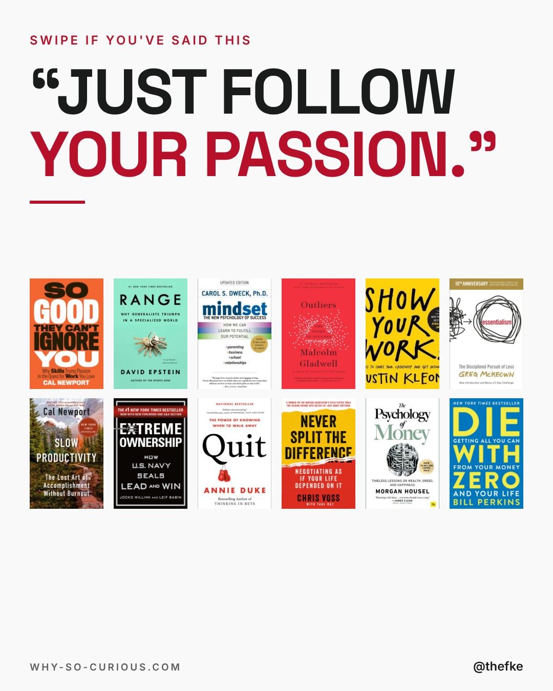
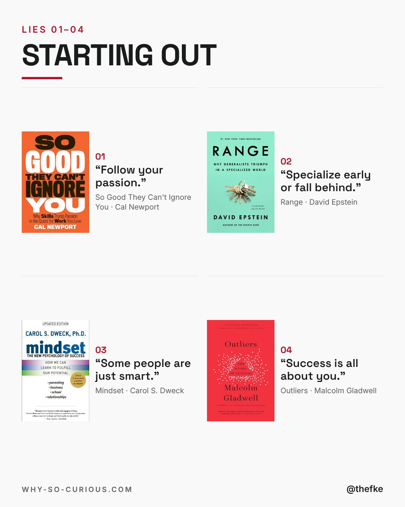
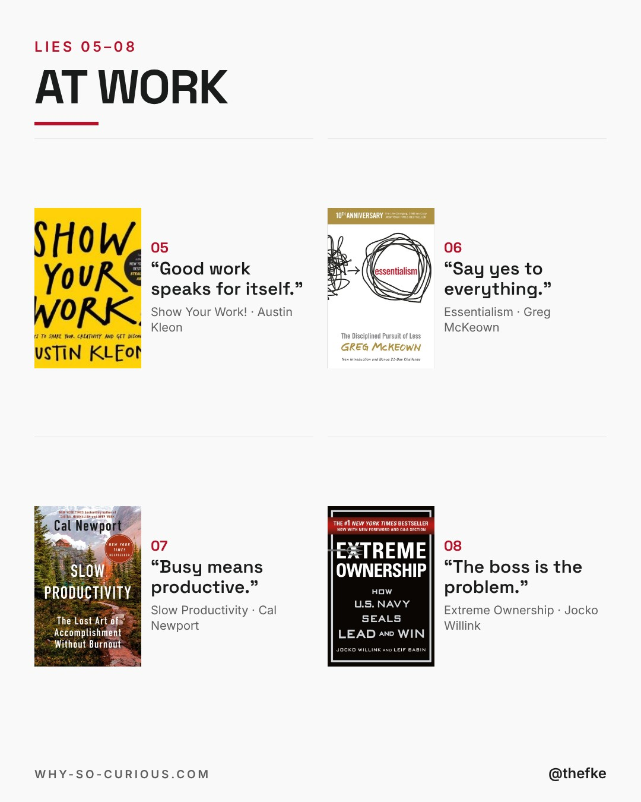
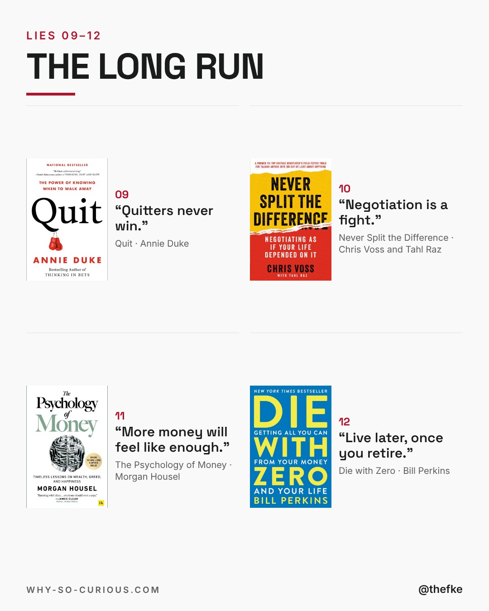
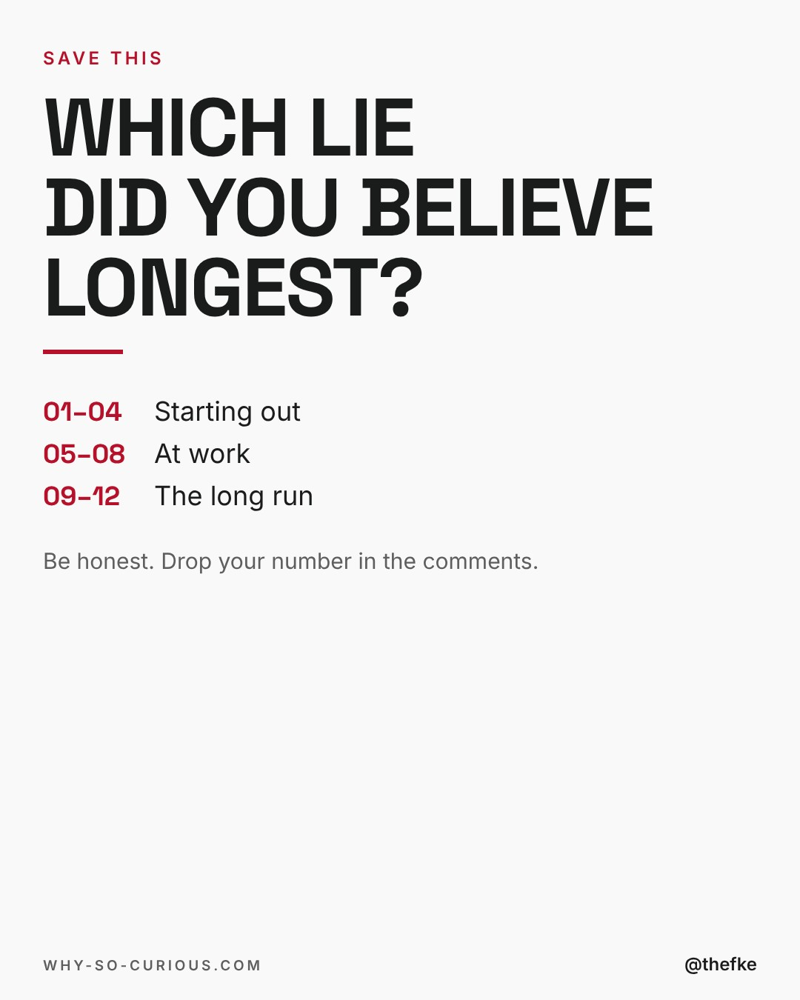

# Fr 25.12. · 12 Career Lies You Believe

Früh-Slot, wird automatisch gepostet (ohne Musik). Nicht von Hand posten. Karussell, 5 Slides. Beim Hochladen 4:5 wählen.

## Caption

```
“Just follow your passion.” Most of us heard it early.
It's one of 12 career lies, like these:

“Good work speaks for itself.”
“Busy means productive.”
“Quitters never win.”

12 books from my shelf take them apart.
Starting out, at work, the long run. 4 each.

Number 01 in one line, from Cal Newport in So Good They Can't Ignore You:
“In other words, you need to be good at something before you can expect a good job.”

Send this to the friend still waiting for the perfect job.

Which lie did you believe longest?

Books from this post: link in bio.

#bookstagram #bookrecommendations #books
```

## Slides






