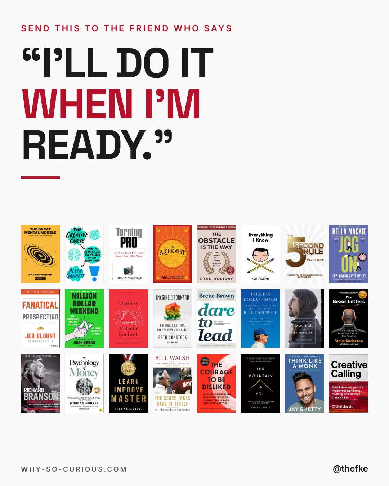
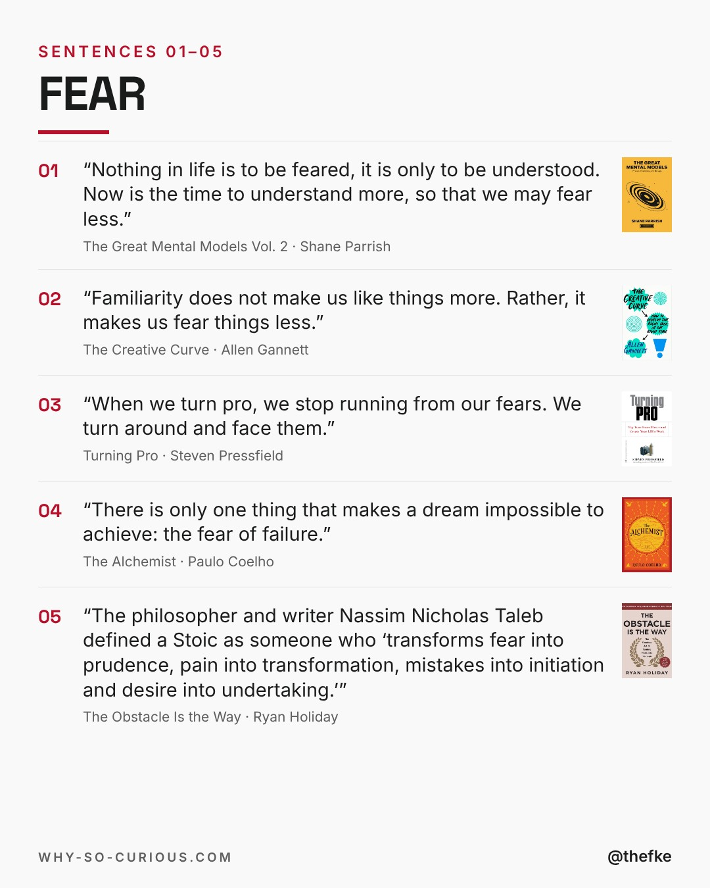
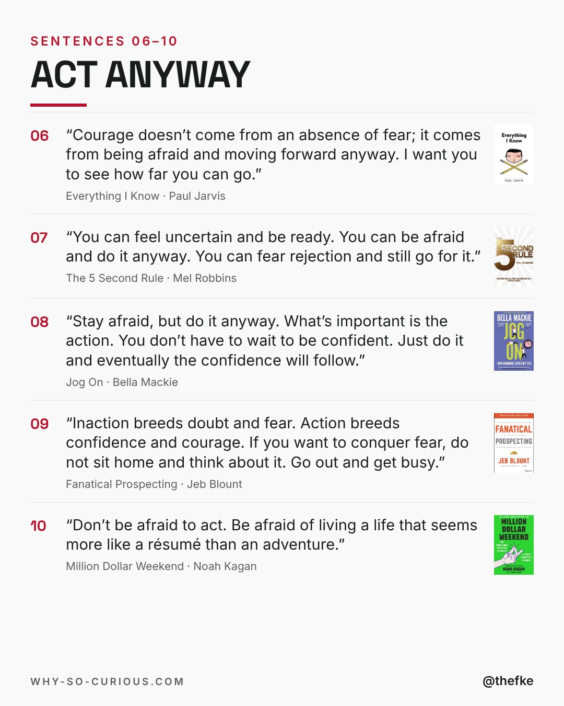
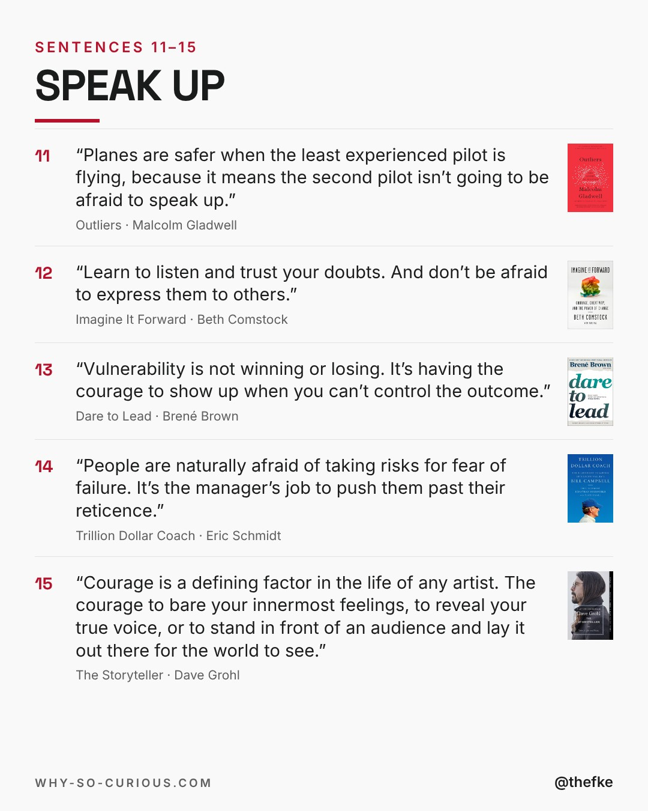
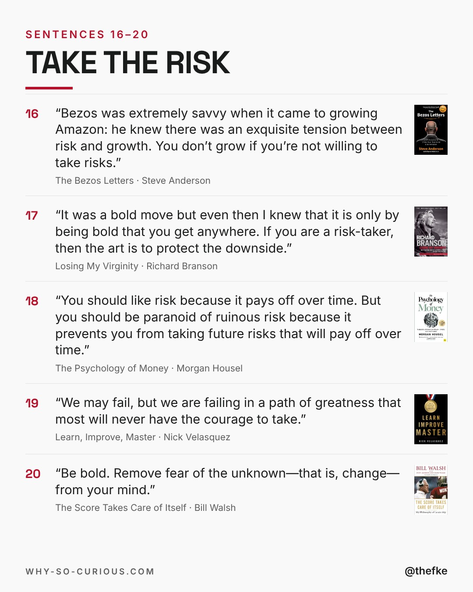
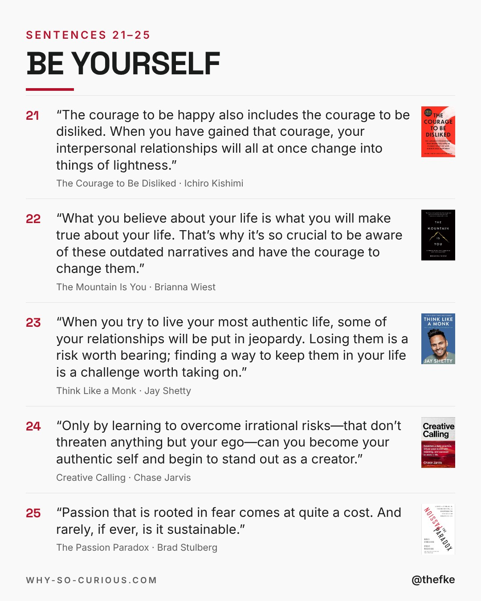
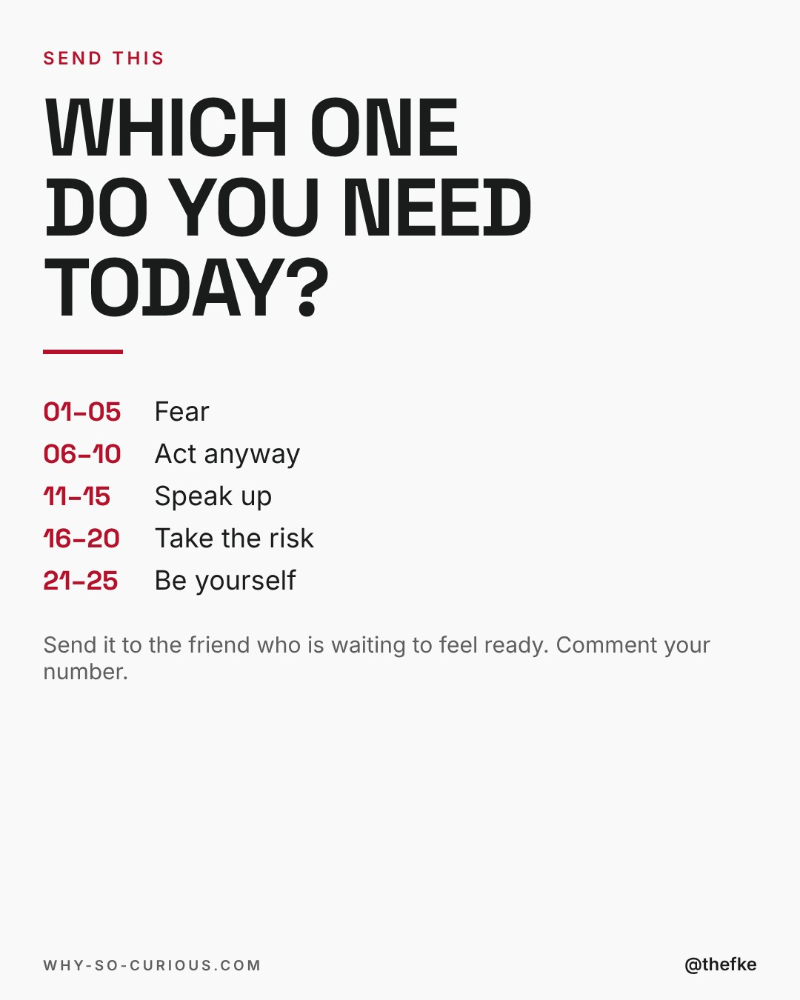

# Fr 25.12. · 25 Sentences About Courage

Karussell, 7 Slides. Beim Hochladen 4:5 wählen.

## Caption

```
“I'll do it when I'm ready.”
Ready rarely shows up on its own.

25 sentences about courage.
25 books from my shelf.

Fear. Act anyway. Speak up. Take the risk. Be yourself.
5 each.

Number 11 is from Outliers by Malcolm Gladwell:
“Planes are safer when the least experienced pilot is flying, because it means the second pilot isn’t going to be afraid to speak up.”

Send this to the friend who is waiting to feel ready.

Which one do you need today?

Books from this post: link in bio.

#bookstagram #bookrecommendations #books
```

## Slides








