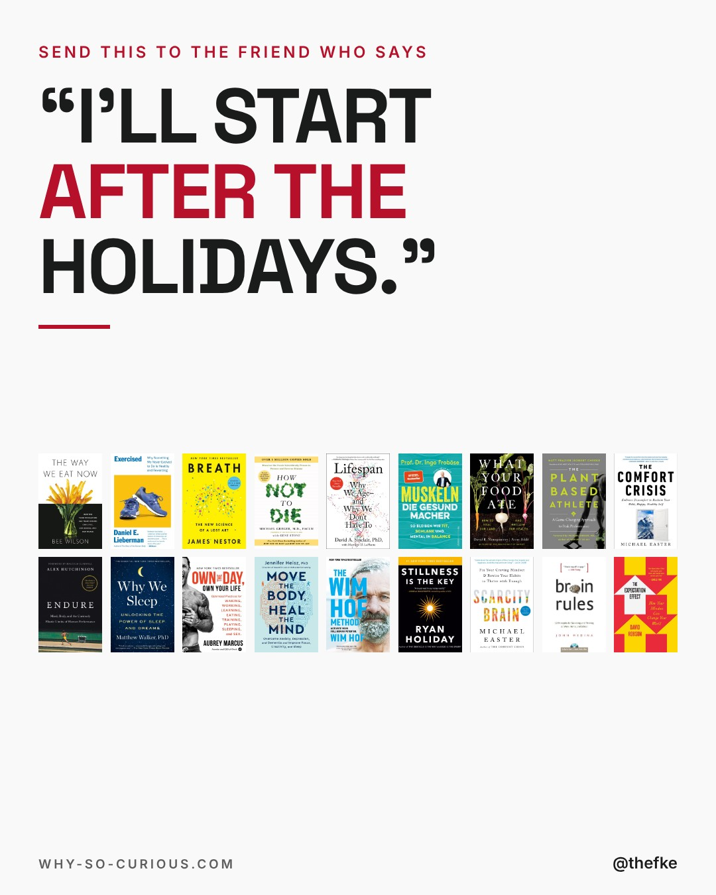
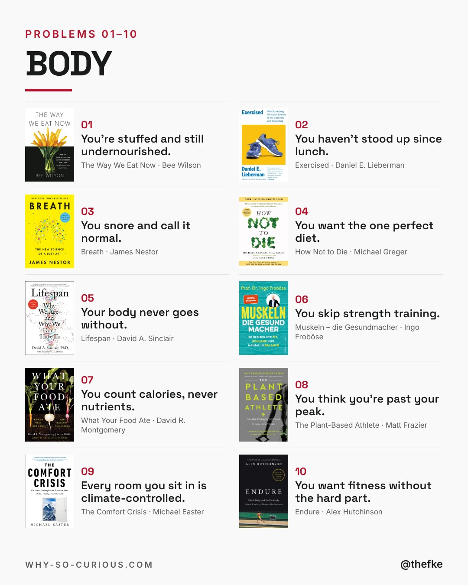
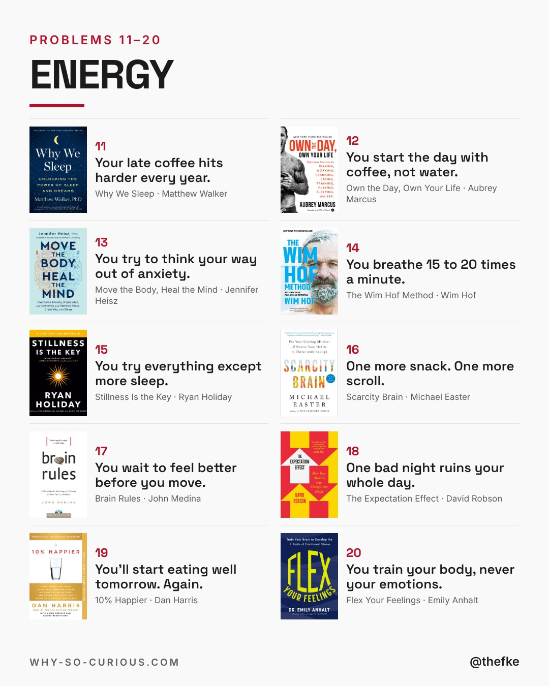
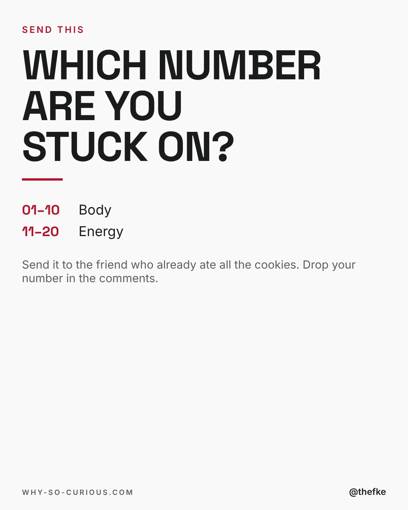

# Sa 26.12. · 20 Health Problems, 20 Books

Karussell, 4 Slides. Beim Hochladen 4:5 wählen.

## Caption

```
“I'll start after the holidays.”
That's next week.

20 health problems.
20 books from my shelf that help.

10 about your body.
10 about your energy.

Number 14 comes from Wim Hof:
“If you’re breathing between fifteen to twenty times a minute, you are stressed.”

Send this to the friend who already ate all the cookies.

Which number are you stuck on?

Books from this post: link in bio.

#bookstagram #bookrecommendations #books
```

## Slides





