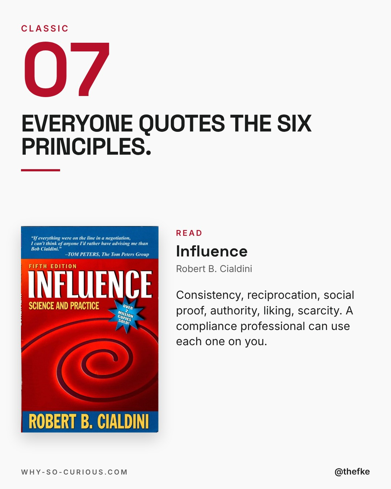

# Sa 26.12. · Got a gift card? Buy the classics everyone quotes

Abend-Slot. Karussell, 12 Slides. Beim Hochladen 4:5 wählen.

## Caption

```
Got a gift card for Christmas?
Spend it on the books everyone quotes.

Ten classics.
You know the famous line.
Few people know what comes after it.

Napoleon Hill in Think and Grow Rich:
“One of the most common causes of failure is the habit of quitting when one is overtaken by temporary defeat.”

All from my shelf.

Send this to the friend who just got a gift card.

Which classic is still on your list?

Books from this post: link in bio.

#bookstagram #bookrecommendations #books
```

## Slides





