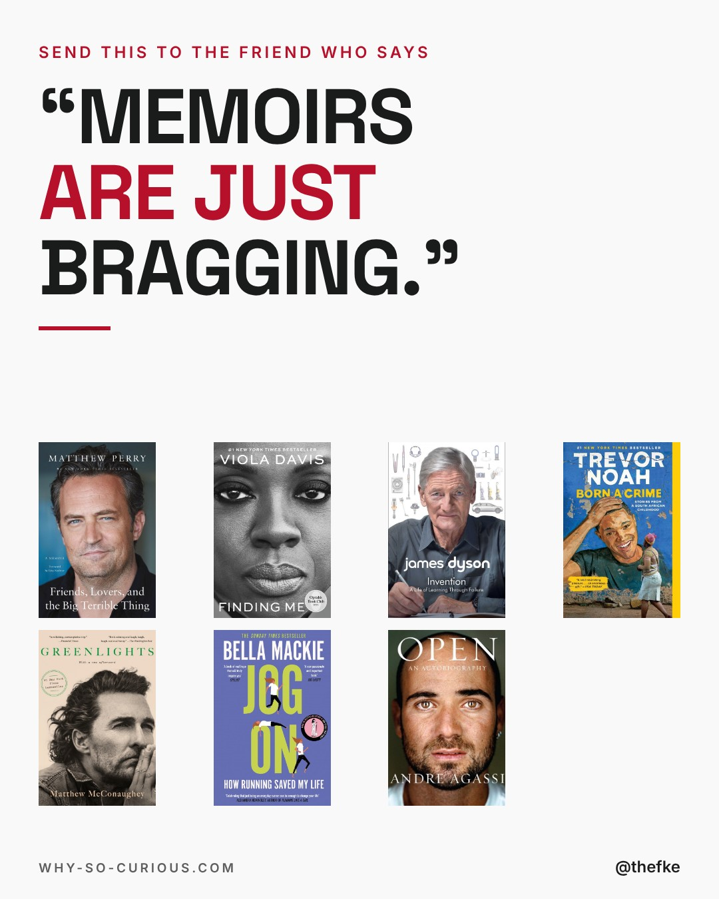
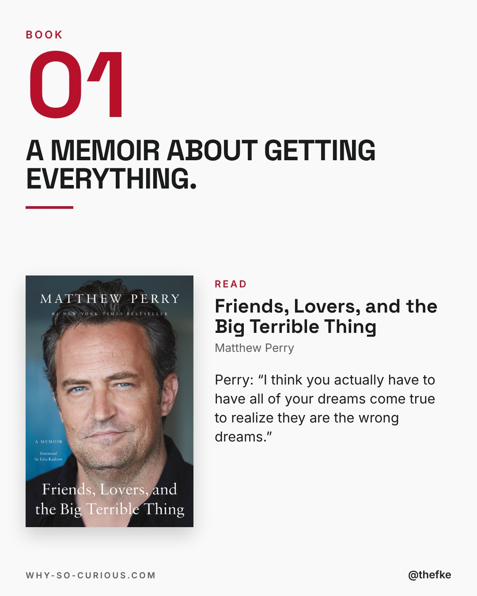
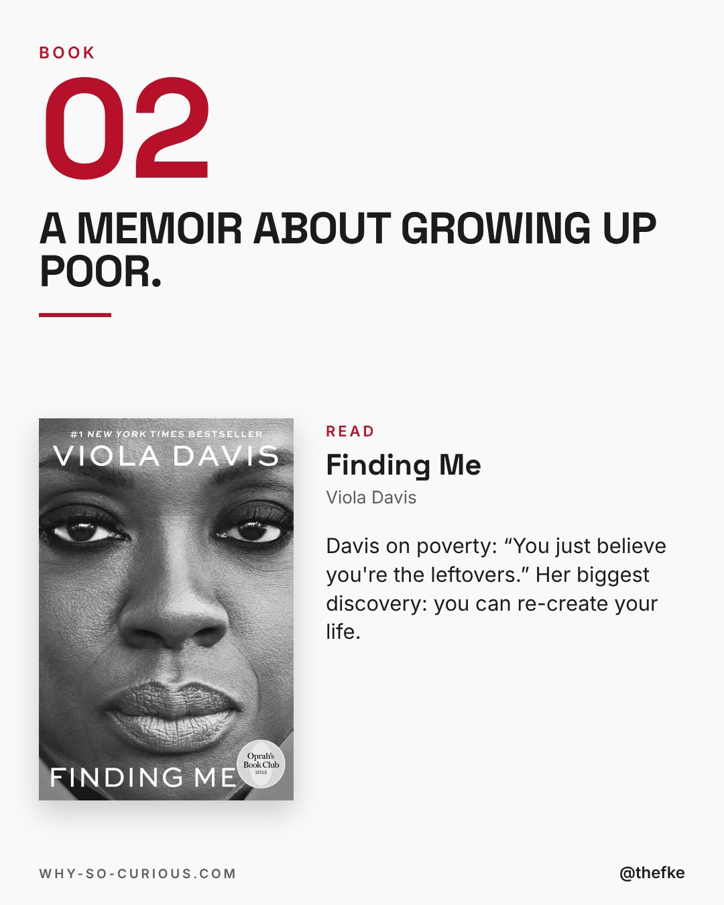
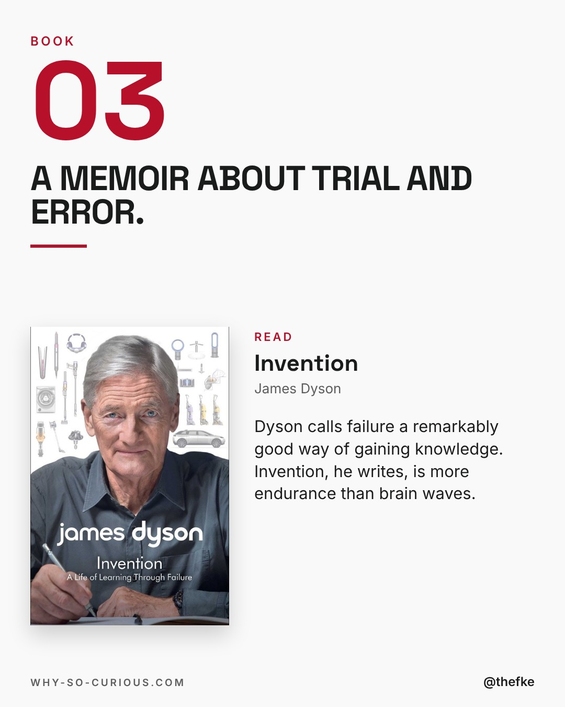
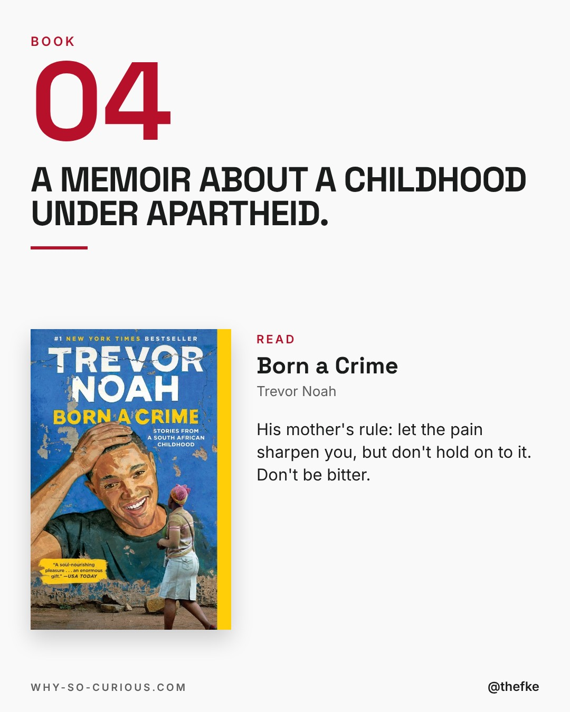
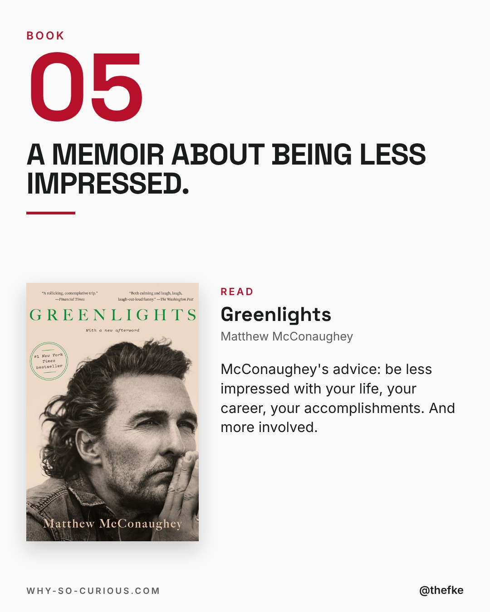
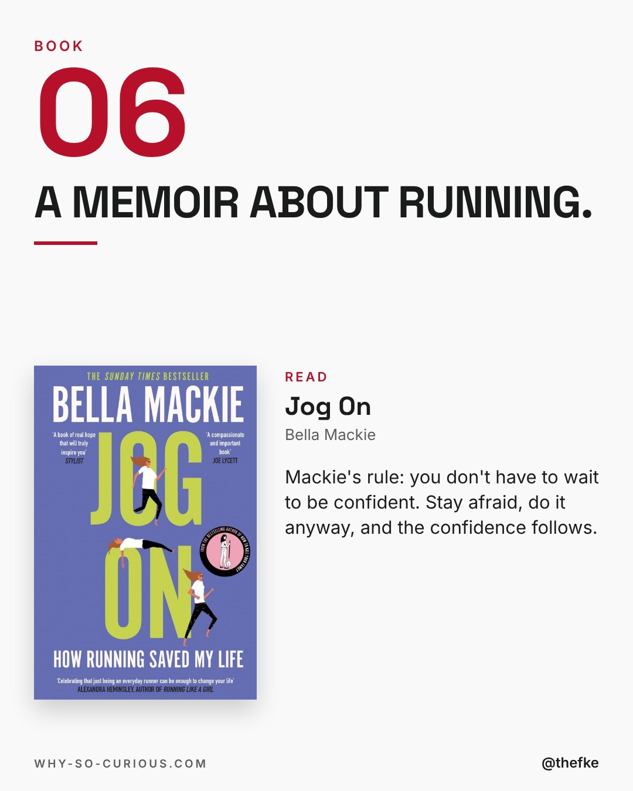
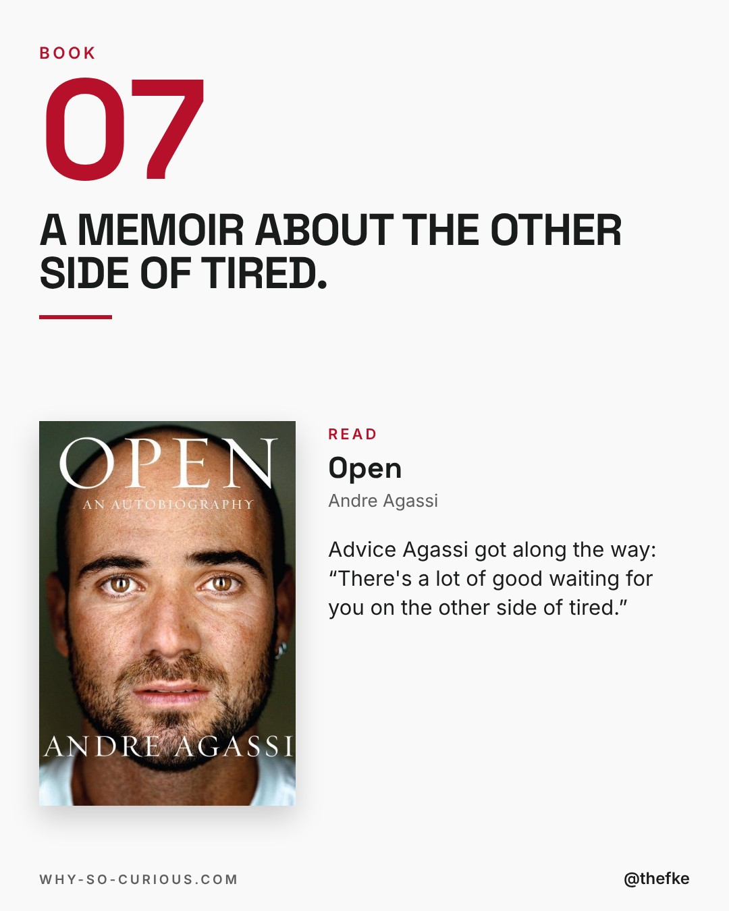
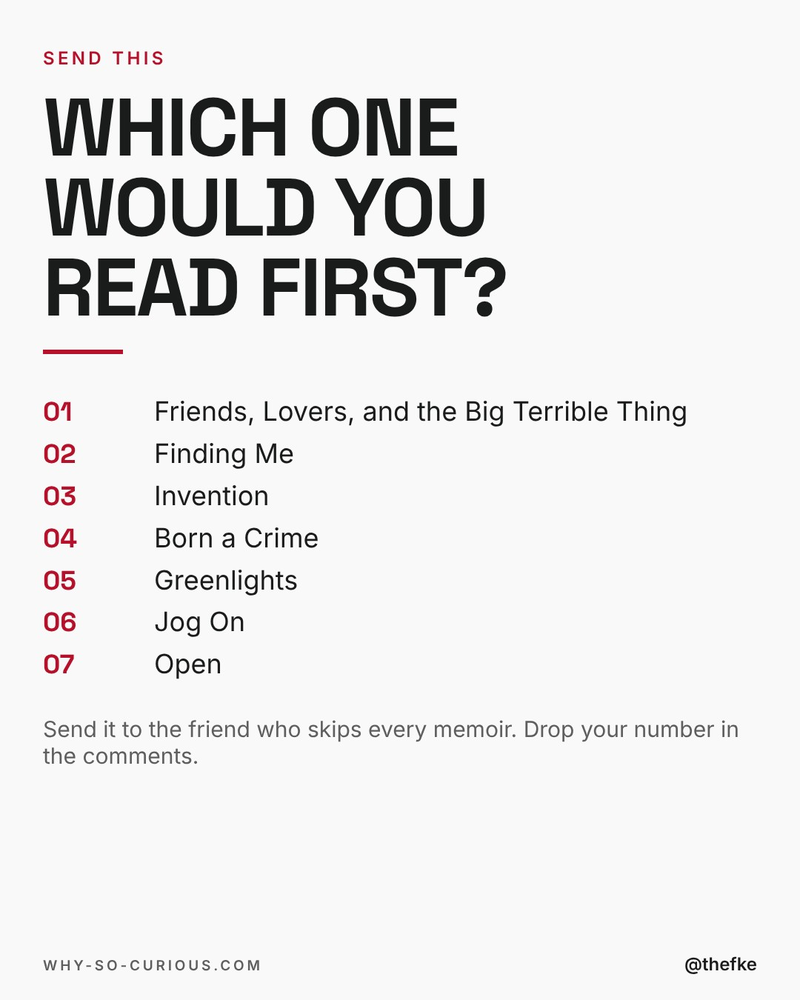

# Sa 26.12. · “Memoirs are just bragging.” Read these seven

Früh-Slot, wird automatisch gepostet (ohne Musik). Nicht von Hand posten. Karussell, 9 Slides. Beim Hochladen 4:5 wählen.

## Caption

```
“Memoirs are just bragging.”
Some are. These seven are the opposite.

Poverty. Addiction. Failure. Apartheid. Fear.
Each one admits more than it brags.

The line I keep is from Trevor Noah's mother, in Born a Crime:
“Learn from your past and be better because of your past,” she would say, “but don’t cry about your past. Life is full of pain. Let the pain sharpen you, but don’t hold on to it. Don’t be bitter.”

All from my shelf.

Send this to the friend who skips every memoir.

Which one would you read first?

Books from this post: link in bio.

#bookstagram #bookrecommendations #books
```

## Slides










