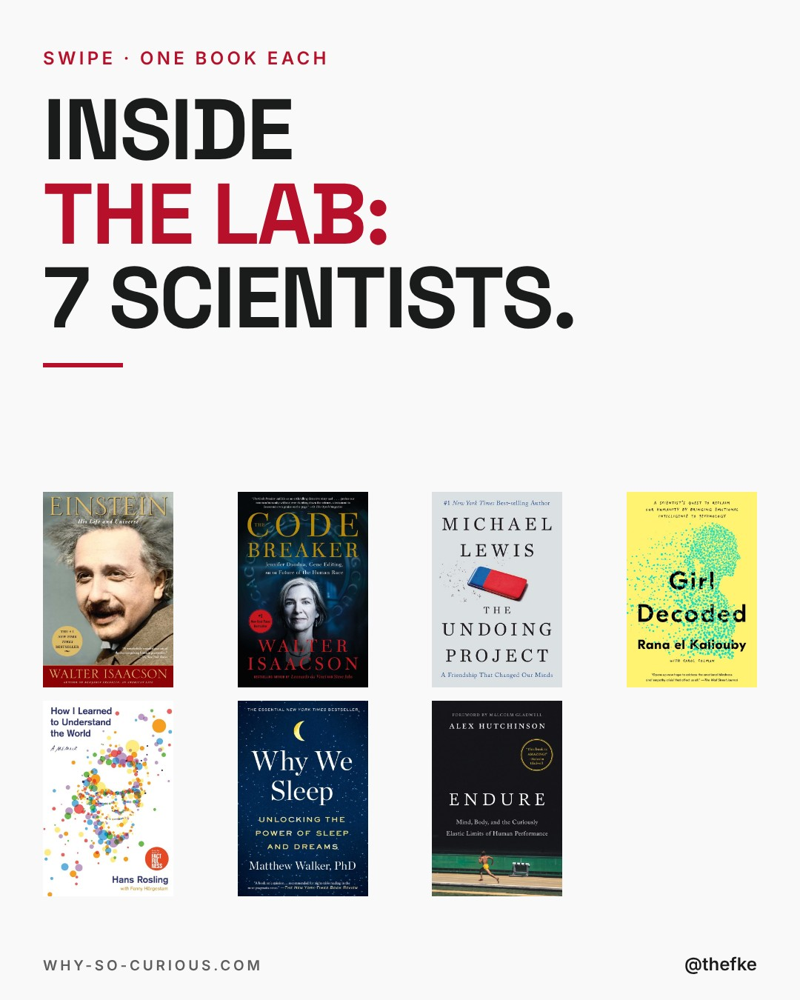
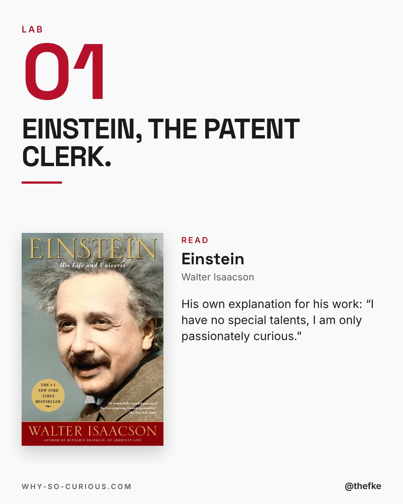
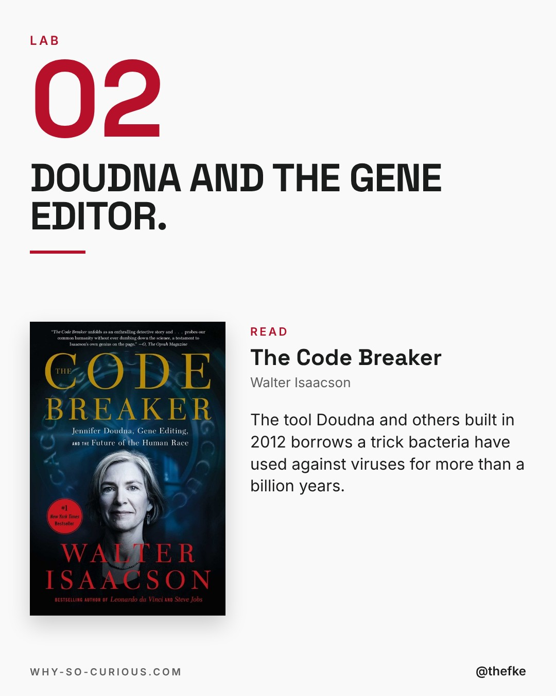
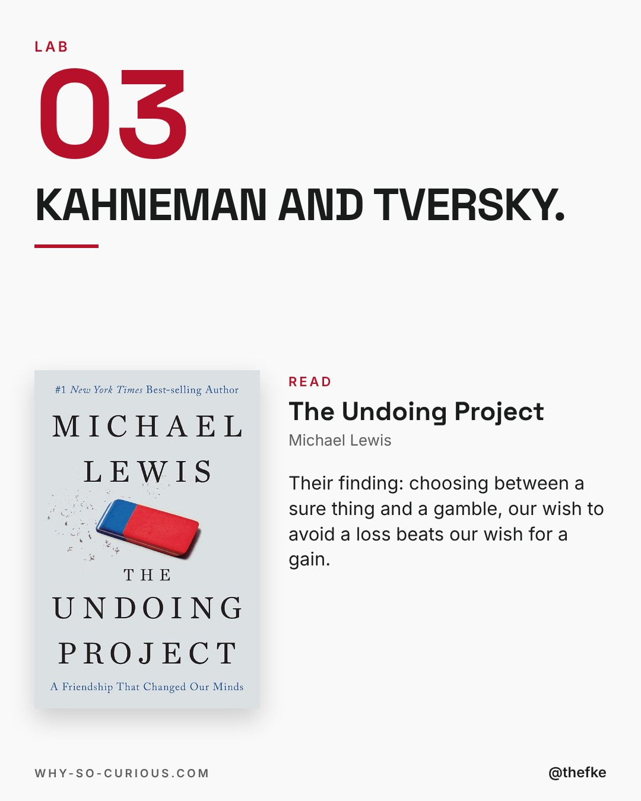
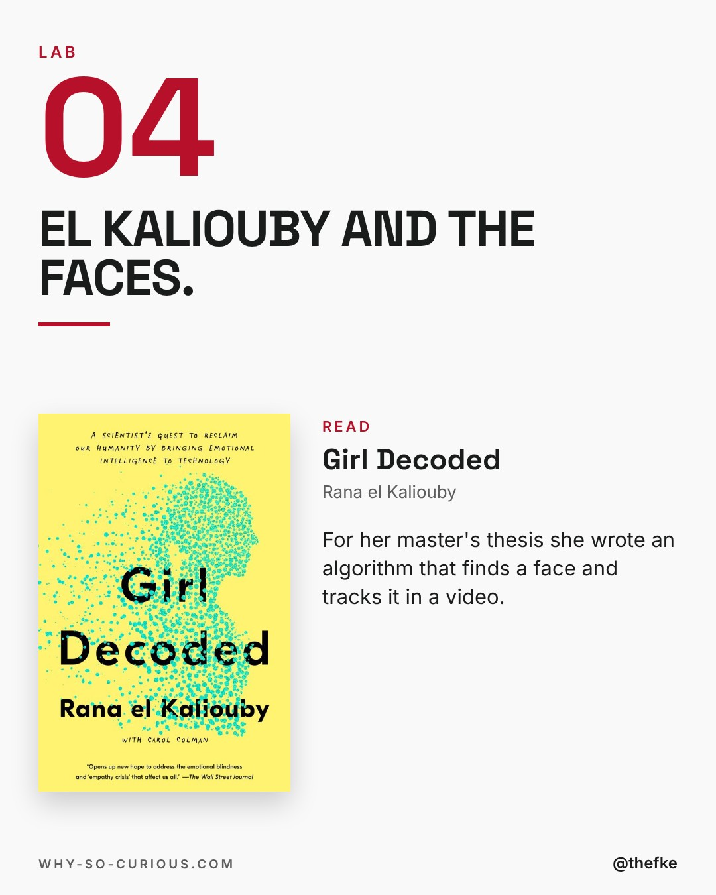
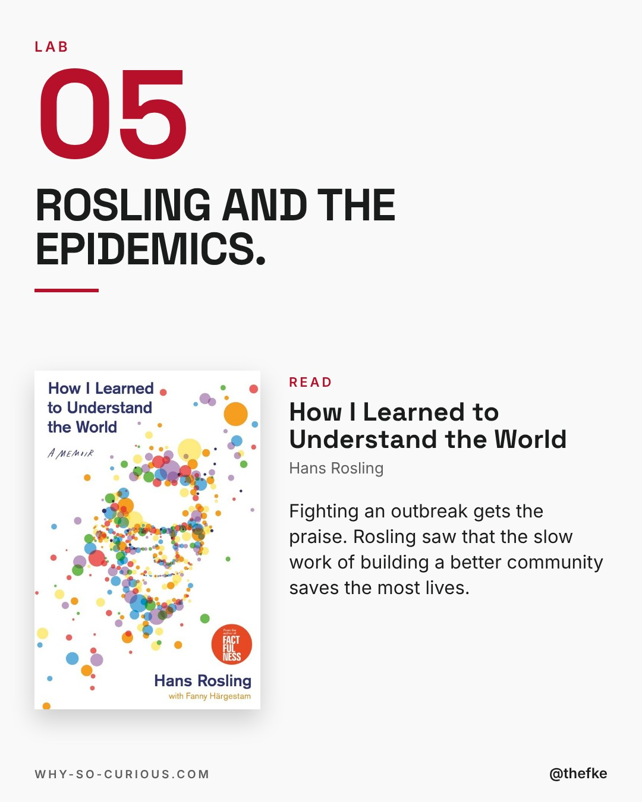
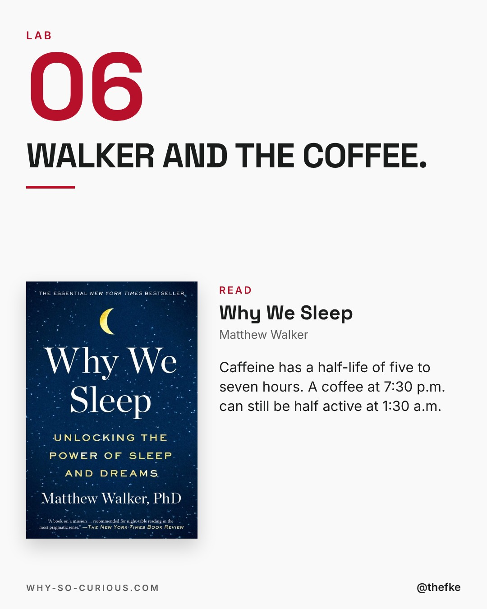
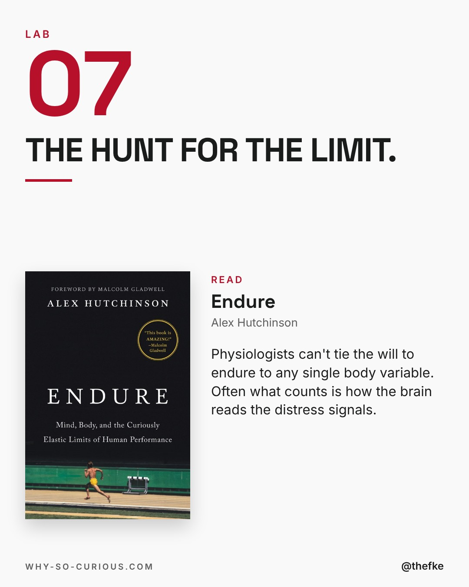
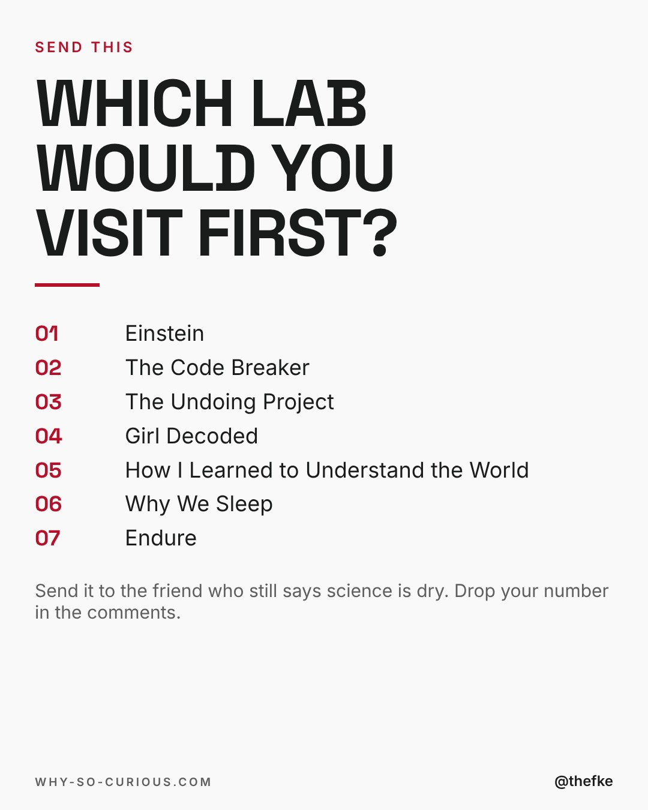

# So 27.12. · Inside the lab: 7 scientists

Früh-Slot, wird automatisch gepostet (ohne Musik). Nicht von Hand posten. Karussell, 9 Slides. Beim Hochladen 4:5 wählen.

## Caption

```
Seven scientists. Seven books that let you sit in the lab with them.

Einstein at the patent office.
Kahneman and Tversky on why a loss hurts more than a gain feels good.
A coffee at 7:30 p.m. that is still half active at 1:30 a.m.

Each book has one detail you'll repeat at dinner.

Walter Isaacson in Einstein:
“The explanation that Einstein himself most often gave for his mental accomplishments was his curiosity. As he put it near the end of his life, “I have no special talents, I am only passionately curious.””

All from my shelf.

Send this to the friend who still says science is dry.

Which lab would you visit first?

Books from this post: link in bio.

#bookstagram #bookrecommendations #books
```

## Slides










