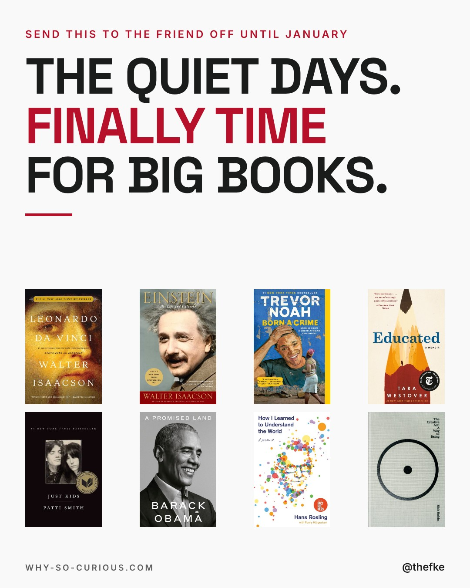
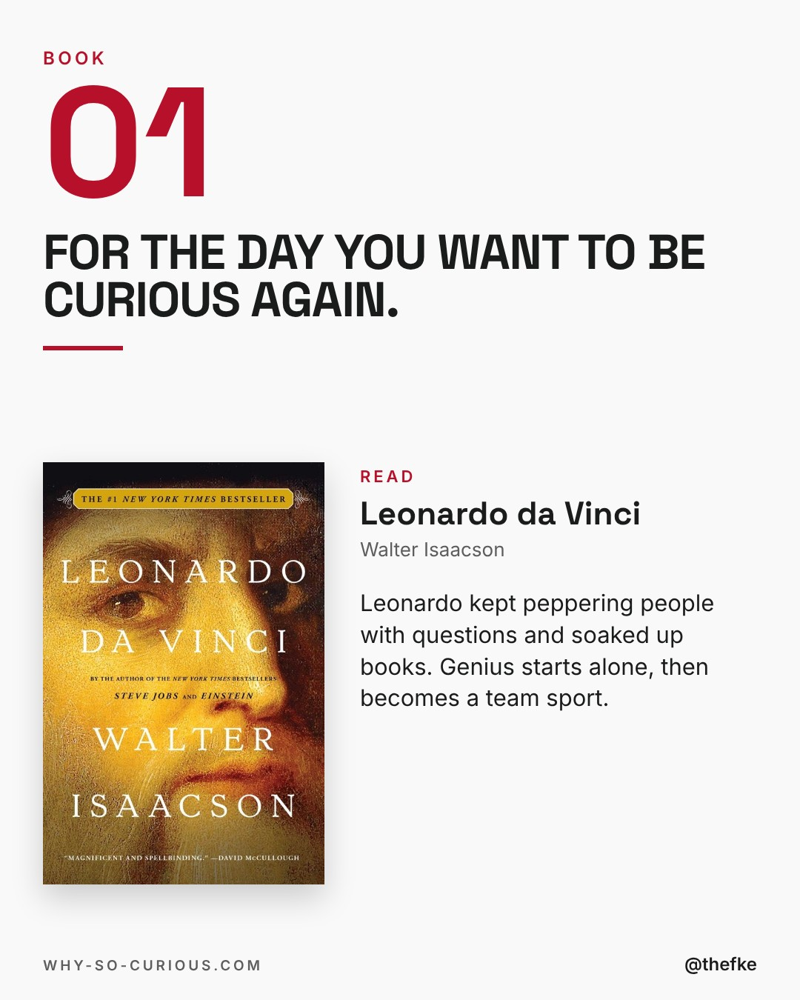
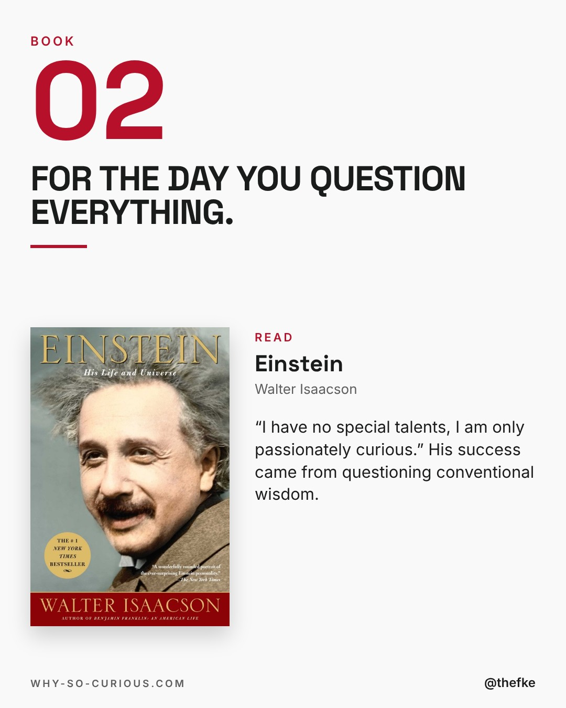
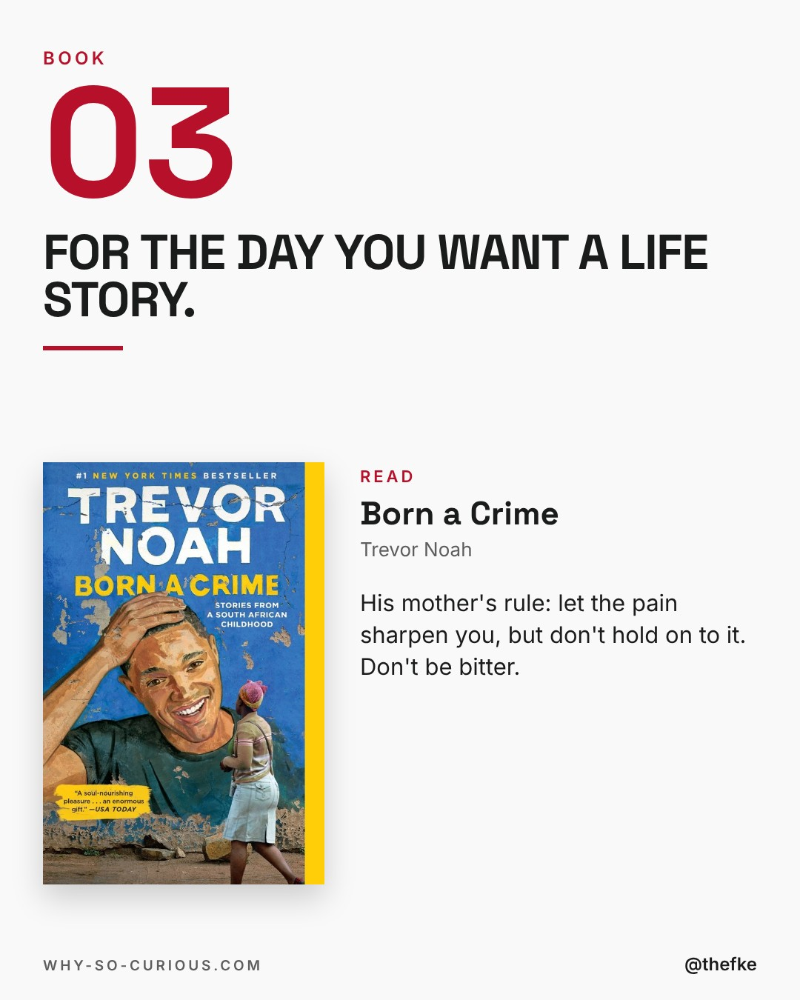
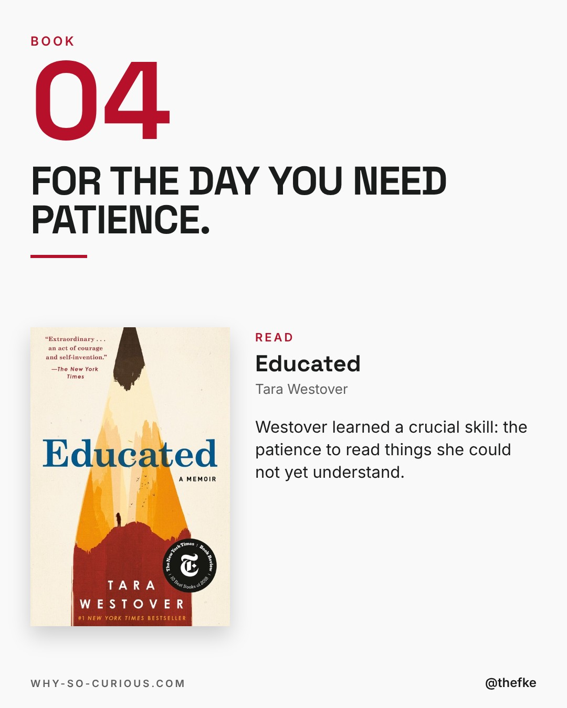
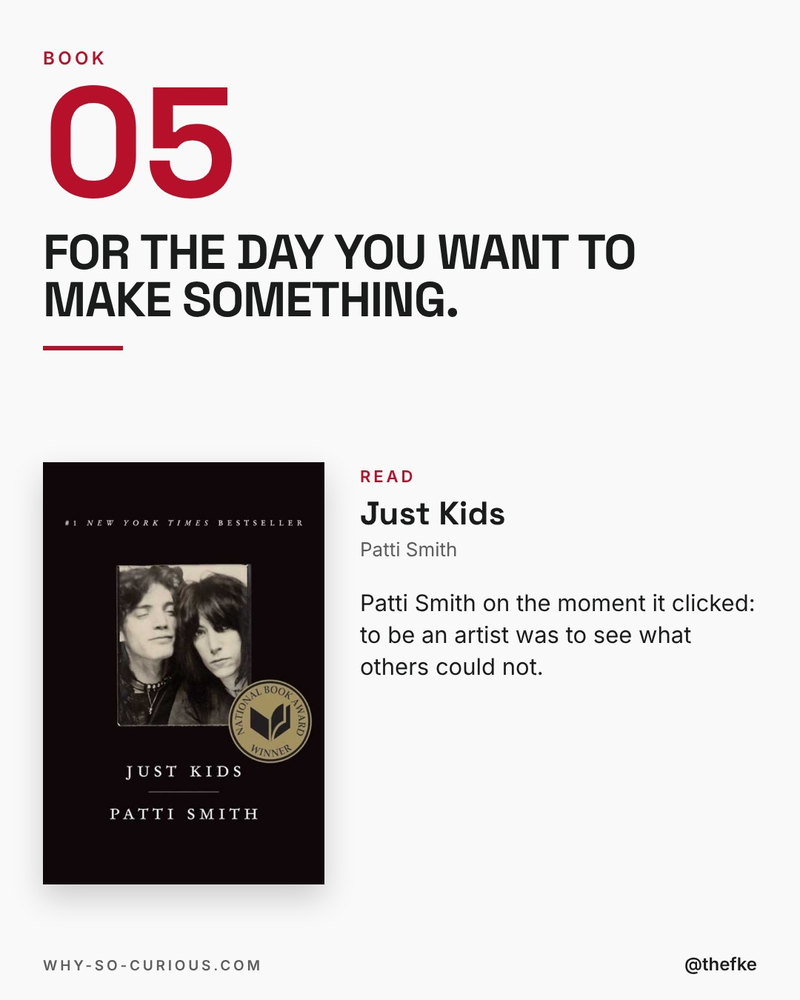
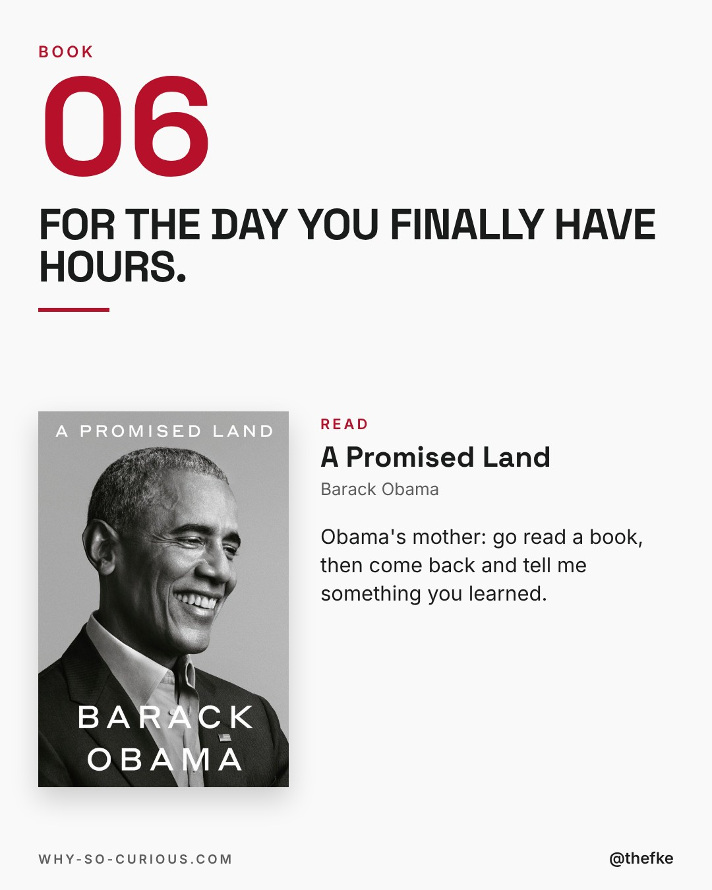
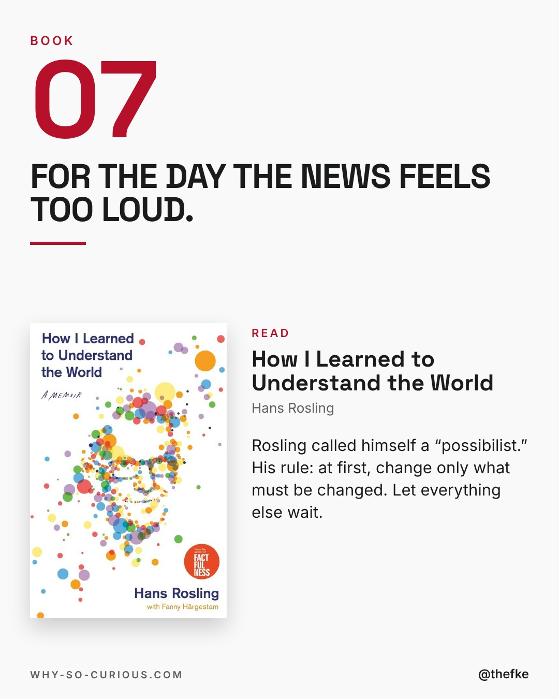
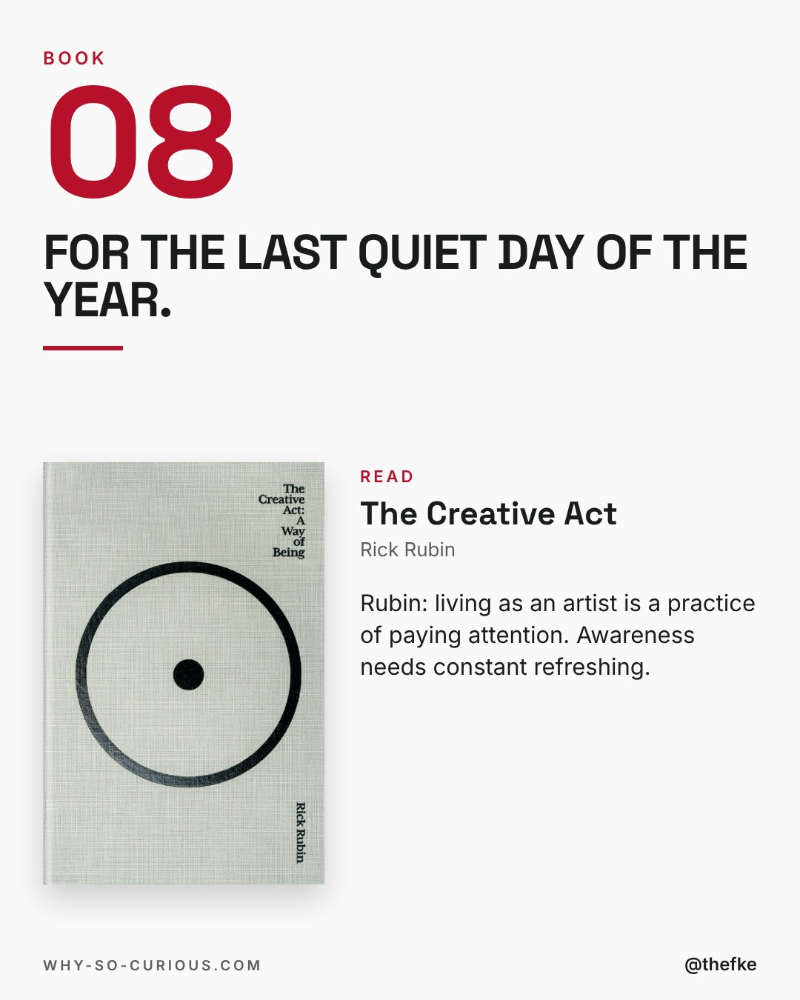
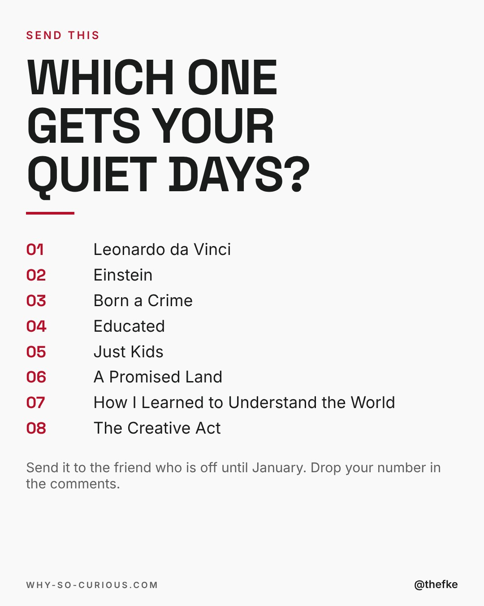

# So 27.12. · Books for the quiet days between Christmas and New Year

Abend-Slot. Karussell, 10 Slides. Beim Hochladen 4:5 wählen.

## Caption

```
Christmas is over.
The new year hasn't started.

The quiet days in between are made for the big books.
The ones the year never had time for.

Leonardo. Einstein. Obama. Rosling.
Trevor Noah, Tara Westover, Patti Smith, Rick Rubin.

One detail from Isaacson's Leonardo da Vinci:
more than 7,200 notebook pages survive.
Probably about a quarter of what Leonardo actually wrote.

All from my shelf.

Send this to the friend who is off until January.

Which one are you starting?

Books from this post: link in bio.

#bookstagram #bookrecommendations #books
```

## Slides











