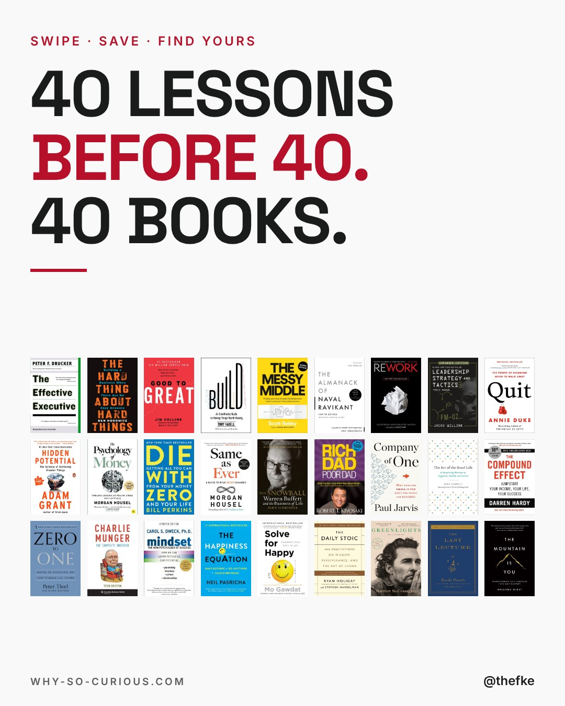
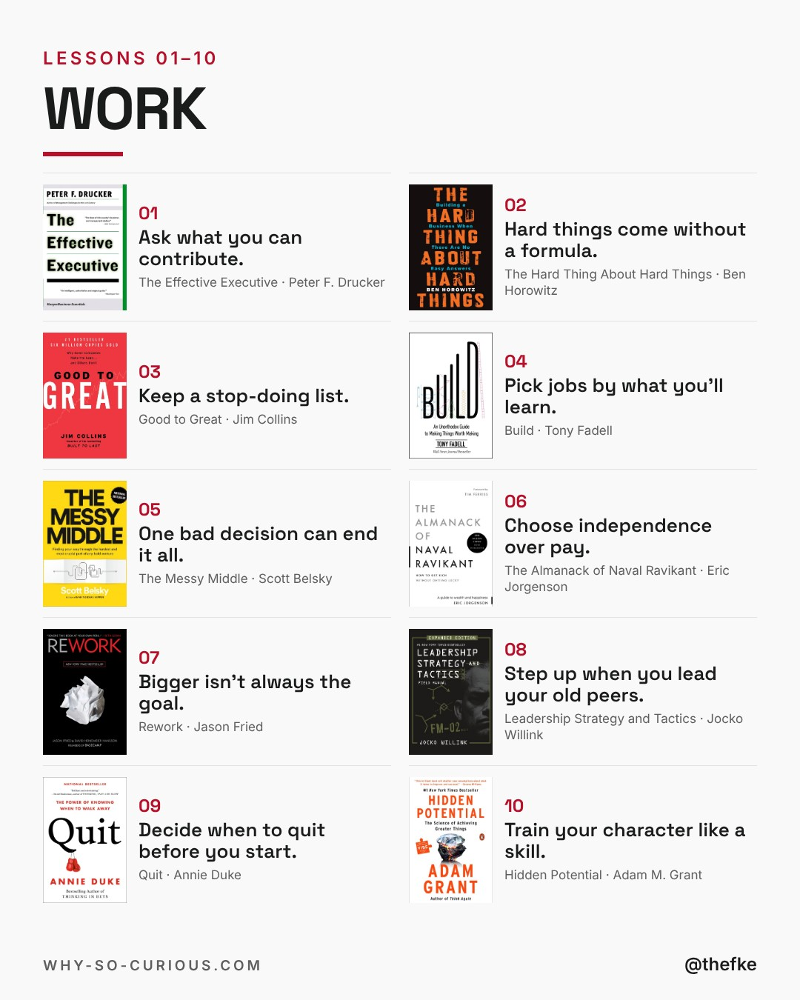
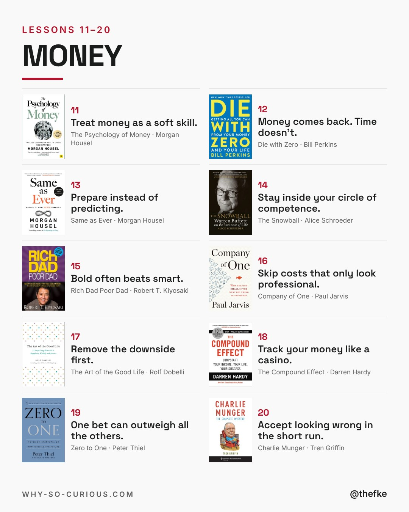
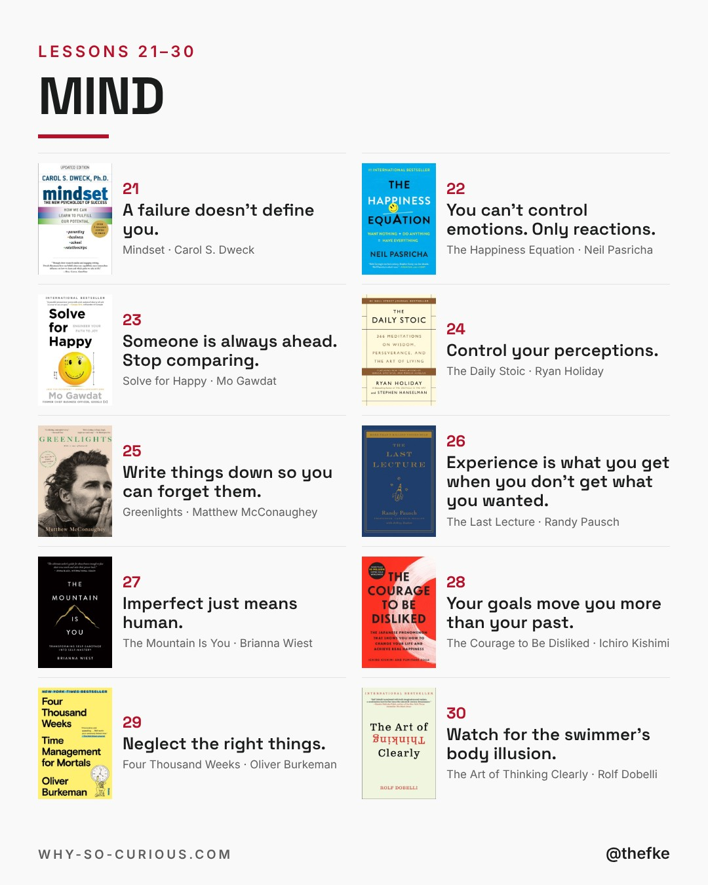
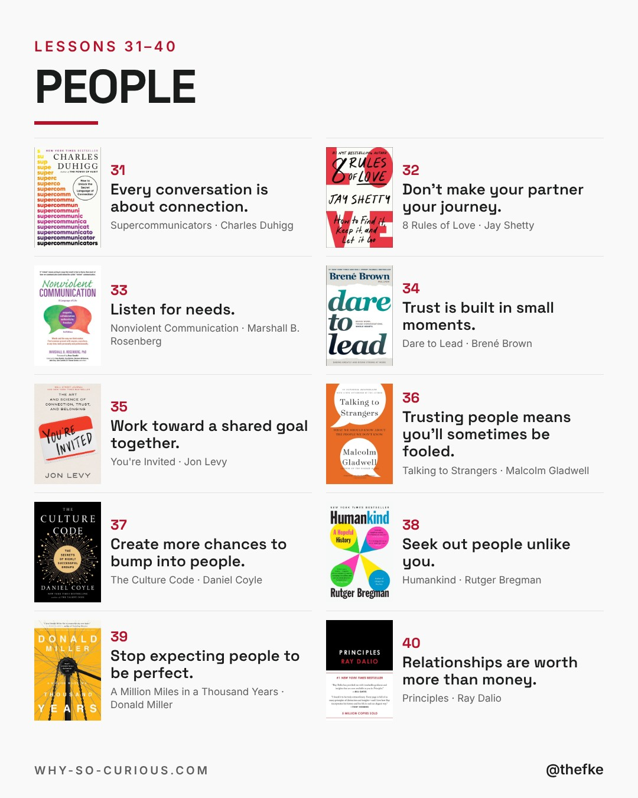
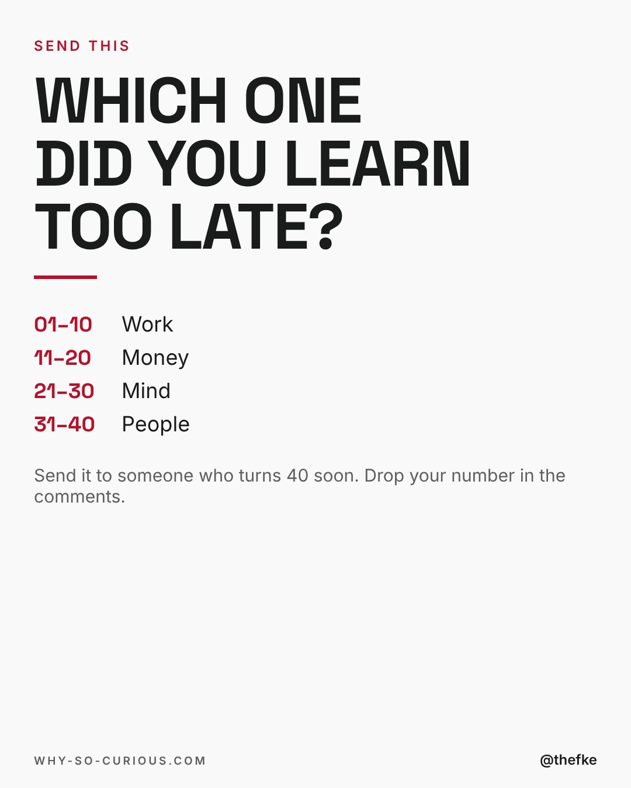

# Mo 28.12. · 40 Lessons Before 40

Karussell, 6 Slides. Beim Hochladen 4:5 wählen.

## Caption

```
40 lessons before 40.
40 books that teach them.

Work, money, mind, people.
10 each.

Number 26 comes from Randy Pausch in The Last Lecture:
“Experience is what you get when you didn’t get what you wanted. And experience is often the most valuable thing you have to offer.”

All from my shelf.

Send this to someone who turns 40 soon.

Which one did you learn too late?

Books from this post: link in bio.

#bookstagram #bookrecommendations #books
```

## Slides







