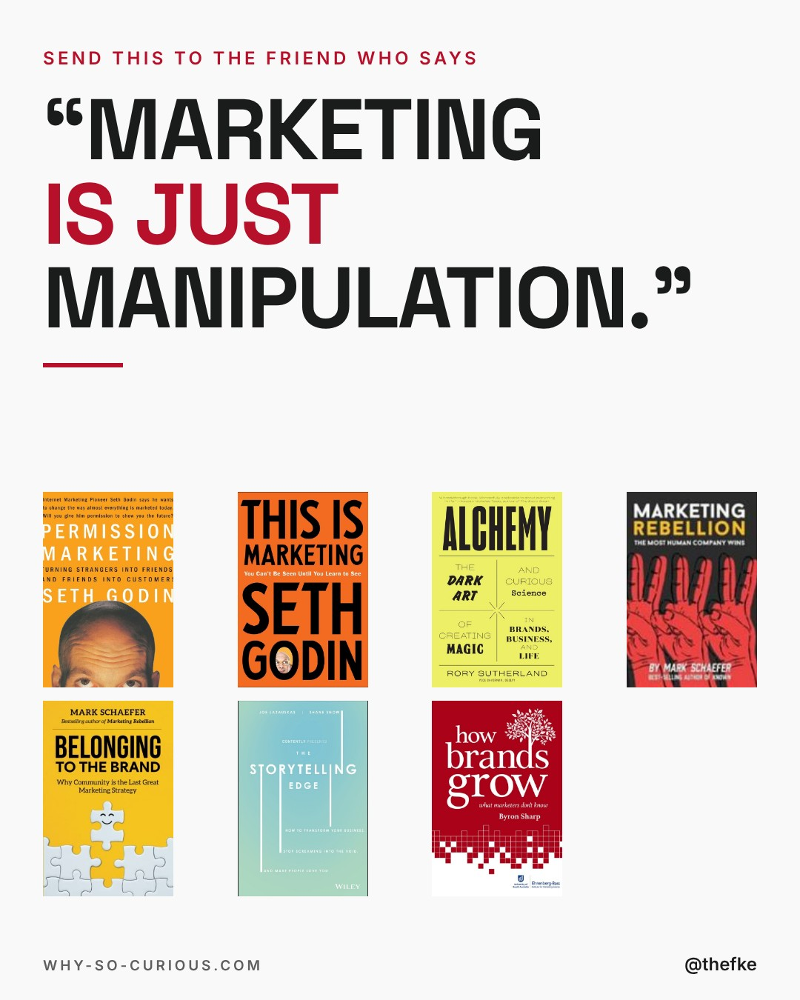
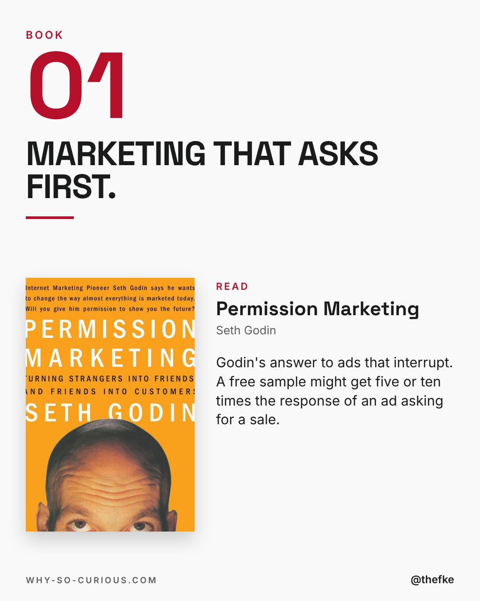
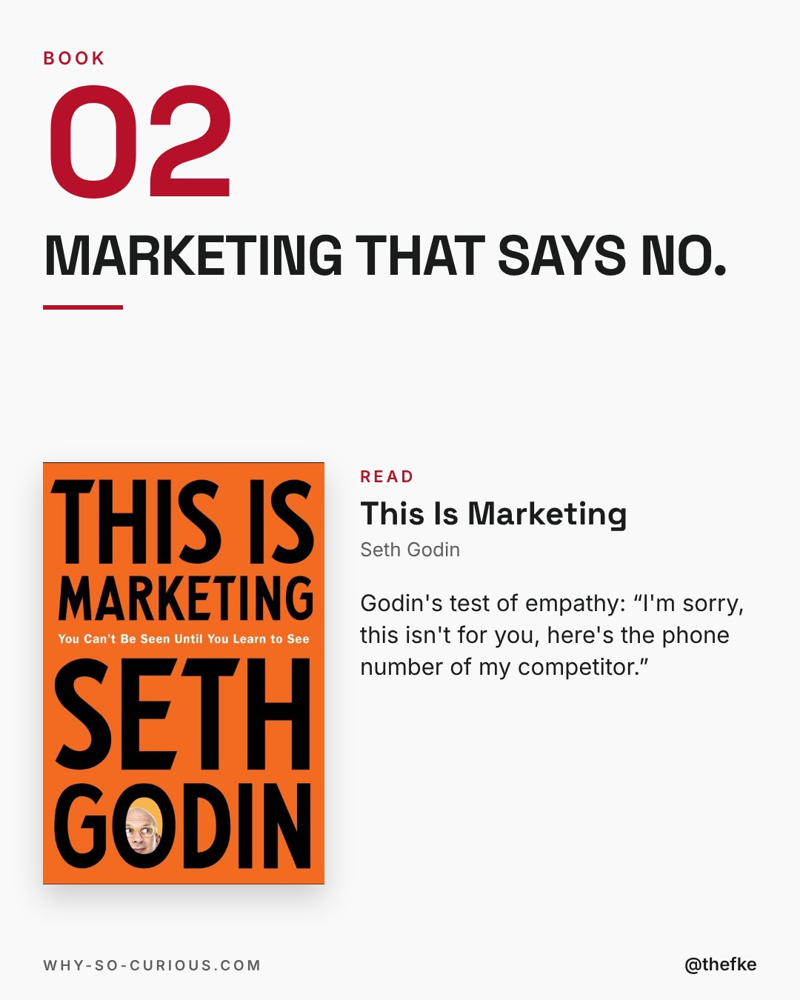
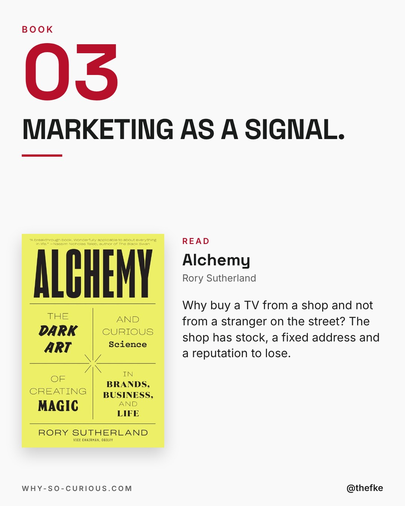
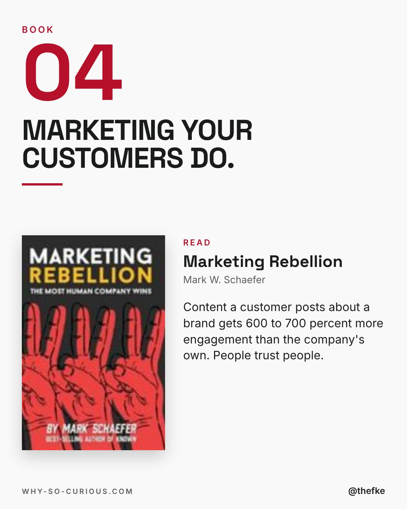
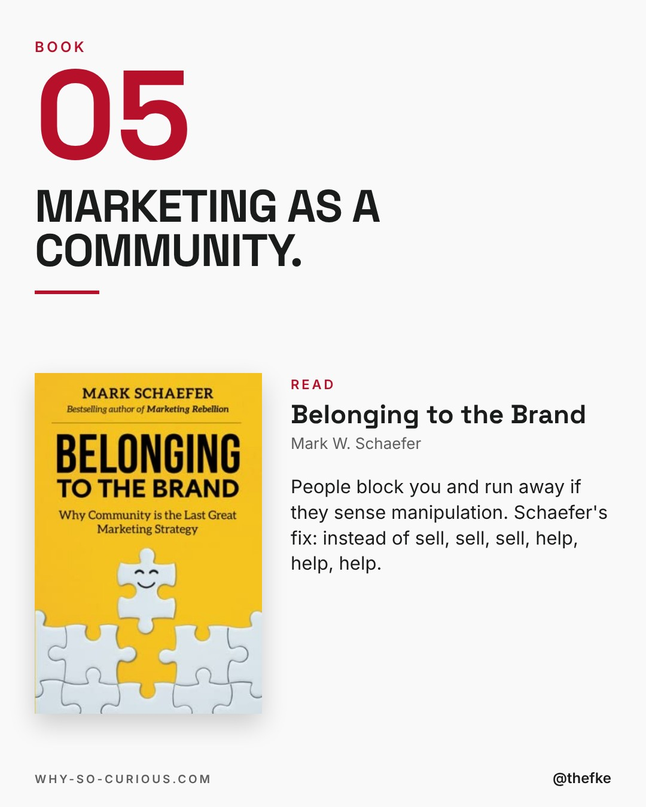
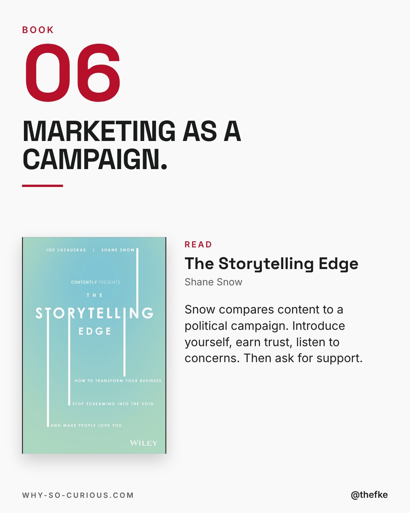
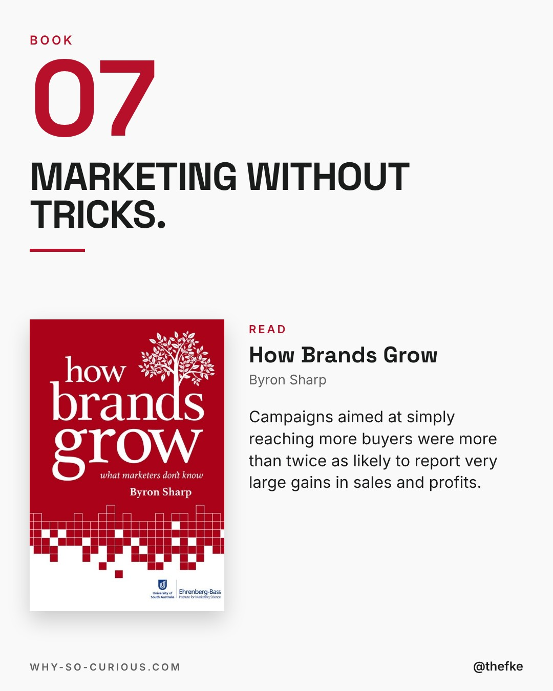
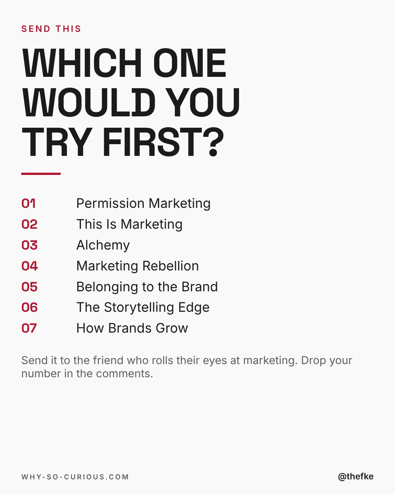

# Mo 28.12. · “Marketing is just manipulation.” Seven books that disagree

Früh-Slot, wird automatisch gepostet (ohne Musik). Nicht von Hand posten. Karussell, 9 Slides. Beim Hochladen 4:5 wählen.

## Caption

```
“Marketing is just manipulation.”
Some of it is. The best of it works the other way.

Seven books from my shelf about marketing that asks first, says no, and lets customers do the talking.

My favorite definition is from Seth Godin in This Is Marketing:
“Marketing is the generous act of helping someone solve a problem. Their problem. It’s a chance to change the culture for the better.”

All from my shelf.

Send this to the friend who rolls their eyes at marketing.

Which one would you try first?

Books from this post: link in bio.

#bookstagram #bookrecommendations #books
```

## Slides










