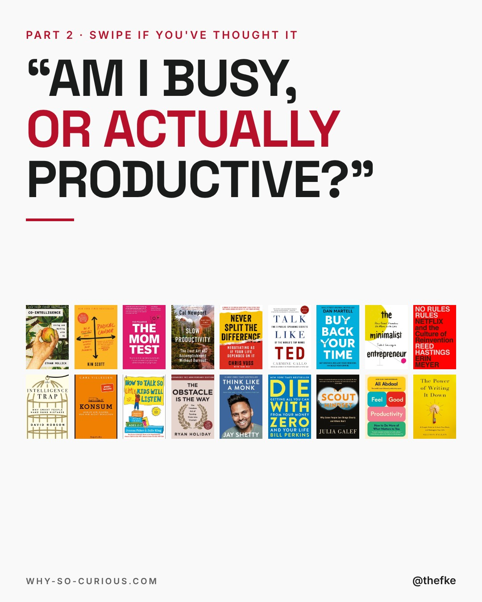
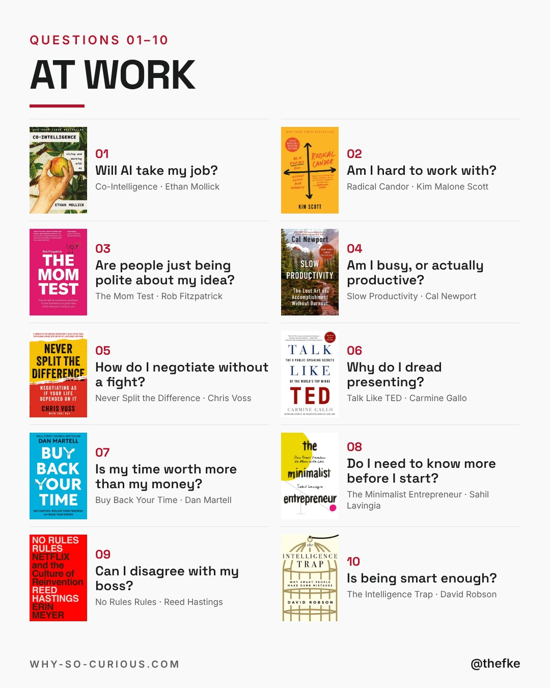
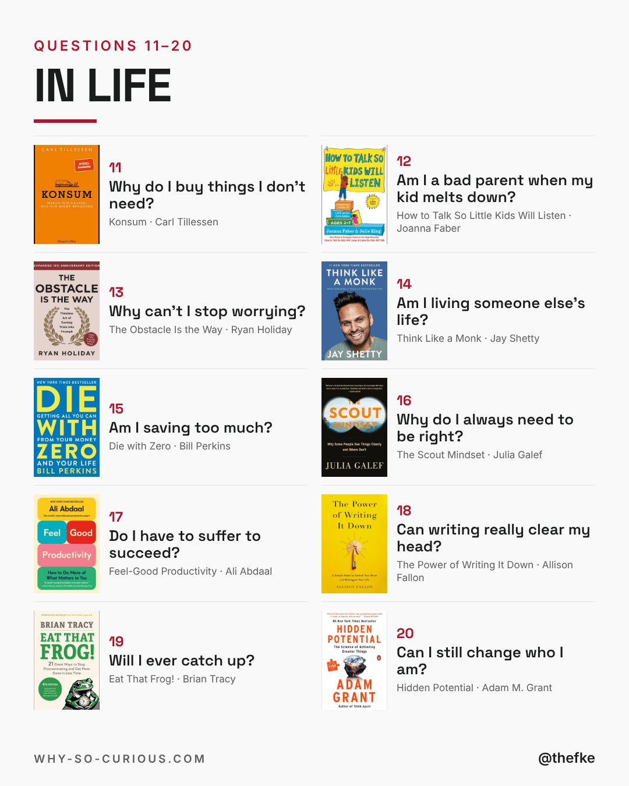
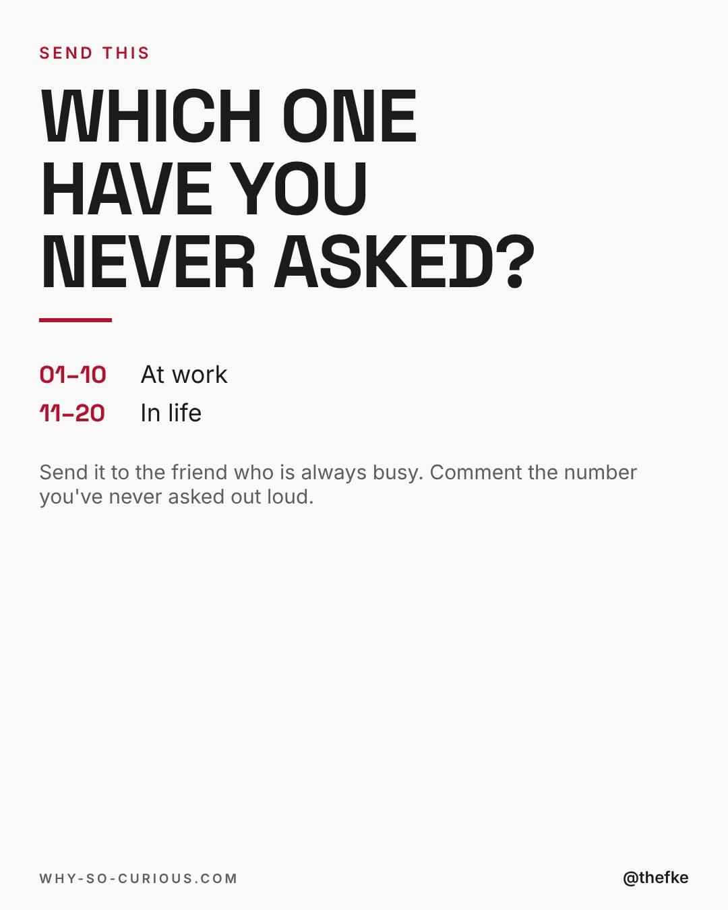

# Di 29.12. · Afraid to Ask? 20 Questions, Part 2

Karussell, 4 Slides. Beim Hochladen 4:5 wählen.

## Caption

```
More questions you only ask Google.
Never your boss. Never your partner.

“Am I busy, or actually productive?”
“Will AI take my job?”
“Am I saving too much?”

Each one has a book that answers it.
10 at work. 10 in life. All from my shelf.

Number 04 has a name in Cal Newport's Slow Productivity: pseudo-productivity.
“The use of visible activity as the primary means of approximating actual productive effort.”

Send this to the friend who is always busy.

Which number have you never asked out loud?

Books from this post: link in bio.

#bookstagram #bookrecommendations #books
```

## Slides





