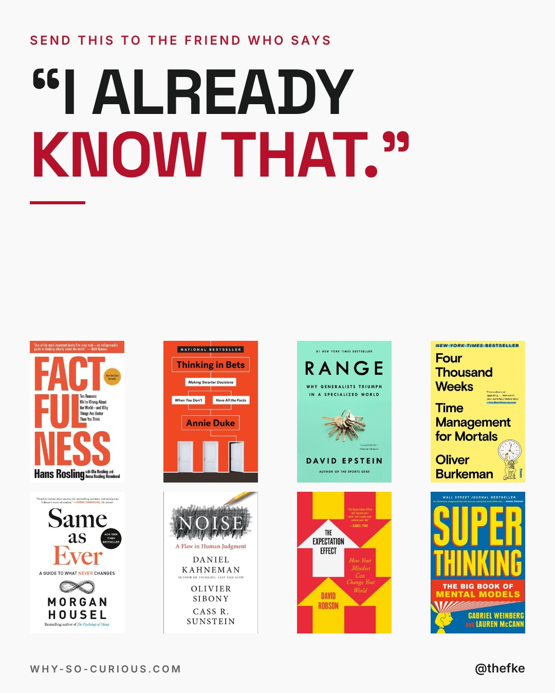
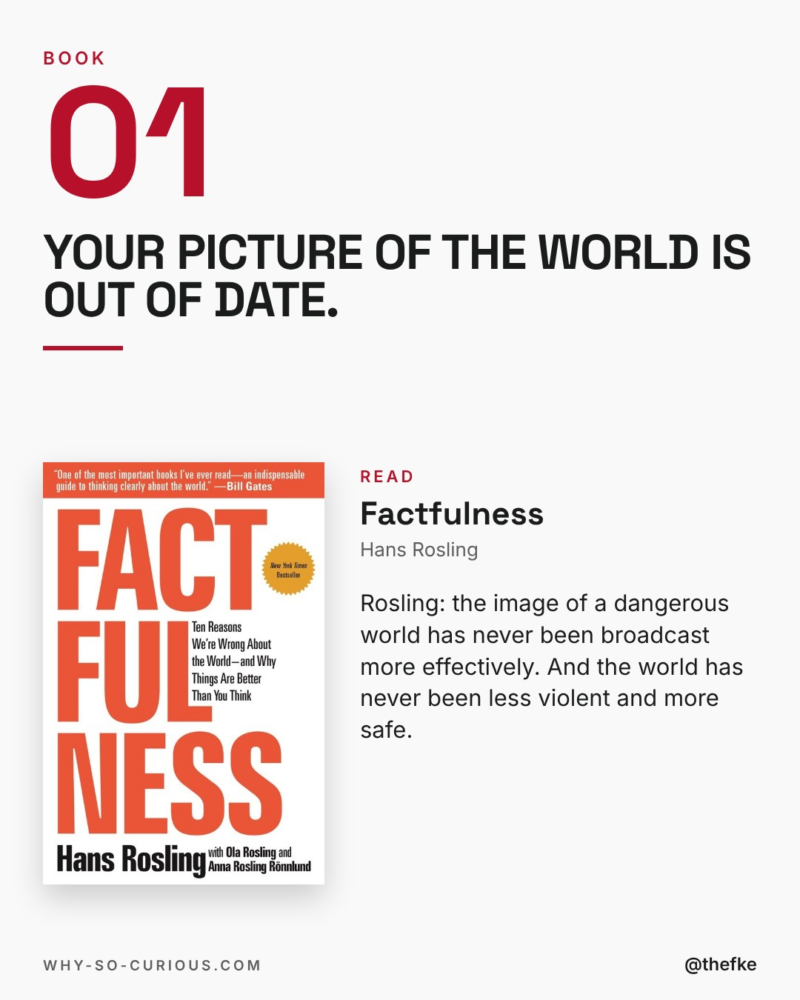
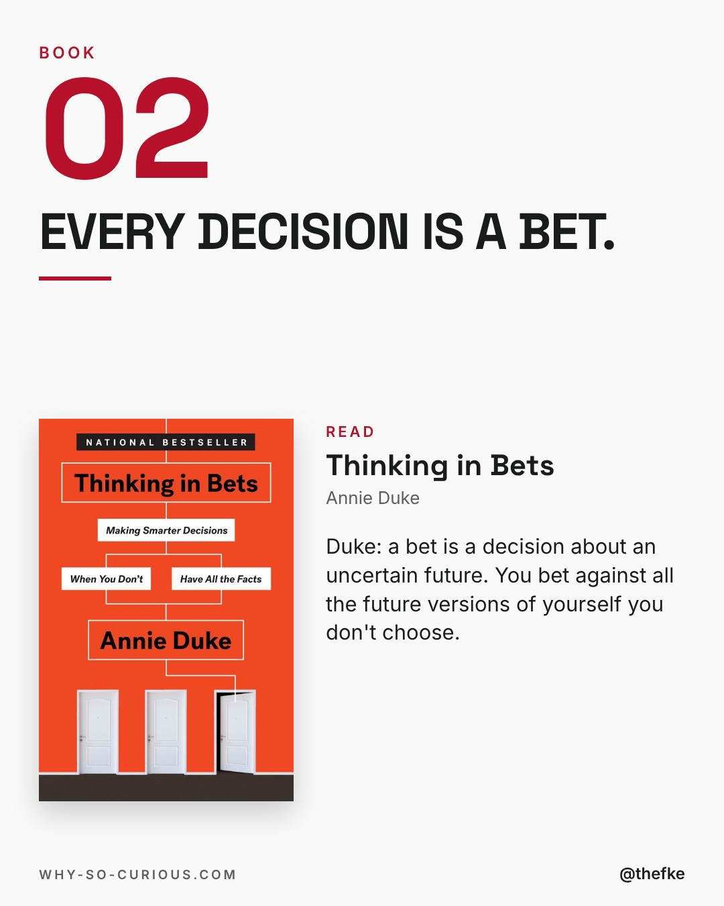
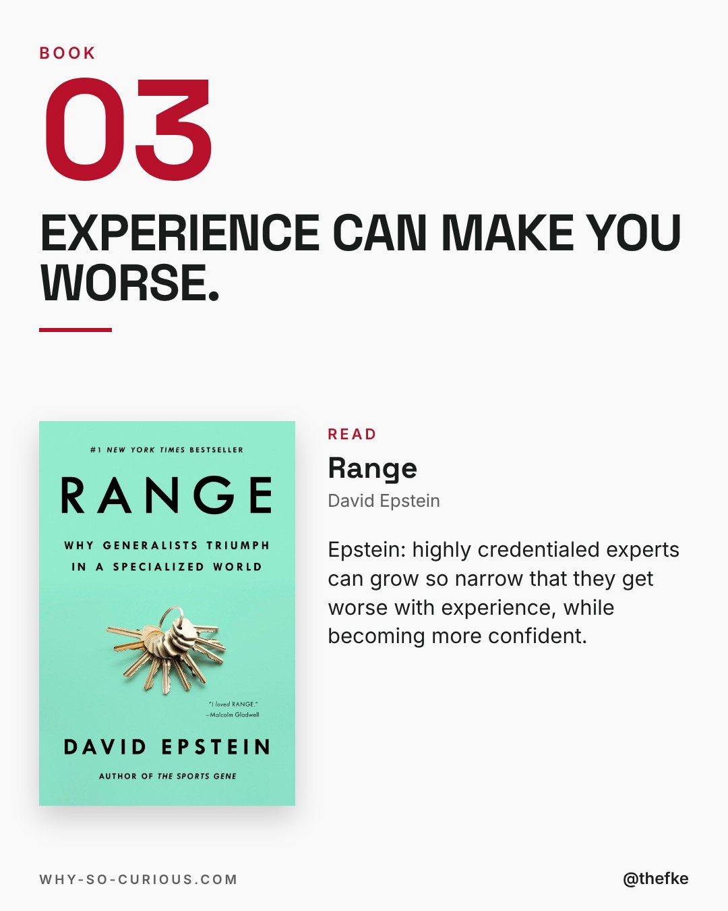
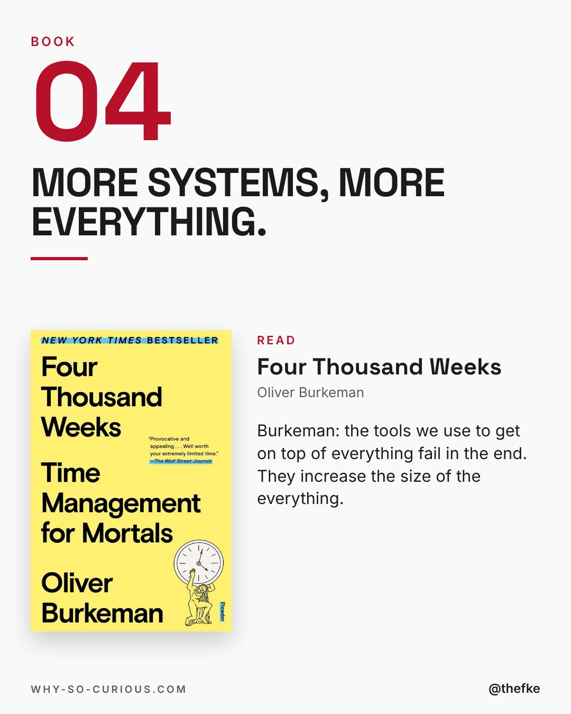
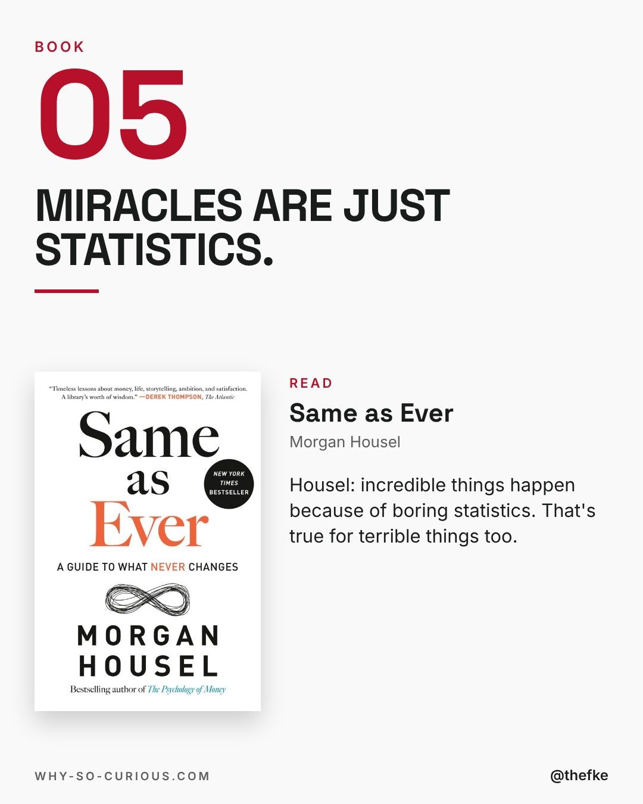
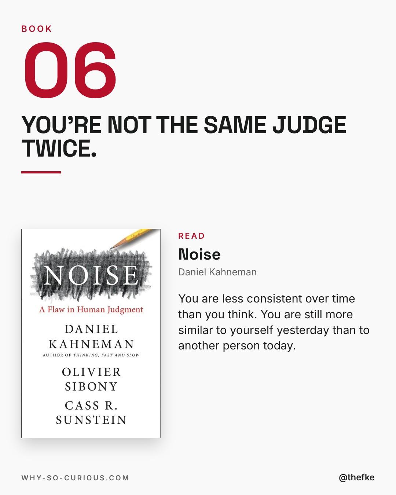
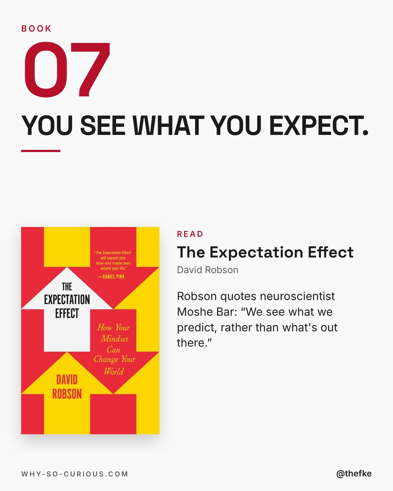
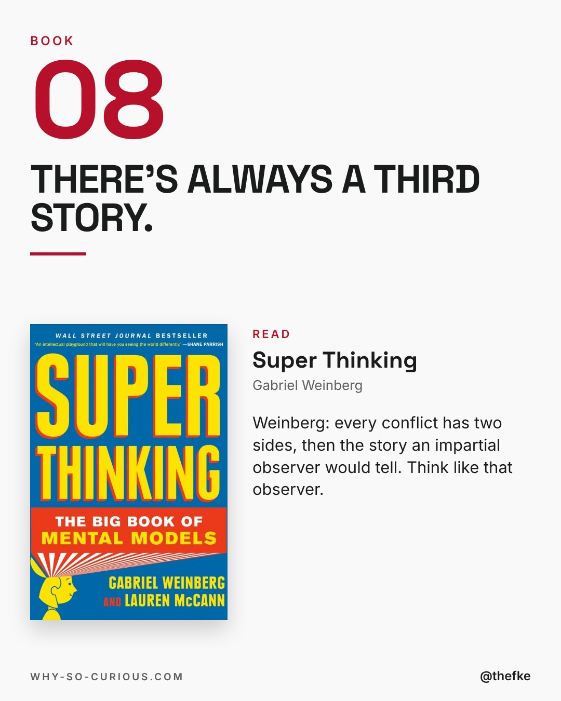
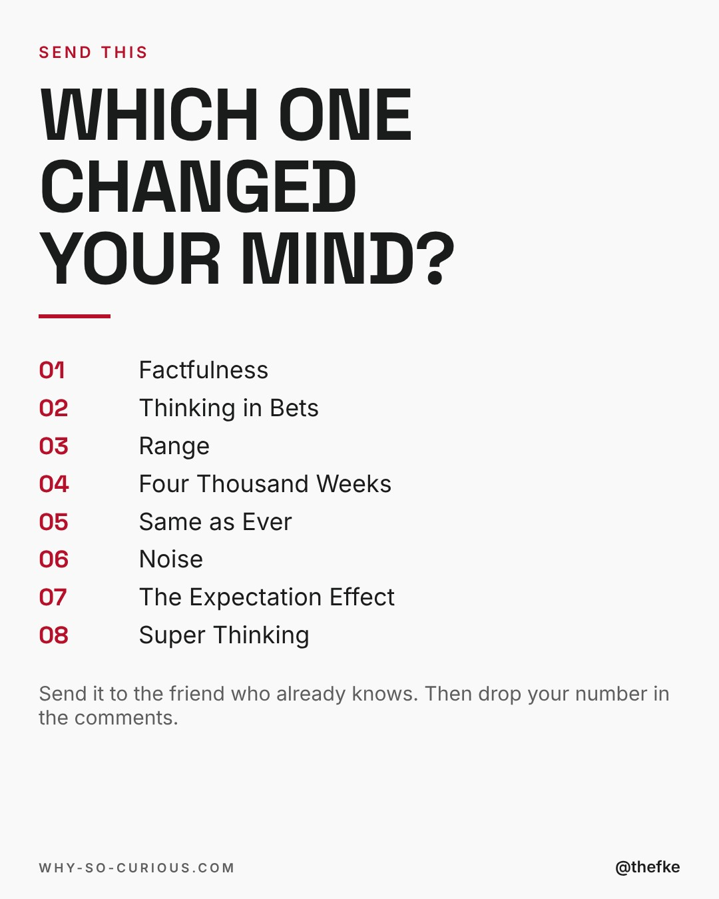

# Di 29.12. · Books that changed how I think, Part 2

Abend-Slot. Karussell, 10 Slides. Beim Hochladen 4:5 wählen.

## Caption

```
“I already know that.”
Eight books that make that sentence harder to say.

Books that changed how I think, part 2.

Your picture of the world. Your experience.
Your decisions. Your to-do list.

From Noise by Kahneman, Sibony and Sunstein:
“you are not always the same person, and you are less consistent over time than you think.”

All from my shelf.

Send this to the friend who already knows.

Which one changed your mind?

Books from this post: link in bio.

#bookstagram #bookrecommendations #books
```

## Slides











