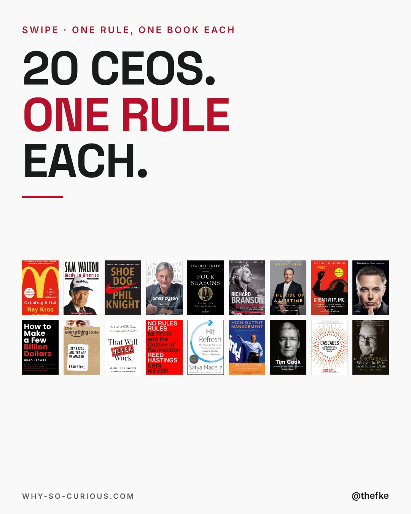
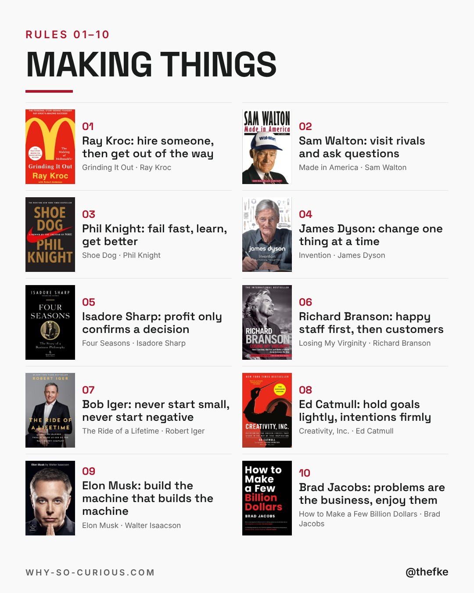
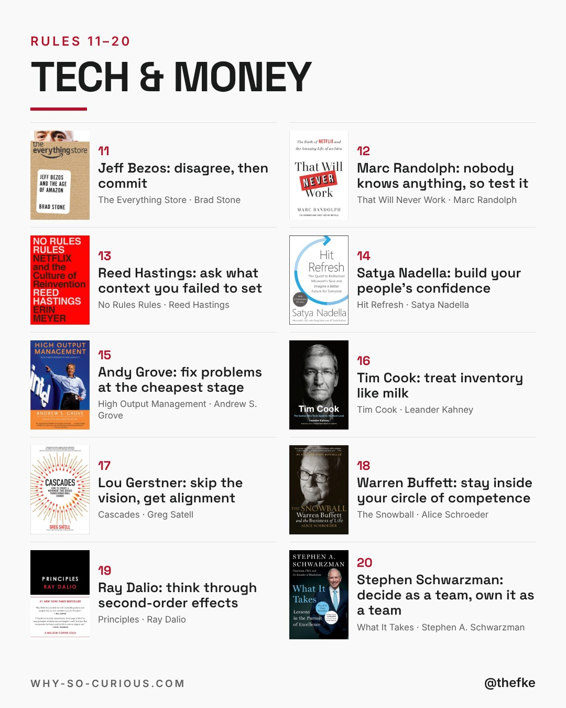
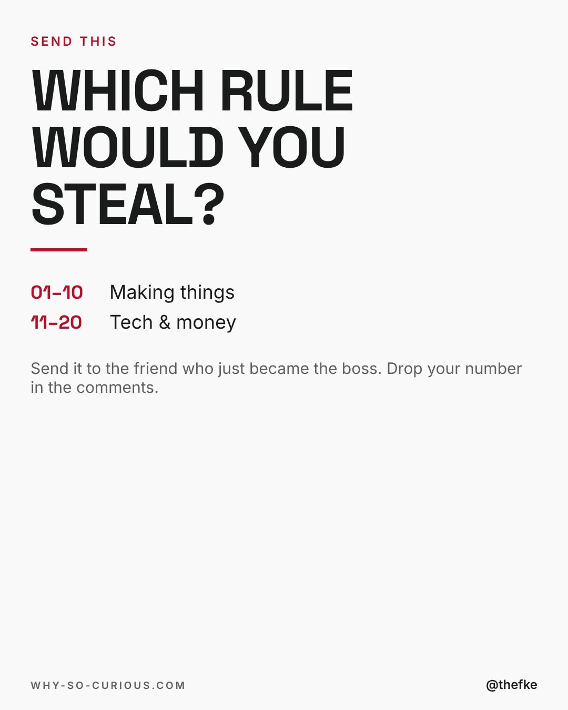

# Mi 30.12. · 20 CEOs. One rule each

Früh-Slot, wird automatisch gepostet (ohne Musik). Nicht von Hand posten. Karussell, 4 Slides. Beim Hochladen 4:5 wählen.

## Caption

```
Every CEO has one rule they repeat until people roll their eyes.

I collected 20 of them.
One rule, one book each.

10 from people who made things.
10 from tech and money.

The one I'd tape to every manager's desk is from Ray Kroc.

Ray Kroc in Grinding It Out:
“I believe that if you hire a man to do a job, you ought to get out of the way and let him do it. If you doubt his ability, you shouldn’t have hired him in the first place.”

All from my shelf.

Send this to the friend who just became the boss.

Which rule would you steal?

Books from this post: link in bio.

#bookstagram #bookrecommendations #books
```

## Slides





