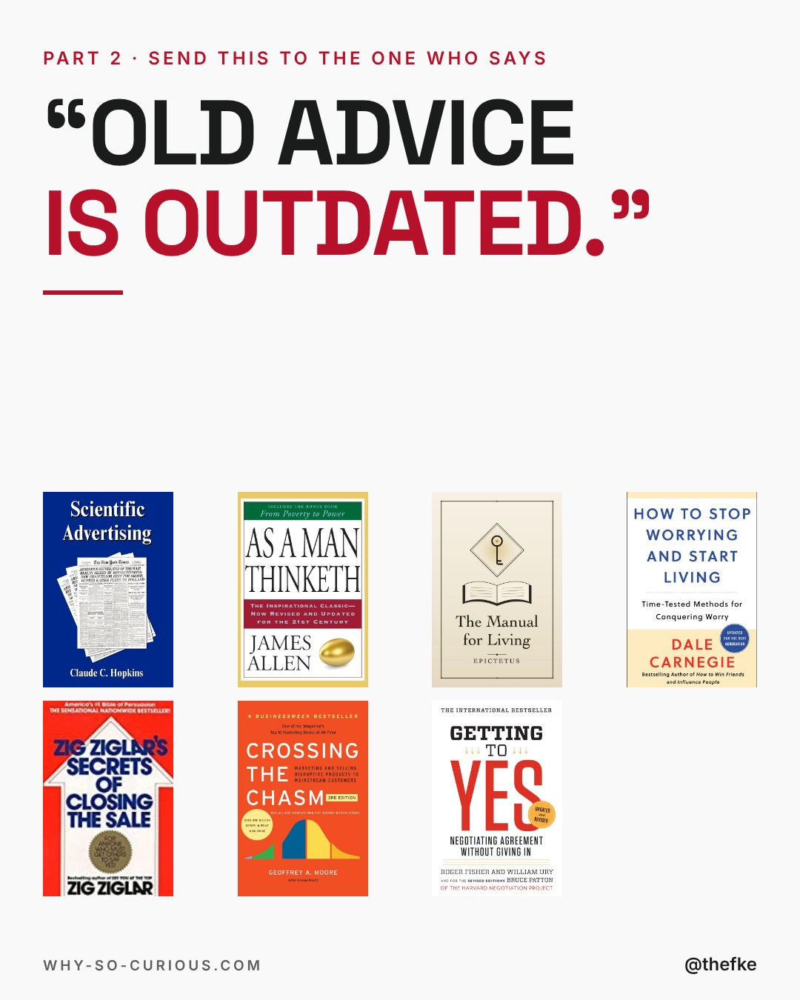
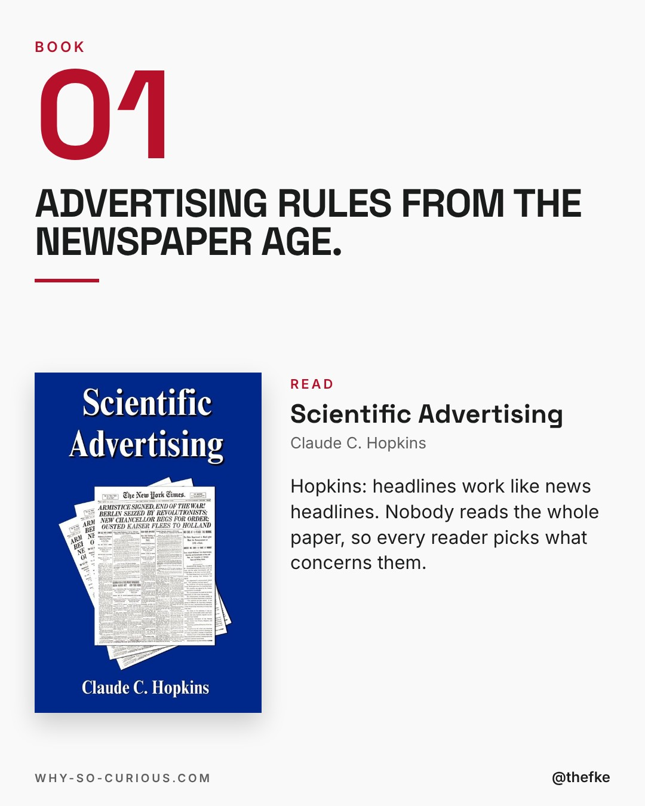
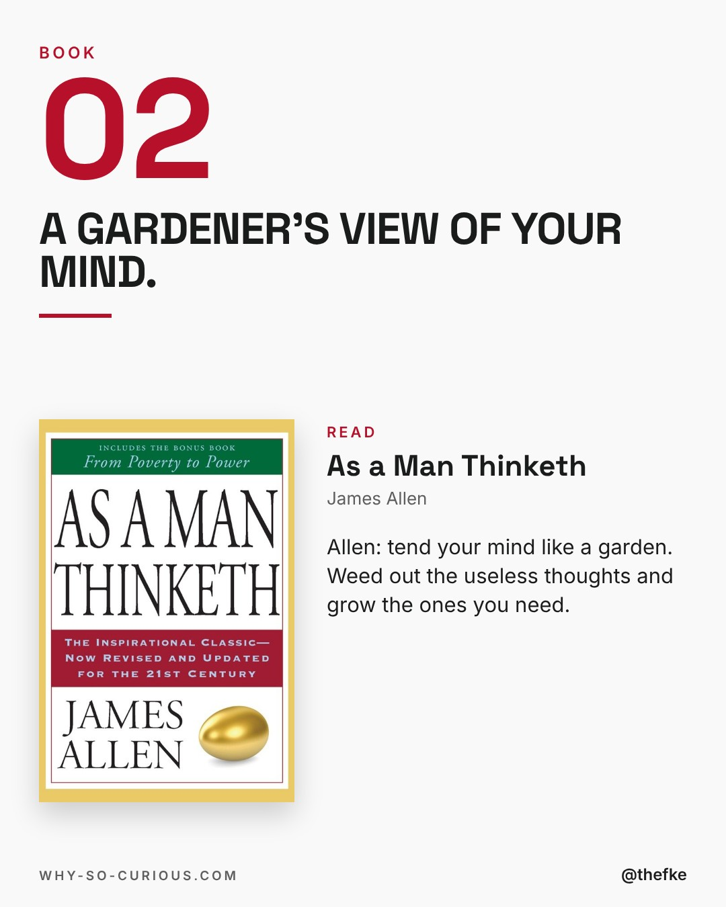
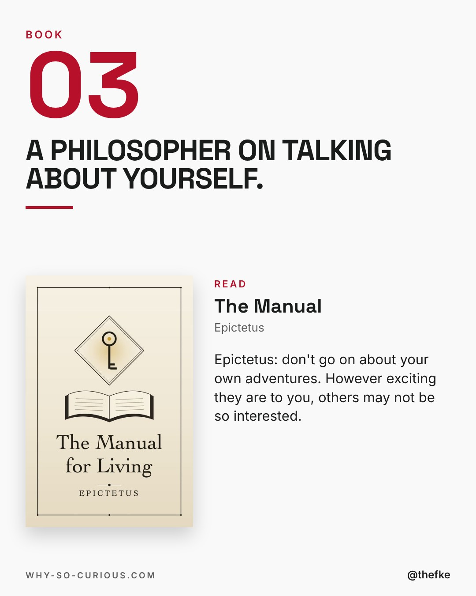
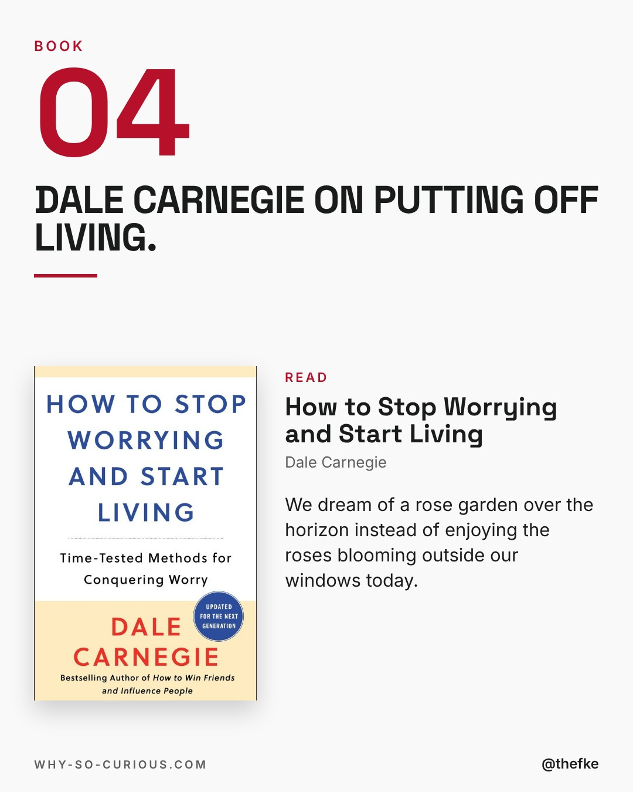
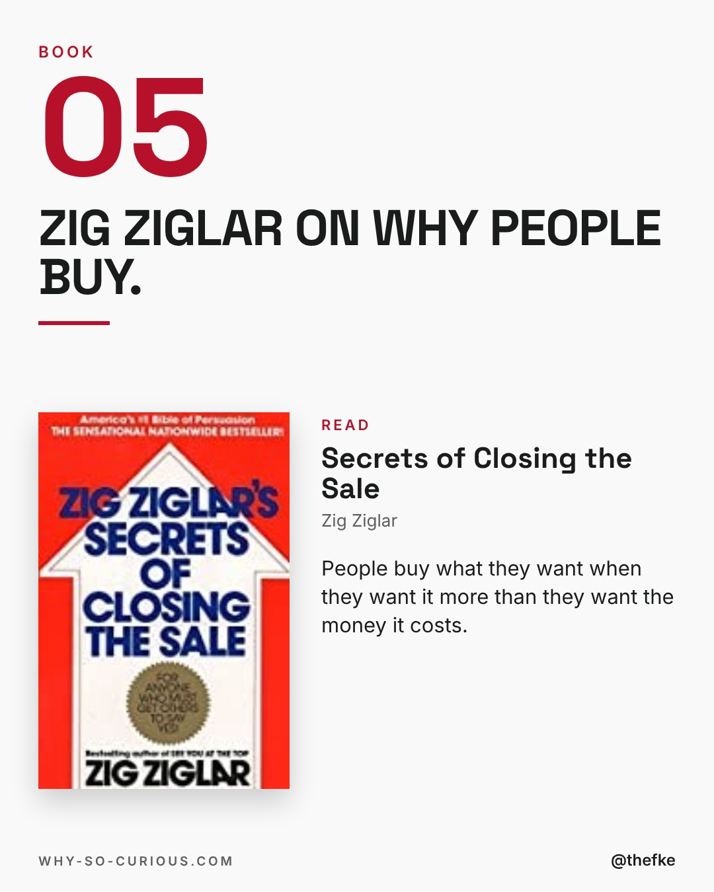
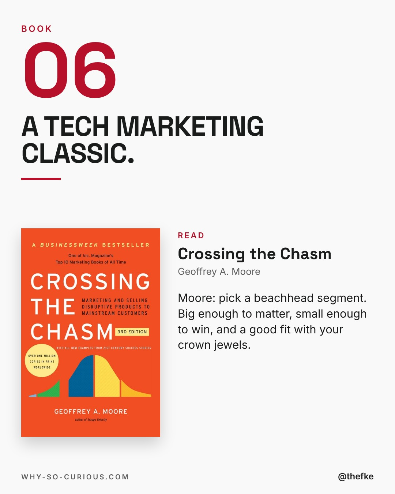
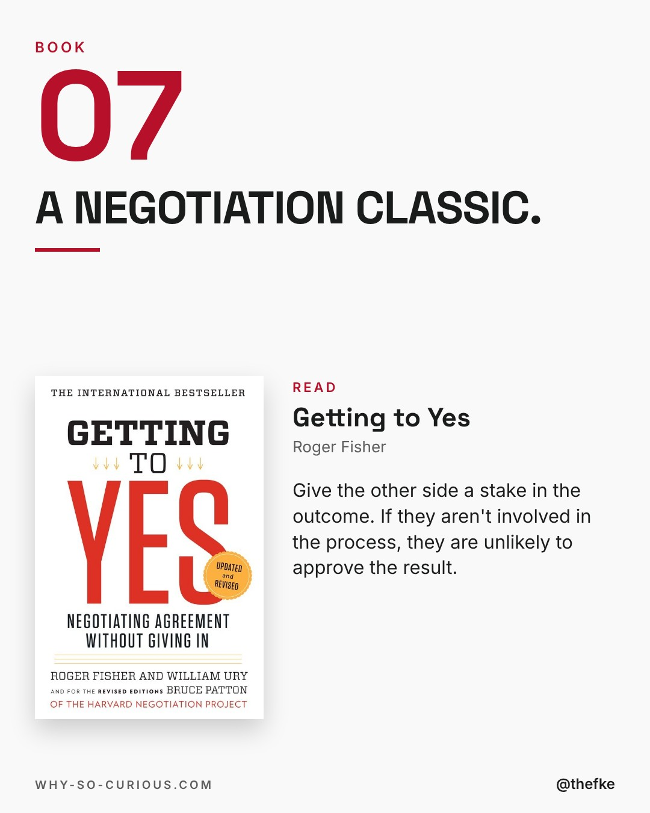
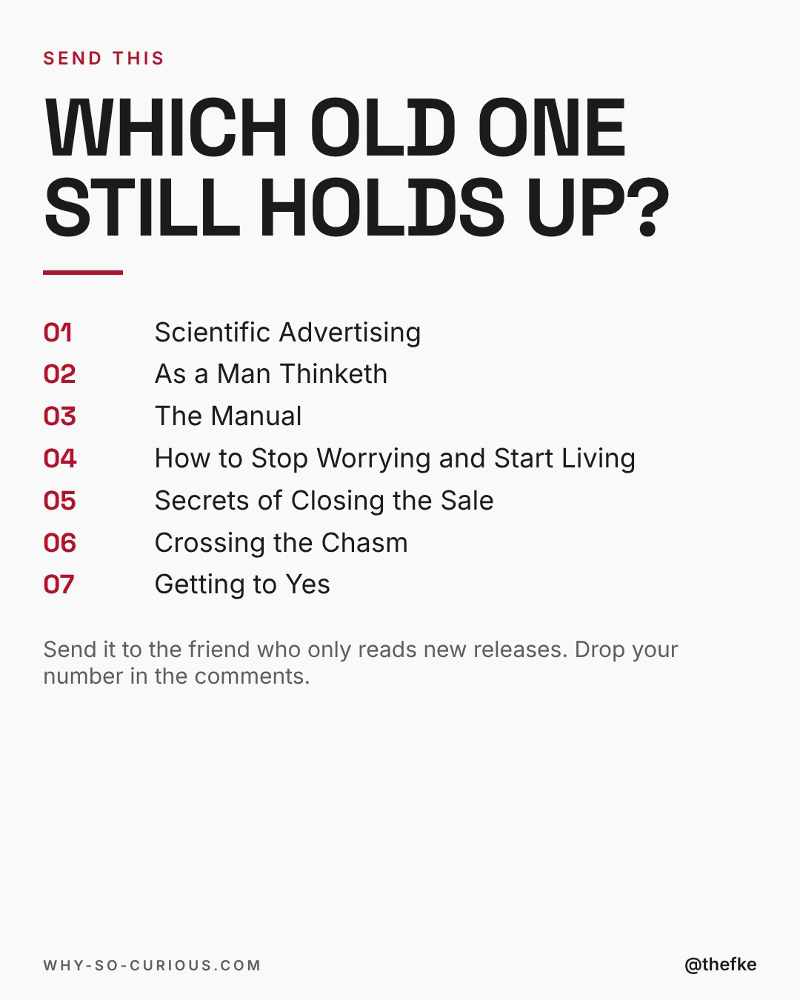

# Mi 30.12. · Old books that are still right, Part 2

Abend-Slot. Karussell, 9 Slides. Beim Hochladen 4:5 wählen.

## Caption

```
“Old advice is outdated.”
Then why does so much of it still work?

Seven more old books that hold up.
An ad man, a salesman, a philosopher.
Dale Carnegie, a gardener's view of the mind and a negotiation classic.

Claude Hopkins wrote this in Scientific Advertising:
“People are hurried. The average person worth cultivating has too much to read.”
Still true.

All from my shelf.

Send this to the friend who only reads new releases.

Which old one would you add?

Books from this post: link in bio.

#bookstagram #bookrecommendations #books
```

## Slides










