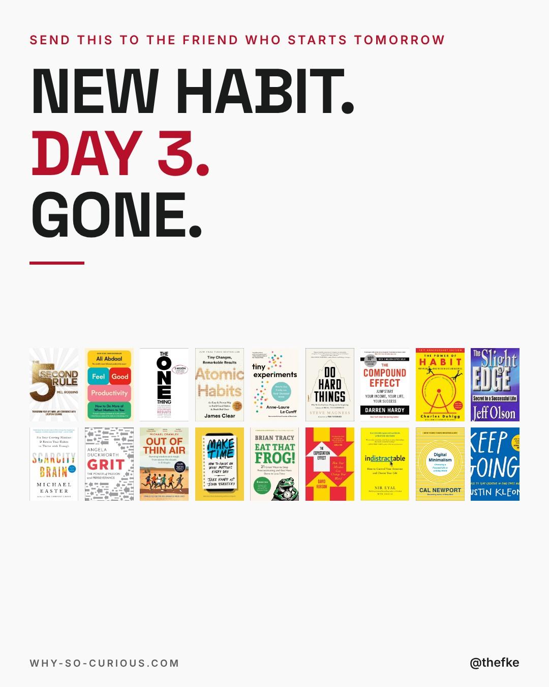
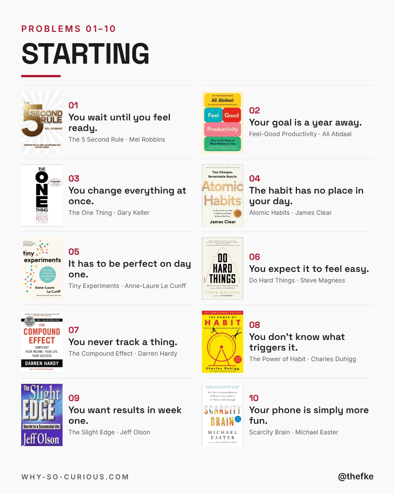
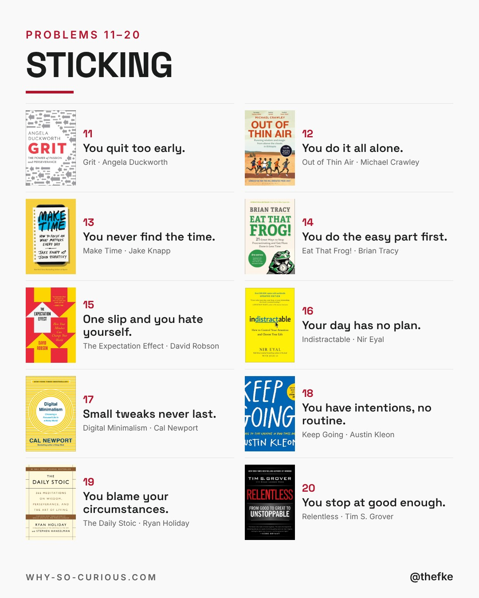
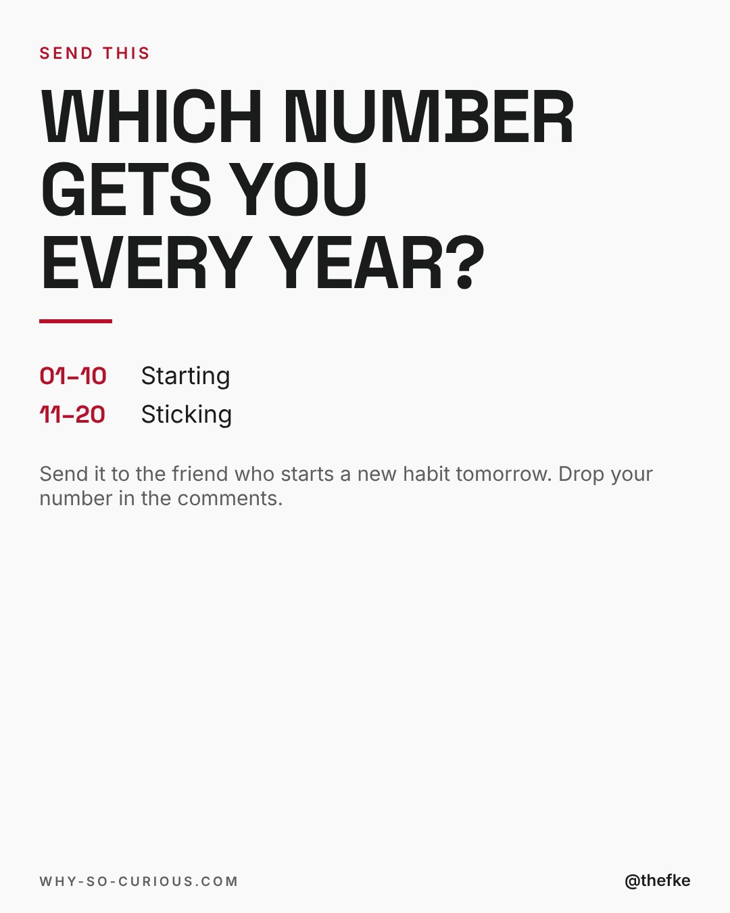

# Do 31.12. · 20 Habit Problems, 20 Books

Früh-Slot, wird automatisch gepostet (ohne Musik). Nicht von Hand posten. Karussell, 4 Slides. Beim Hochladen 4:5 wählen.

## Caption

```
Tomorrow is the day for new habits.
Day 3 is where it gets hard.

20 habit problems.
20 books from my shelf that help.

10 about starting.
10 about sticking.

The simplest trick in the whole list is number 4.

James Clear in Atomic Habits:
“One of the best ways to build a new habit is to identify a current habit you already do each day and then stack your new behavior on top.”

Send this to the friend who starts a new habit tomorrow.

Which number gets you every year?

Books from this post: link in bio.

#bookstagram #bookrecommendations #books
```

## Slides





