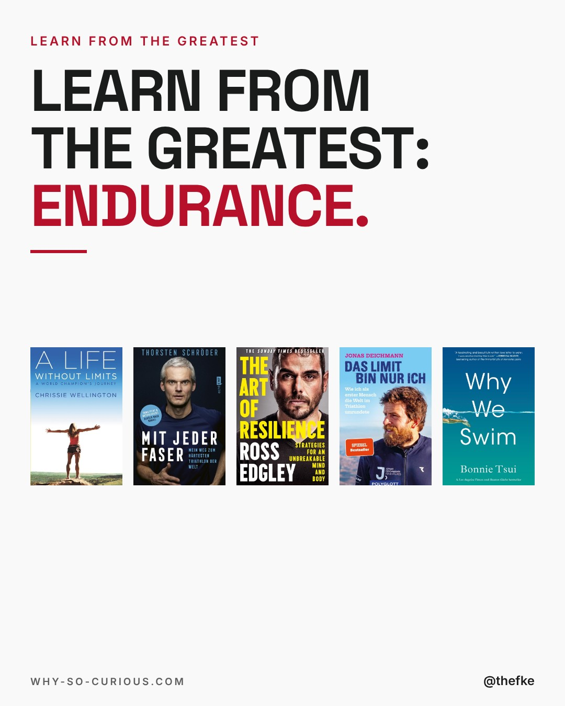
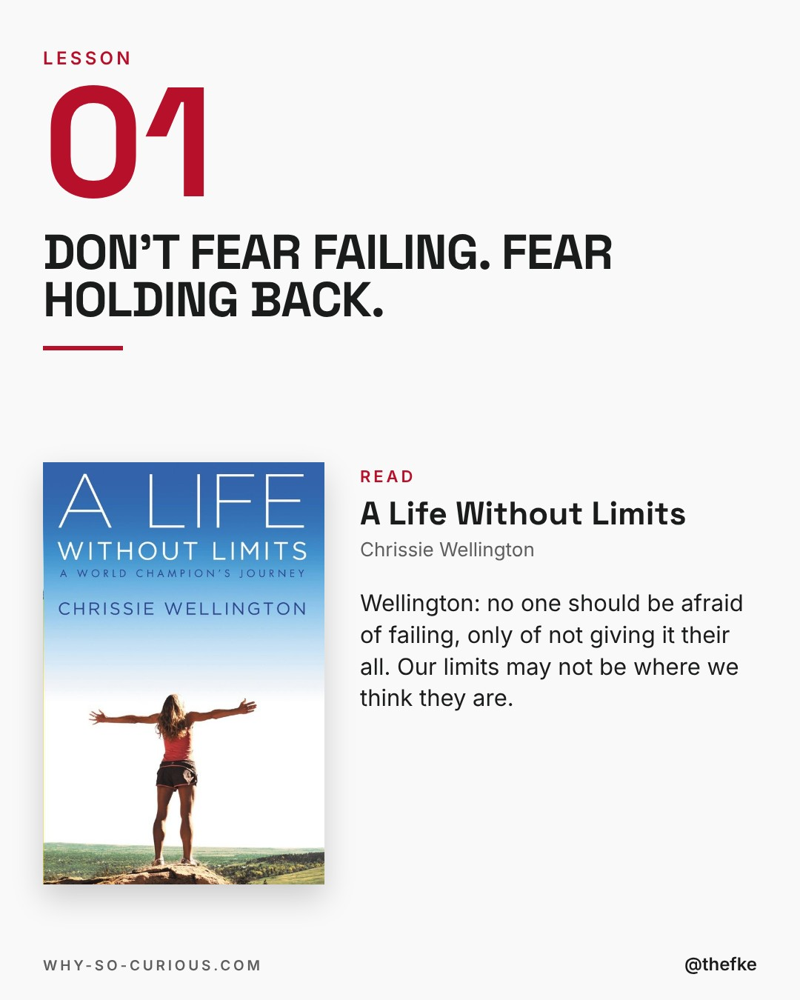
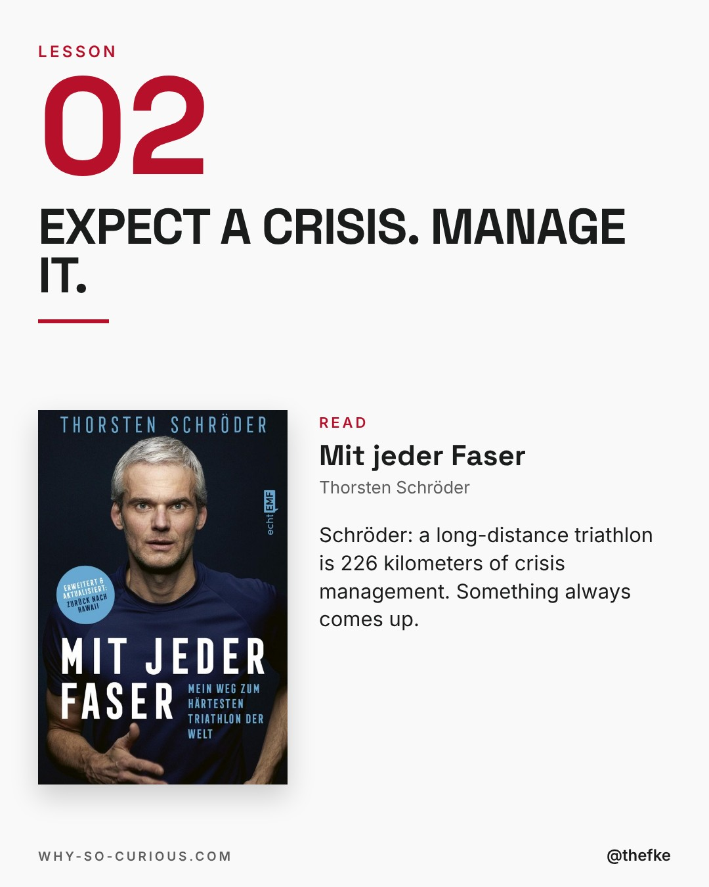
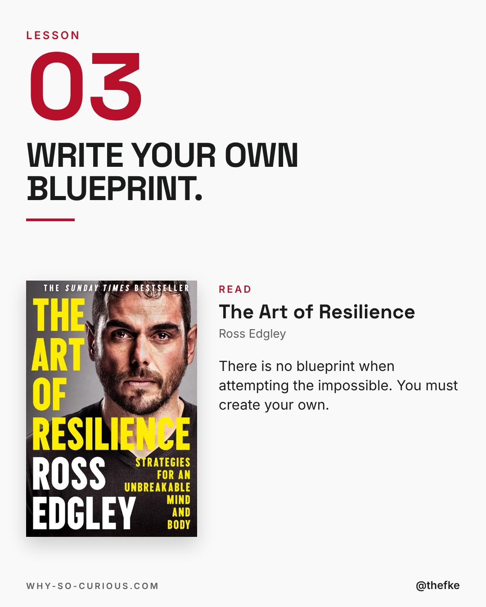
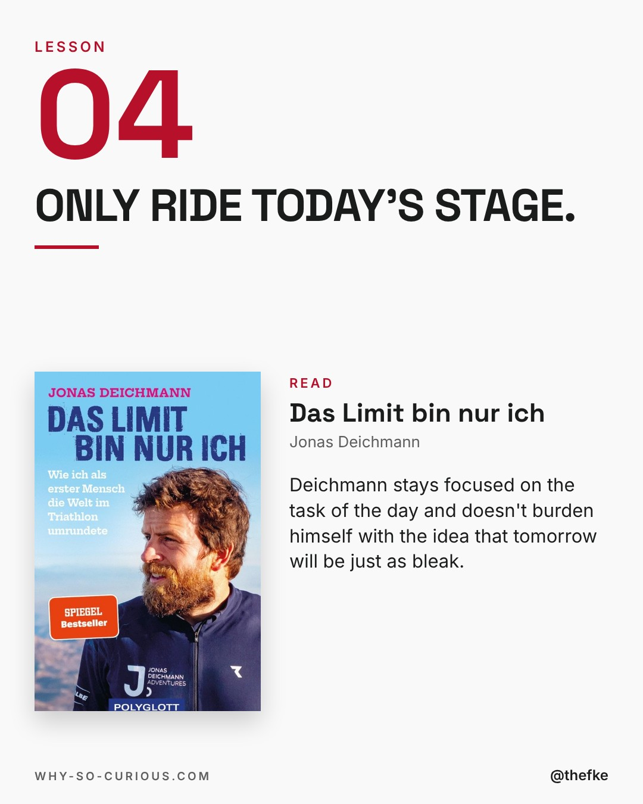
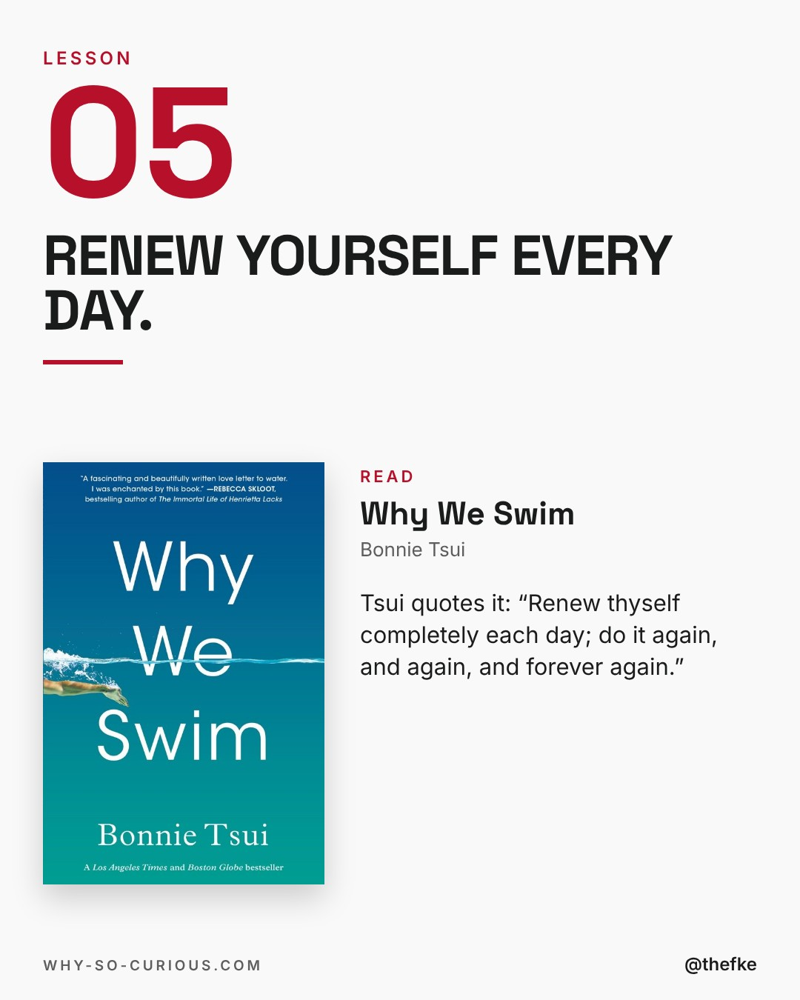
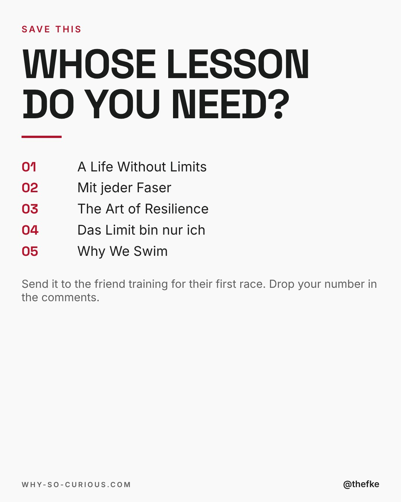

# Do 31.12. · Learn from the Greatest: Endurance

Abend-Slot. Karussell, 7 Slides. Beim Hochladen 4:5 wählen.

## Caption

```
The last day of the year.
A good day to learn from people who go long.

Five lessons on endurance.
A world champion, a triathlete, a cyclist and a writer on swimming.
And a man who calls his book The Art of Resilience.

One number from Why We Swim by Bonnie Tsui:
swimming reduces blood pressure by an average of nine points.

All from books on my shelf.

Send this to the friend whose resolution is a race.

Whose lesson do you need?

Books from this post: link in bio.

#bookstagram #bookrecommendations #books
```

## Slides








