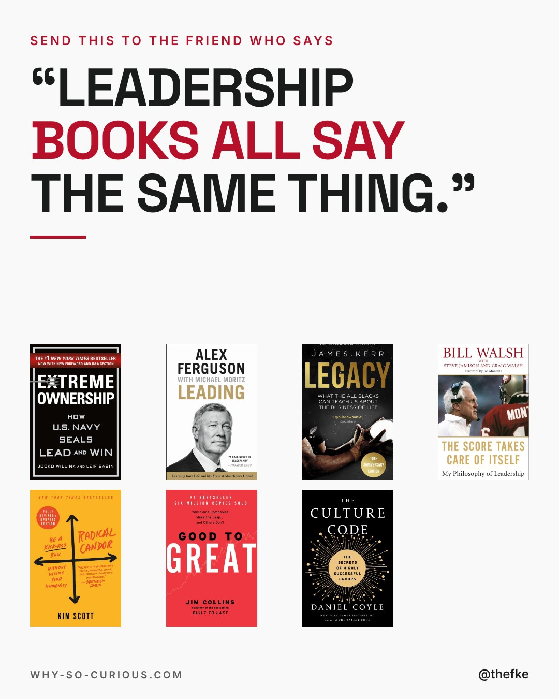
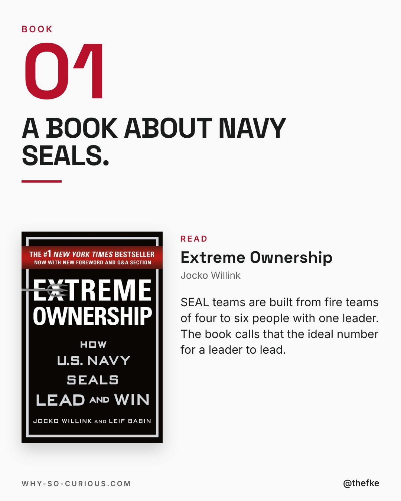
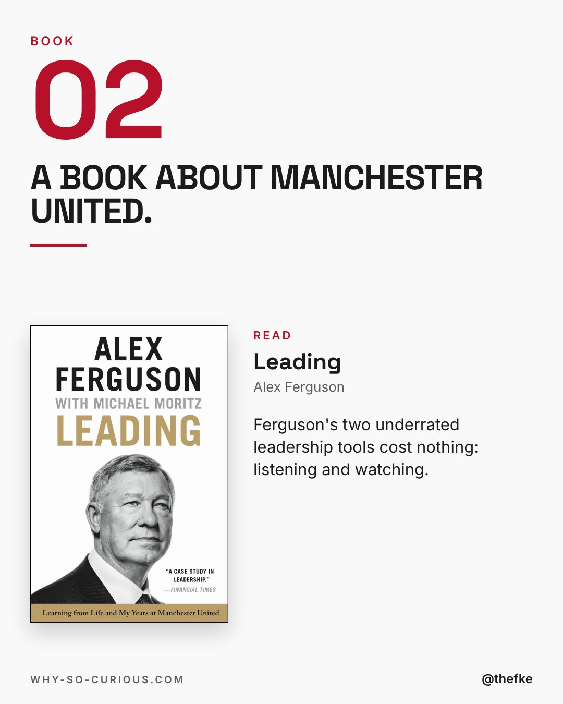
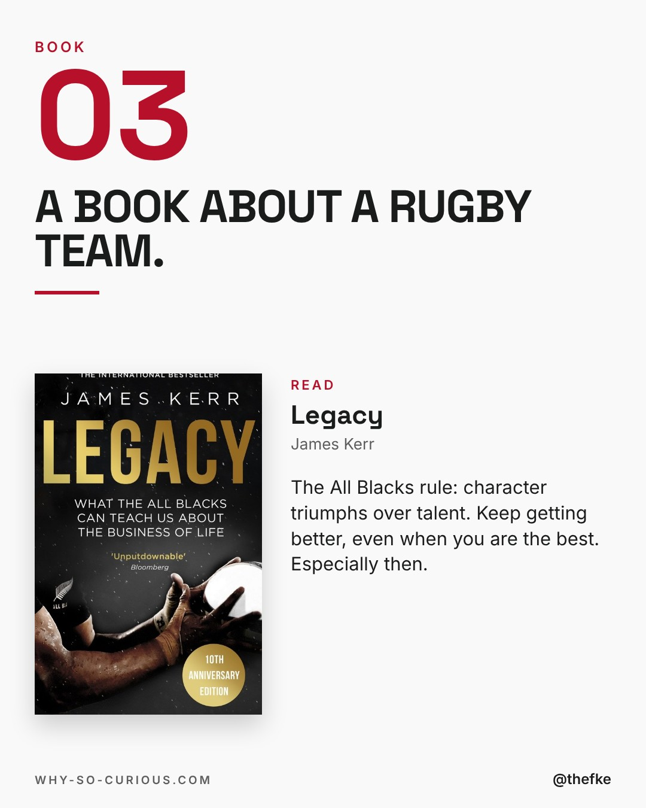
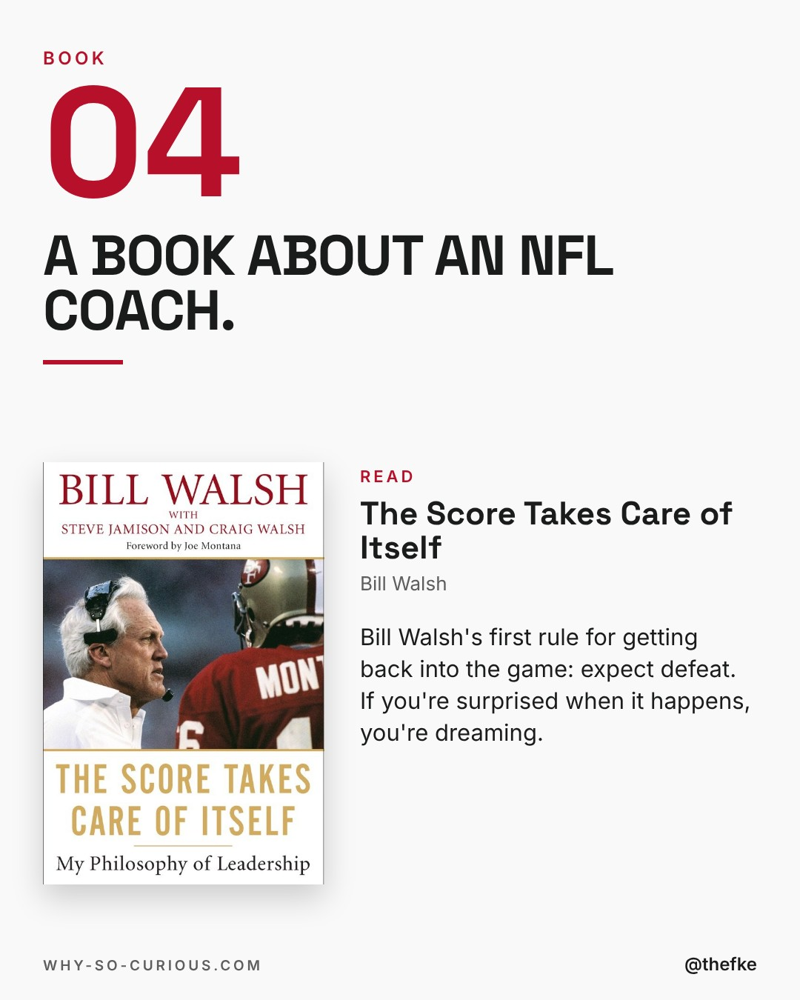
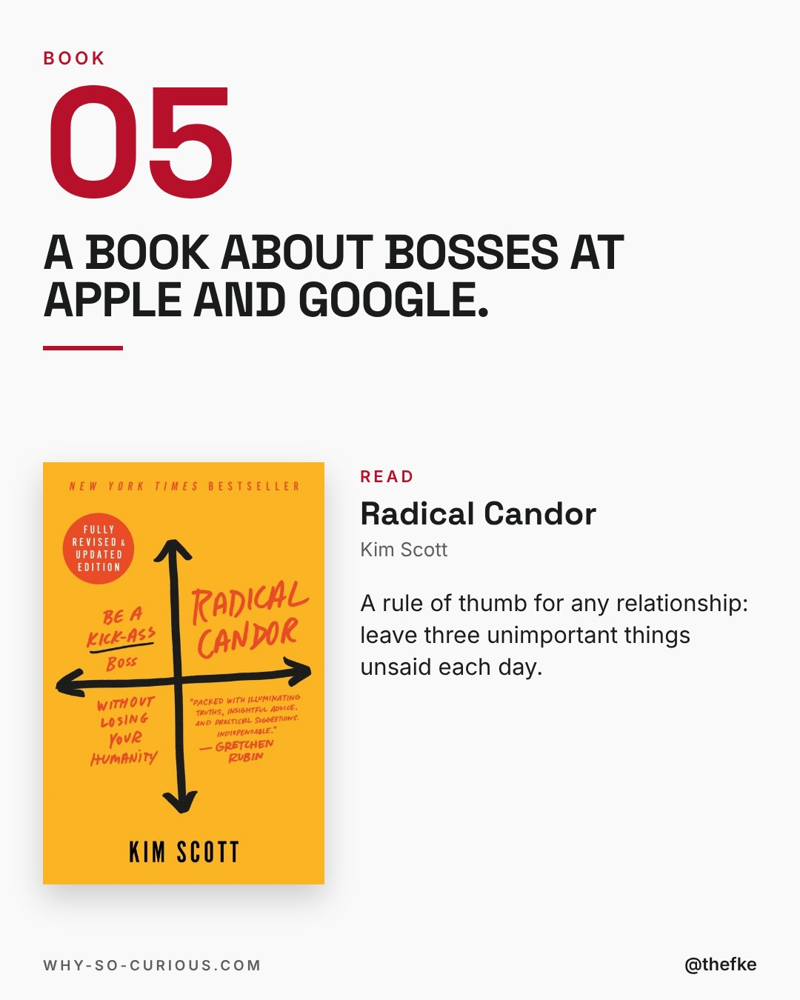
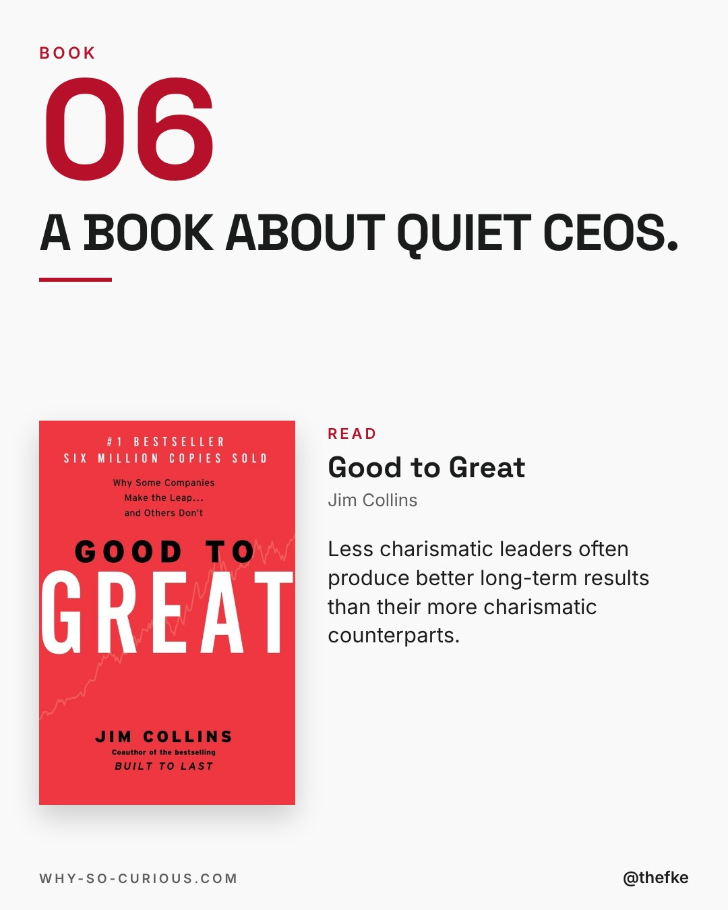
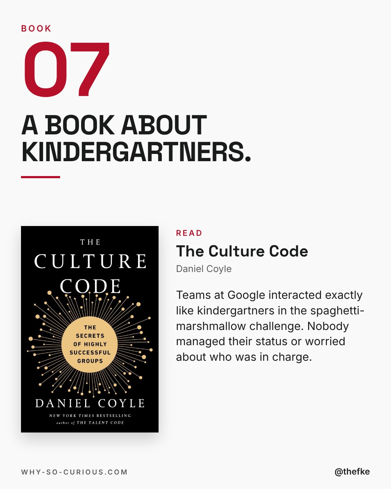
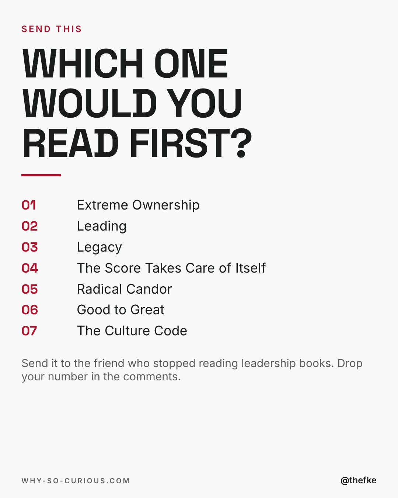

# Fr 01.01. · “Leadership books all say the same thing.” Seven that don't

Früh-Slot, wird automatisch gepostet (ohne Musik). Nicht von Hand posten. Karussell, 9 Slides. Beim Hochladen 4:5 wählen.

## Caption

```
“Leadership books all say the same thing.”
Seven from my shelf that don't.

Navy SEALs. A rugby team. An NFL coach. Kindergartners.
Each one gives you a different rule.

The cheapest advice is from Alex Ferguson.

Alex Ferguson in Leading:
“If you are leading people, it helps to have a sense of who they are–the circumstances in which they were raised, the actions that will draw out the best in them, and the remarks that will cause them to be spooked. The only way to figure this out is by two underrated activities: listening and watching.”

Send this to the friend who stopped reading leadership books.

Which one would you read first?

Books from this post: link in bio.

#bookstagram #bookrecommendations #books
```

## Slides










