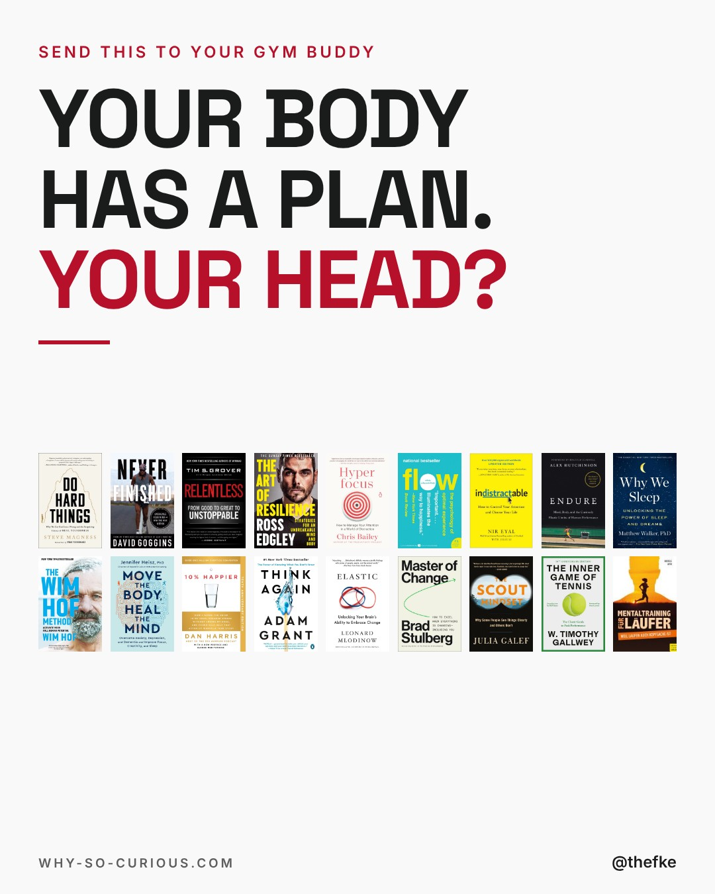
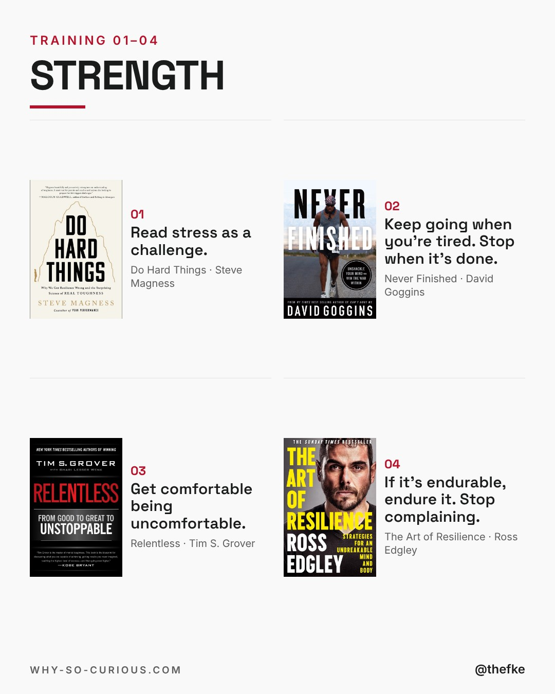
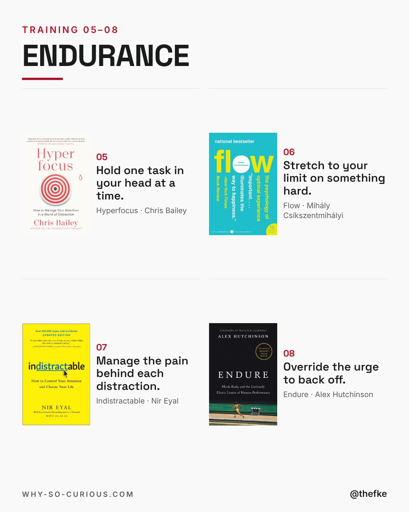
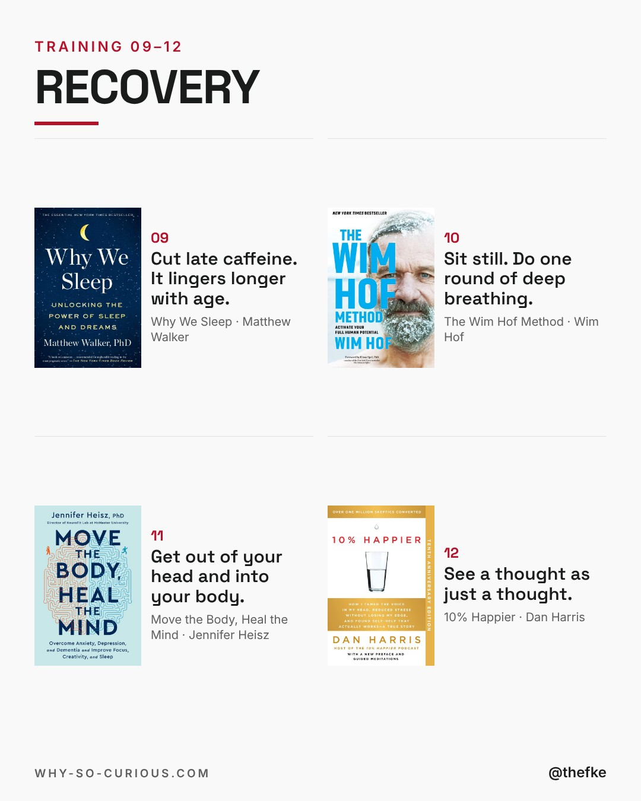
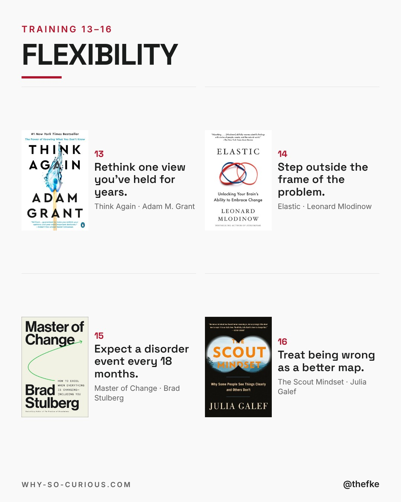
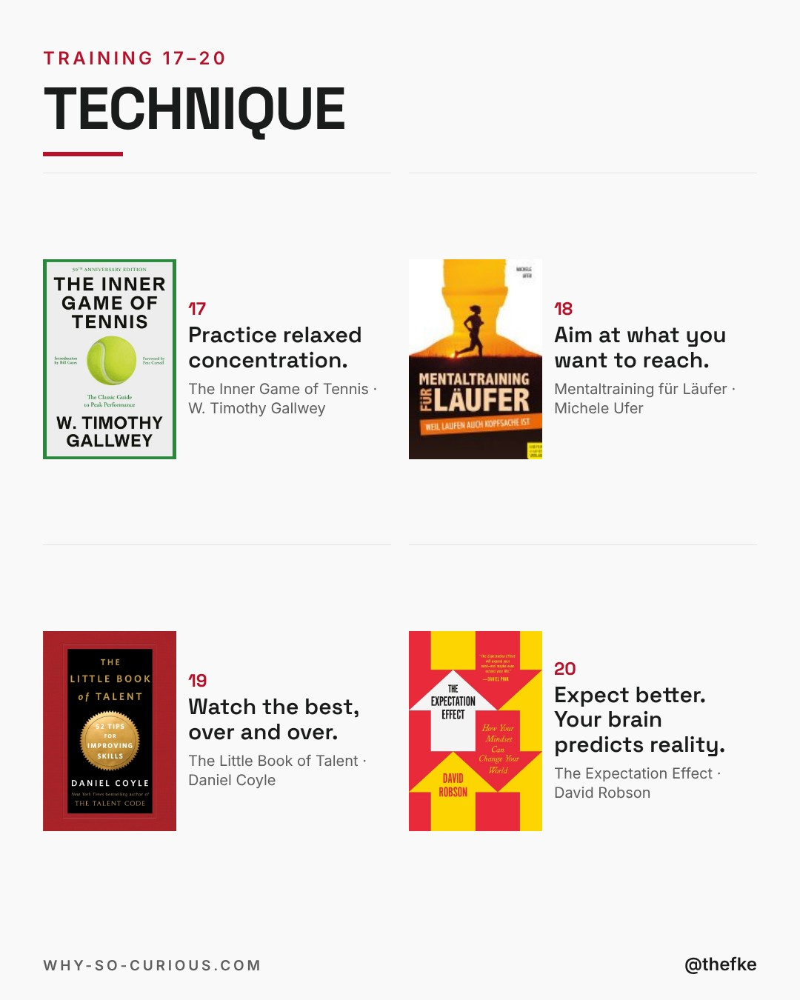
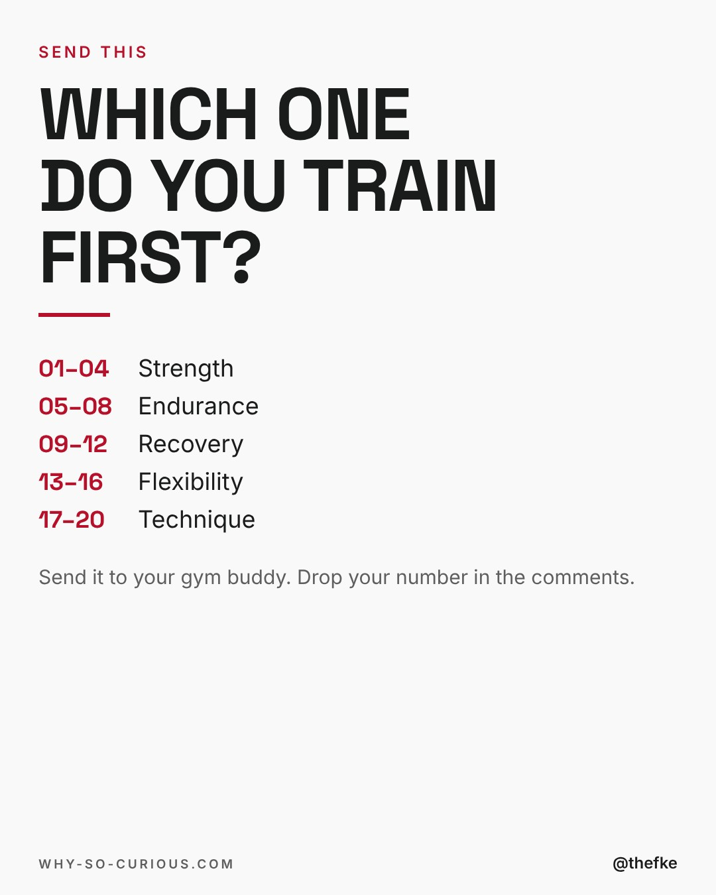

# Fr 01.01. · Train your mind like your body

Abend-Slot. Karussell, 7 Slides. Beim Hochladen 4:5 wählen.

## Caption

```
January 1.
Your body has a plan for this year. Your head doesn't.

20 books. 5 kinds of training.
Strength. Endurance. Recovery. Flexibility. Technique.
4 exercises each.

Number 20 comes from David Robson in The Expectation Effect:
“For the purposes of our next-day performance, we slept as well as we think we did.”

All from my shelf.

Send this to your gym buddy.

Which one do you train first?

Books from this post: link in bio.

#bookstagram #bookrecommendations #books
```

## Slides








