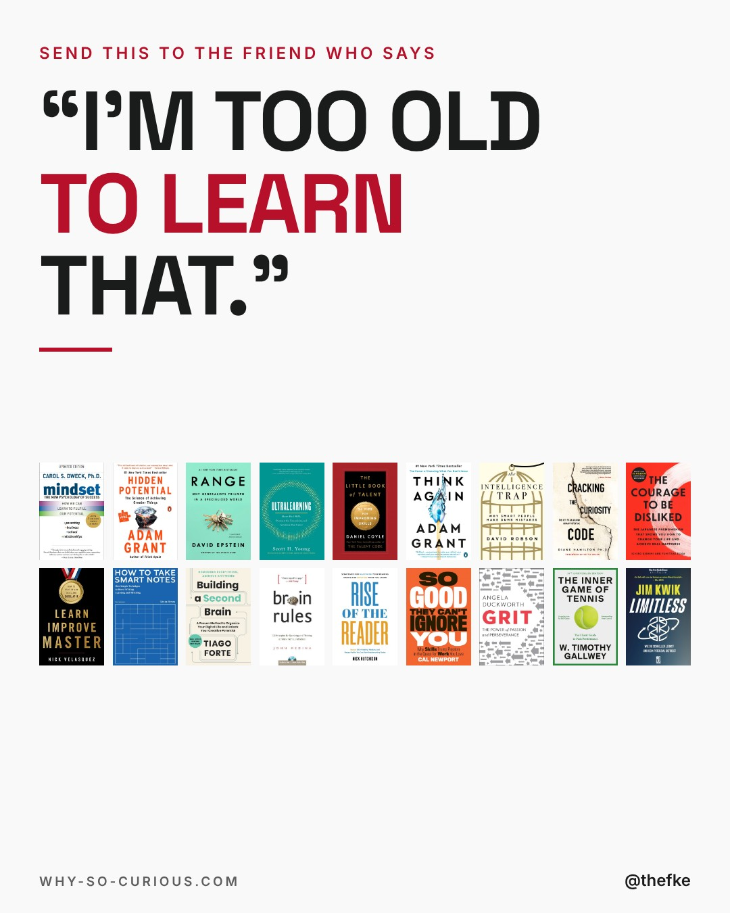
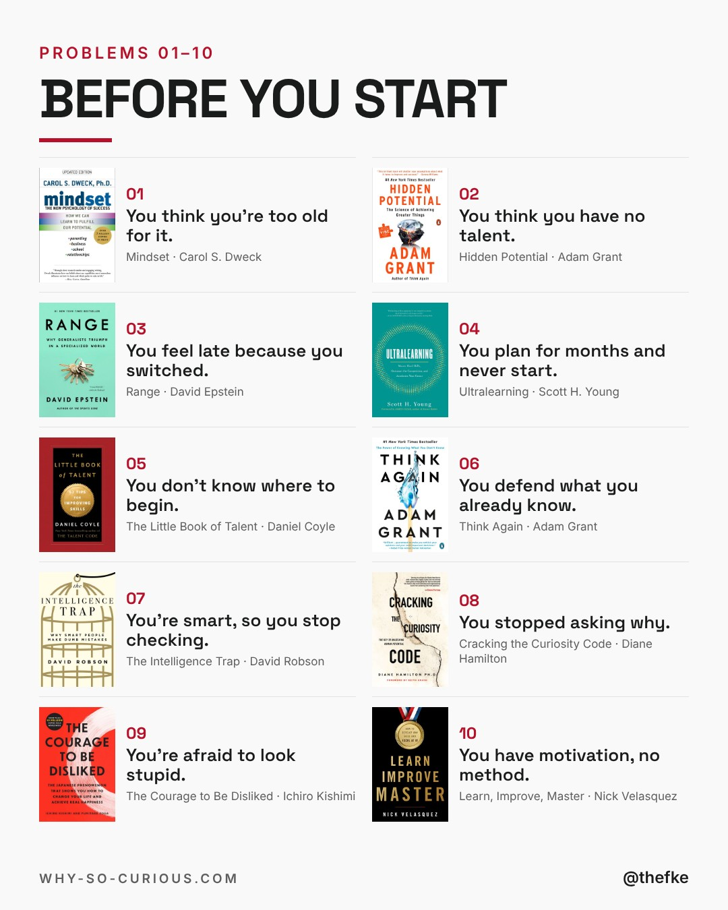
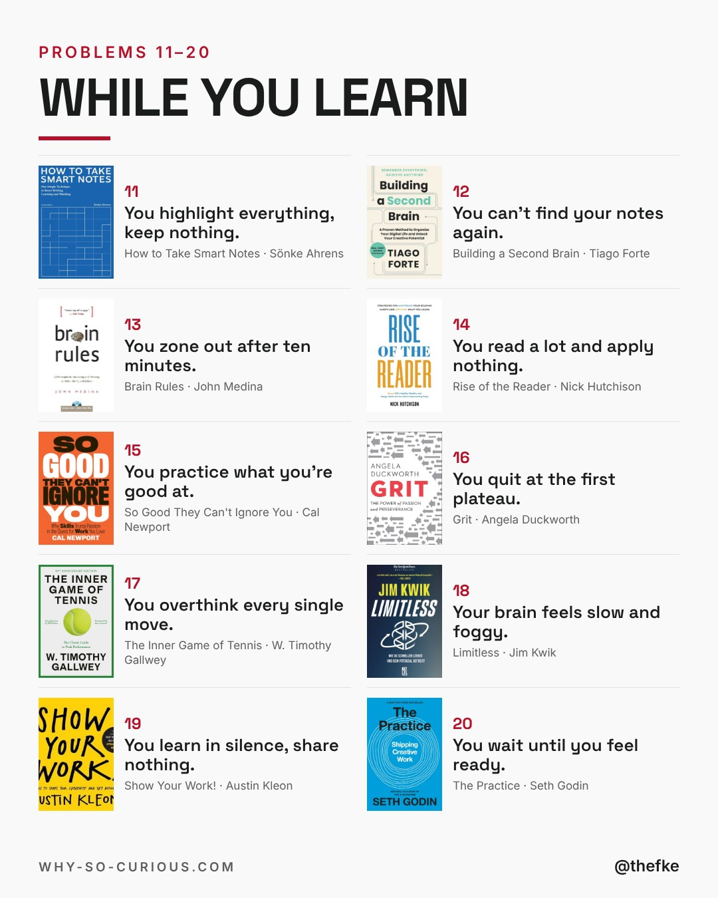
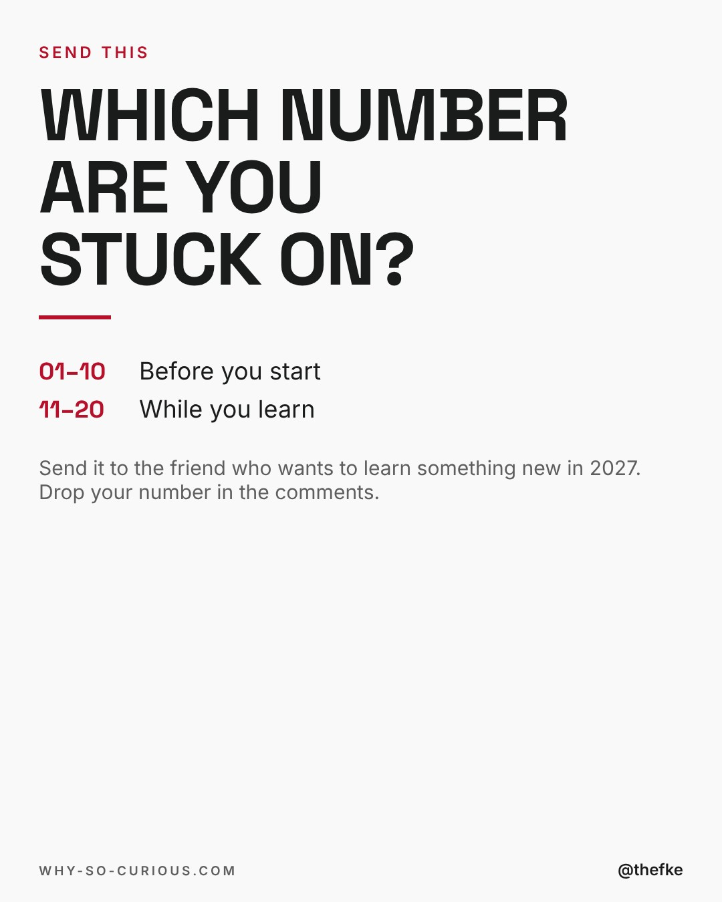

# So 03.01. · 20 Learning Problems, 20 Books

Früh-Slot, wird automatisch gepostet (ohne Musik). Nicht von Hand posten. Karussell, 4 Slides. Beim Hochladen 4:5 wählen.

## Caption

```
“I'm too old to learn that.”
Most of the time, the problem is the method.

20 learning problems.
20 books from my shelf that help.

10 before you start.
10 while you learn.

Daniel Coyle in The Little Book of Talent:
“No matter what skill you set out to learn, the pattern is always the same: See the whole thing. Break it down to its simplest elements. Put it back together.”

Send this to the friend who wants to learn something new in 2027.

Which number are you stuck on?

Books from this post: link in bio.

#bookstagram #bookrecommendations #books
```

## Slides





