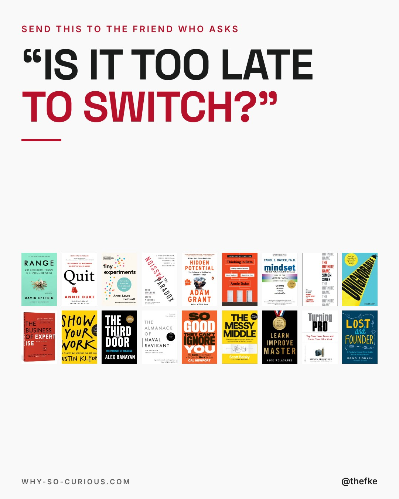
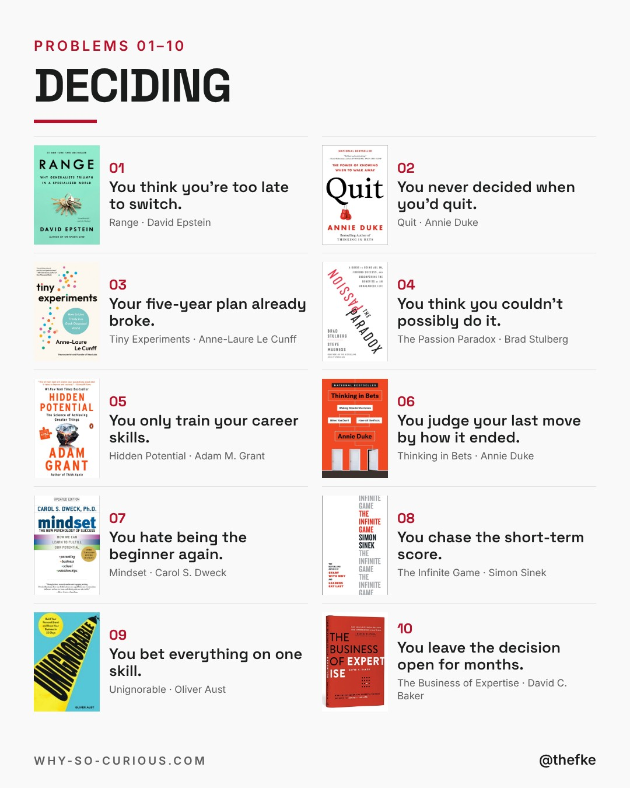
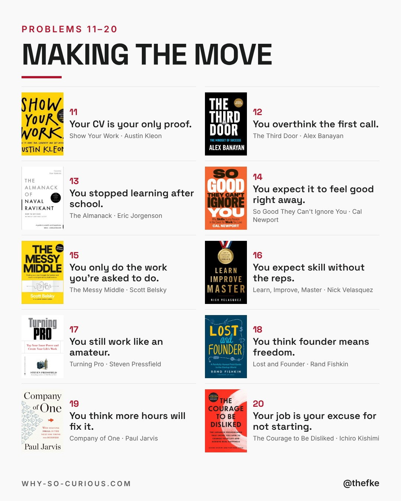
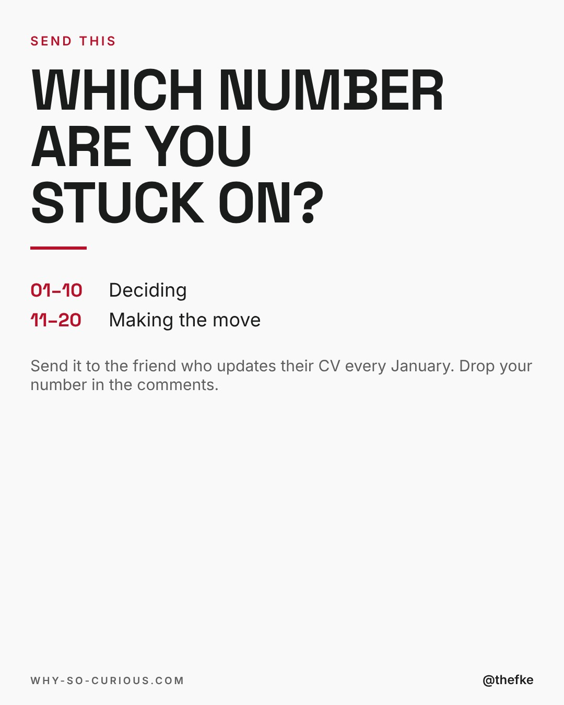

# So 03.01. · Career reset? 20 Problems, 20 Books

Karussell, 4 Slides. Beim Hochladen 4:5 wählen.

## Caption

```
“Is it too late to switch?”
The question everyone asks in January.

20 career problems.
20 books from my shelf.

10 about deciding.
10 about making the move.

David Epstein in Range, on a study of career paths:
“Forty-five of the first fifty subjects detailed professional paths so sinuous that they expressed embarrassment over jumping from thing to thing over their careers.”

Send this to the friend who updates their CV every January.

Which number are you stuck on?

Books from this post: link in bio.

#bookstagram #bookrecommendations #books
```

## Slides





