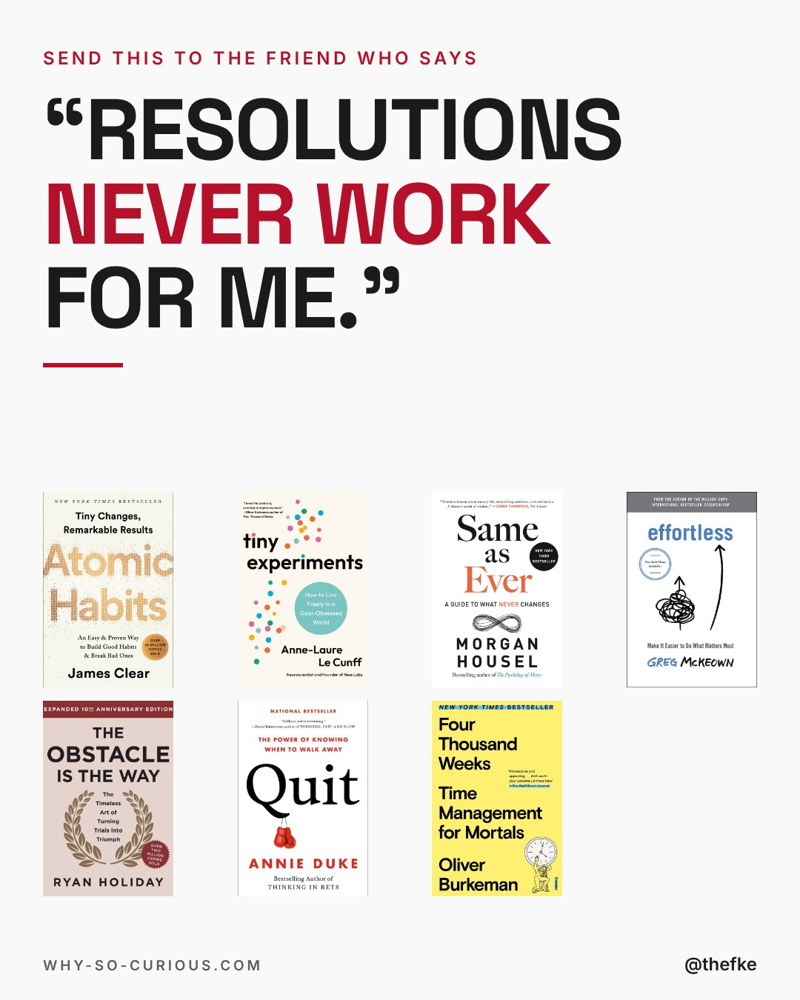
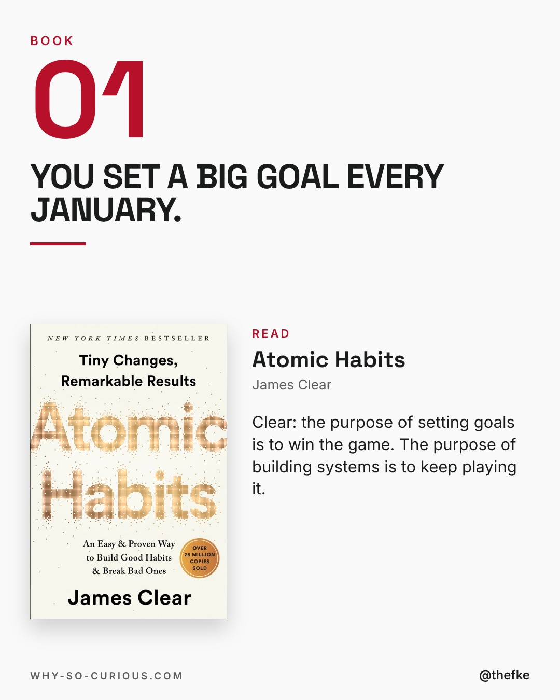
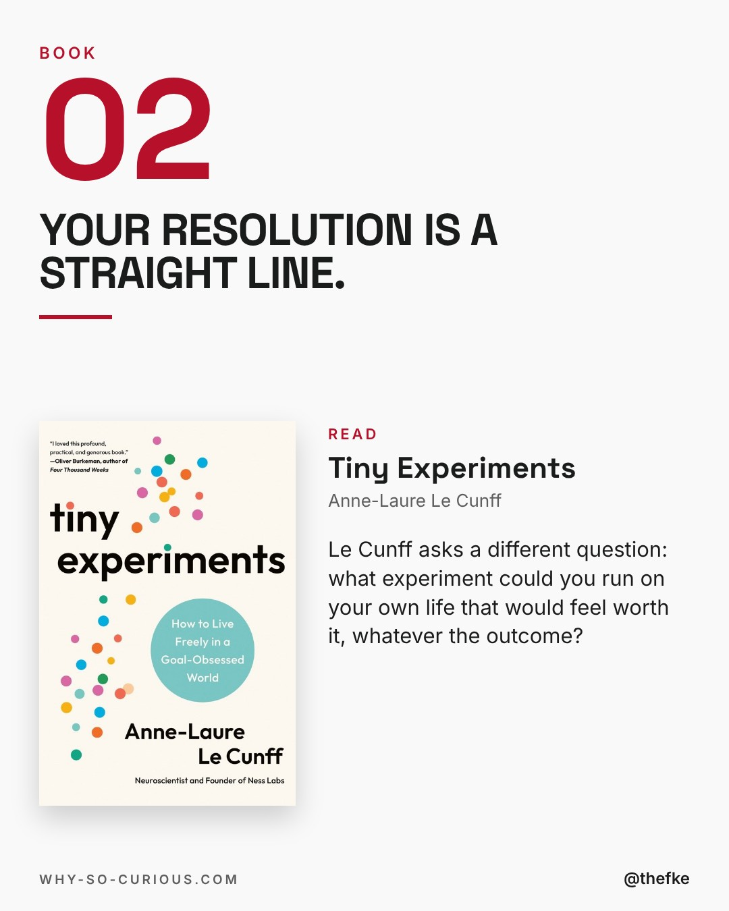
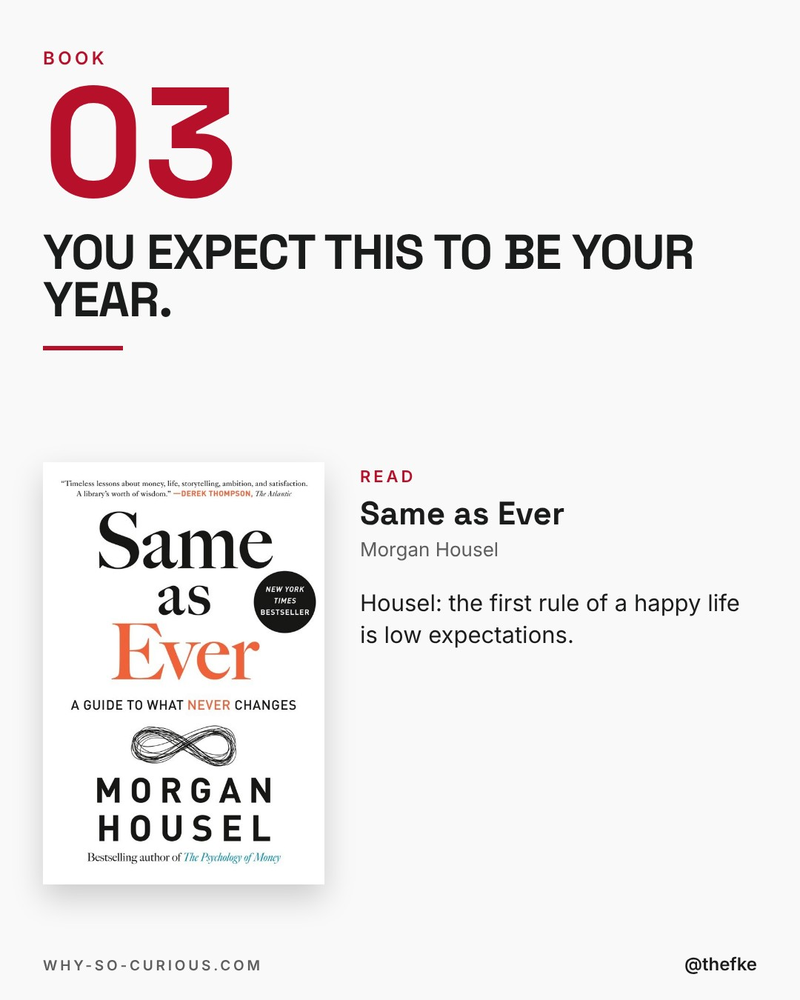
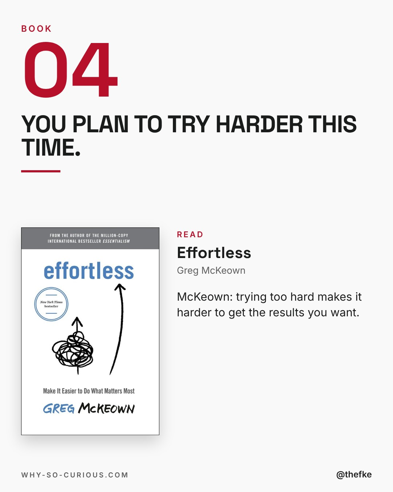
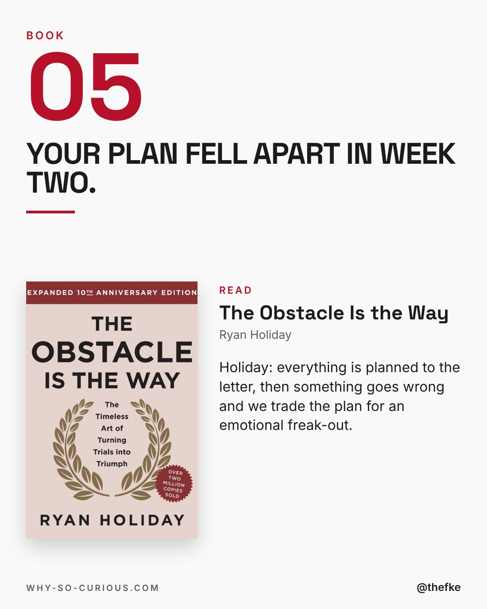
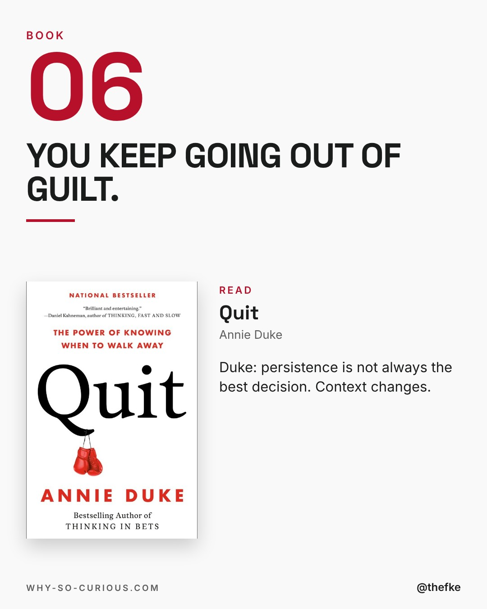
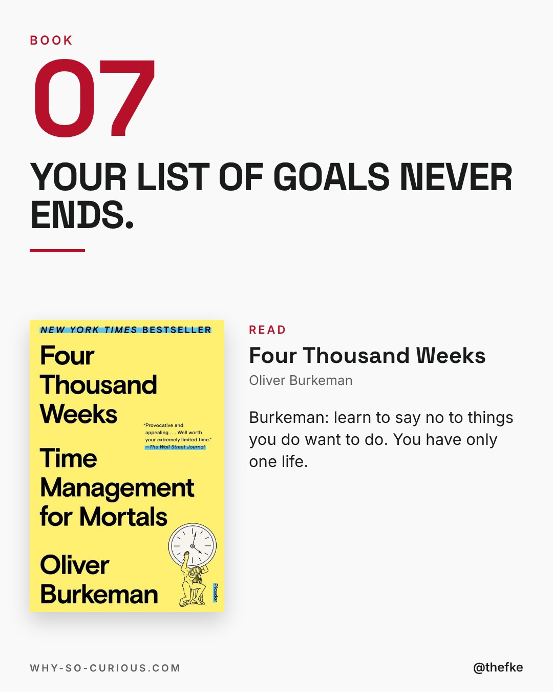
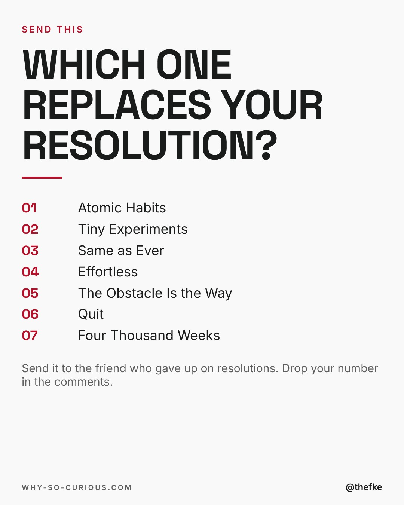

# So 03.01. · Books for people who hate New Year's resolutions

Abend-Slot. Karussell, 9 Slides. Beim Hochladen 4:5 wählen.

## Caption

```
“Resolutions never work for me.”
Good. Skip them this year.

Seven books for a year without resolutions.
Systems. Experiments. Lower expectations.
And permission to quit.

James Clear in Atomic Habits:
“The goal is not to read a book, the goal is to become a reader.”

All from my shelf.

Send this to the friend who already gave up on resolutions.

Which one replaces your resolution?

Books from this post: link in bio.

#bookstagram #bookrecommendations #books
```

## Slides










