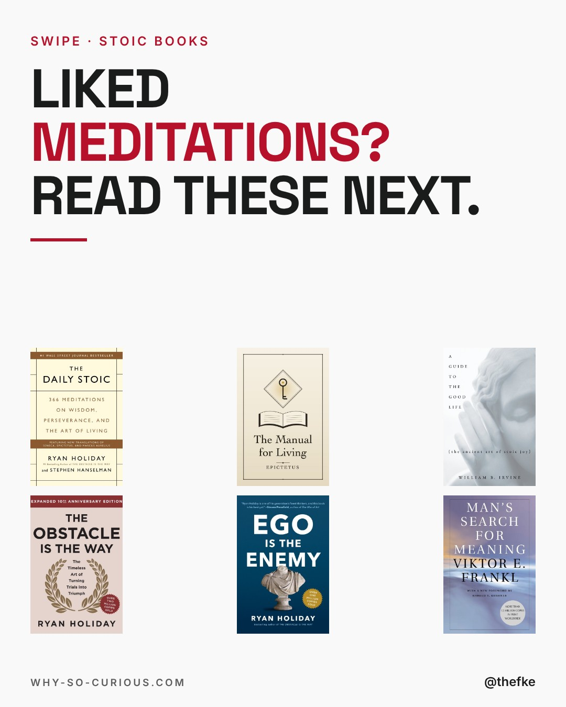
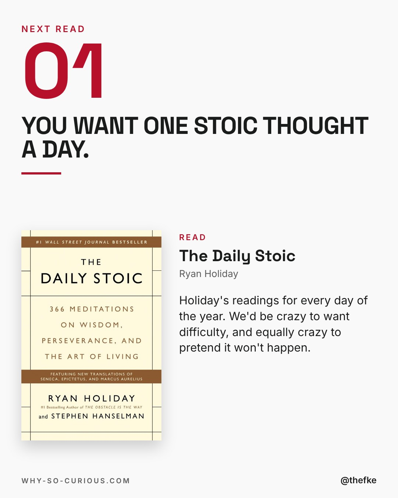
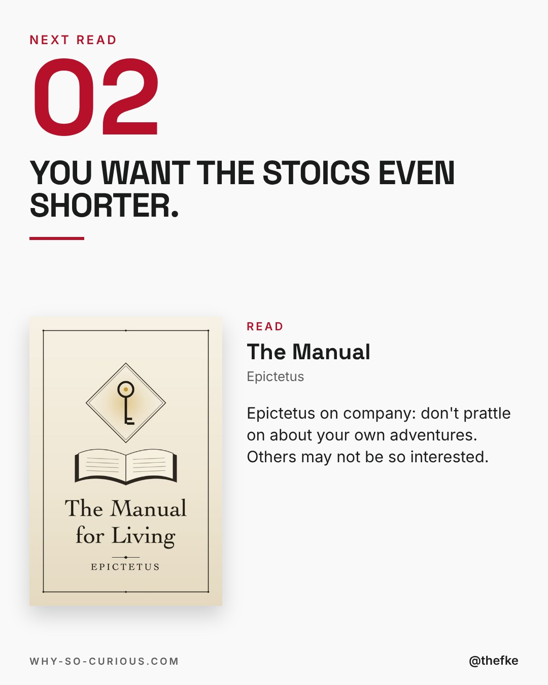
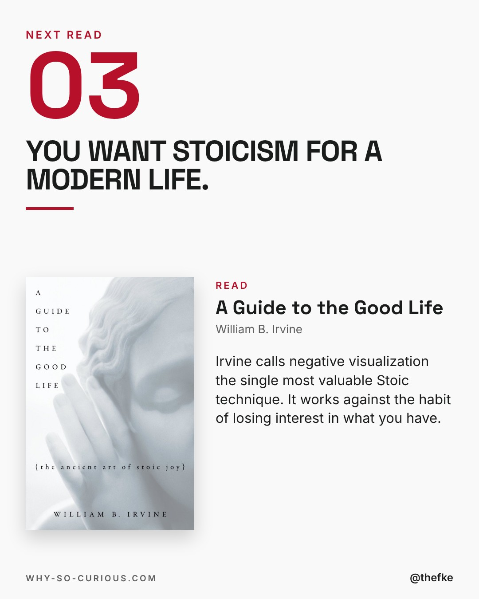
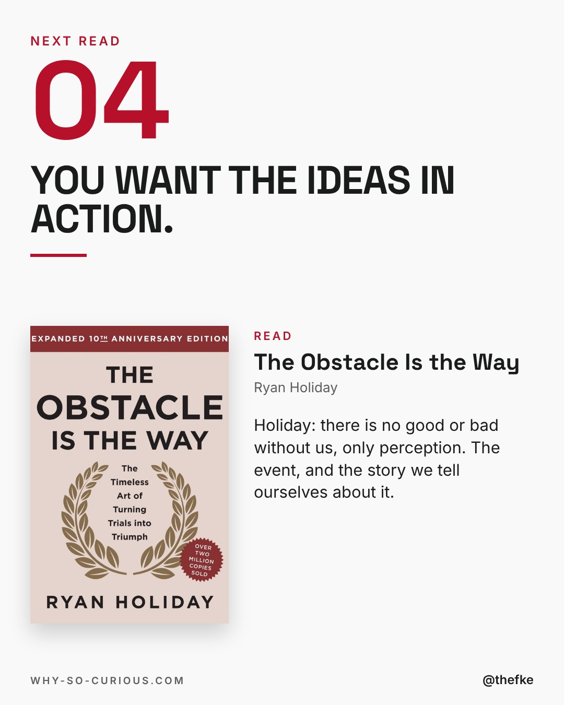
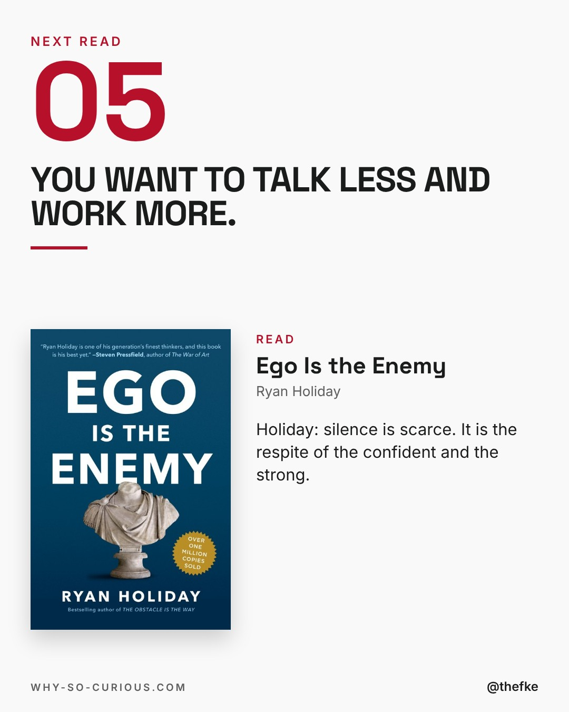
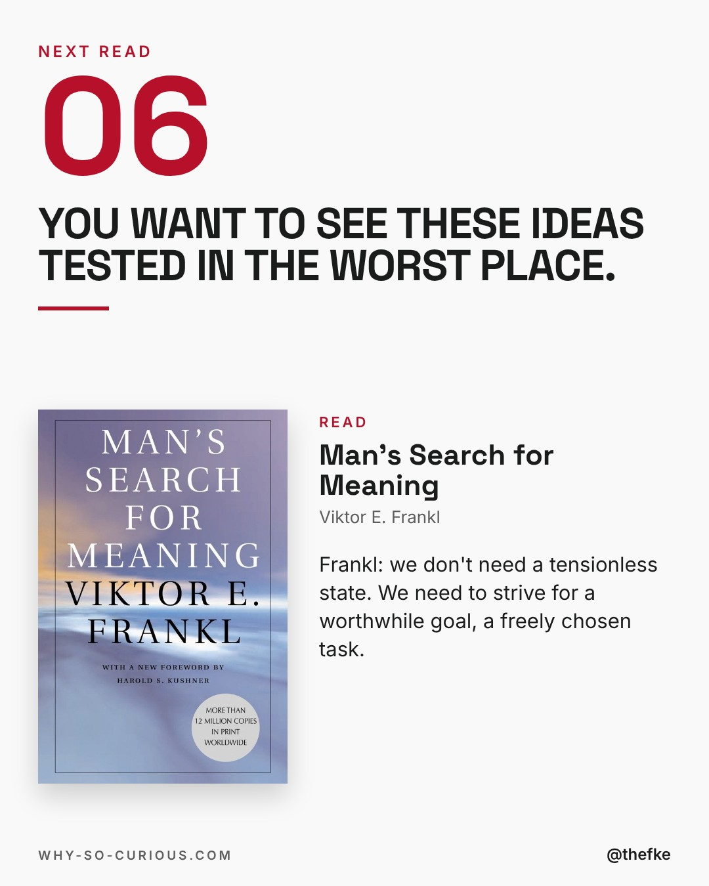
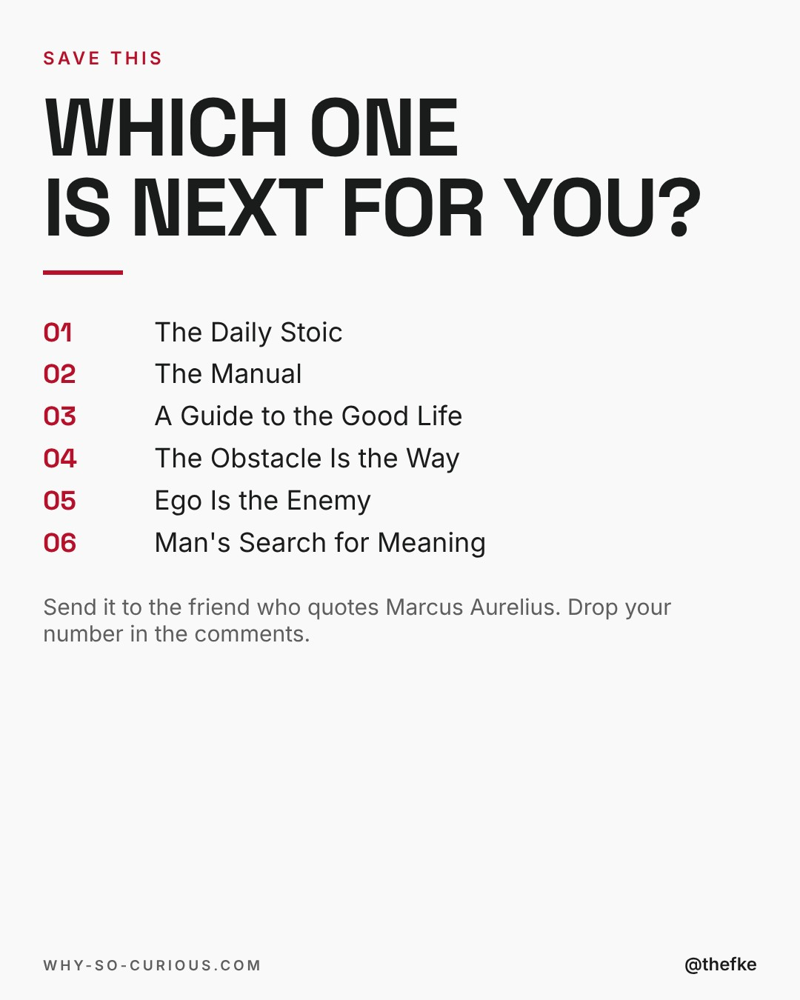

# Mo 04.01. · Liked Meditations? Read these next

Abend-Slot. Karussell, 8 Slides. Beim Hochladen 4:5 wählen.

## Caption

```
You finished Meditations.
Now you want more of that calm.

Six books that keep it going.
One Stoic thought a day. Epictetus, even shorter.
A modern guide. The obstacle. The ego. And Frankl.

One line from The Daily Stoic:
“We'd be crazy to want to face difficulty in life. But we'd be equally crazy to pretend that it isn't going to happen.”

All from my shelf.

Send this to the friend who quotes Marcus Aurelius.

Which one is next for you?

Books from this post: link in bio.

#bookstagram #bookrecommendations #books
```

## Slides









