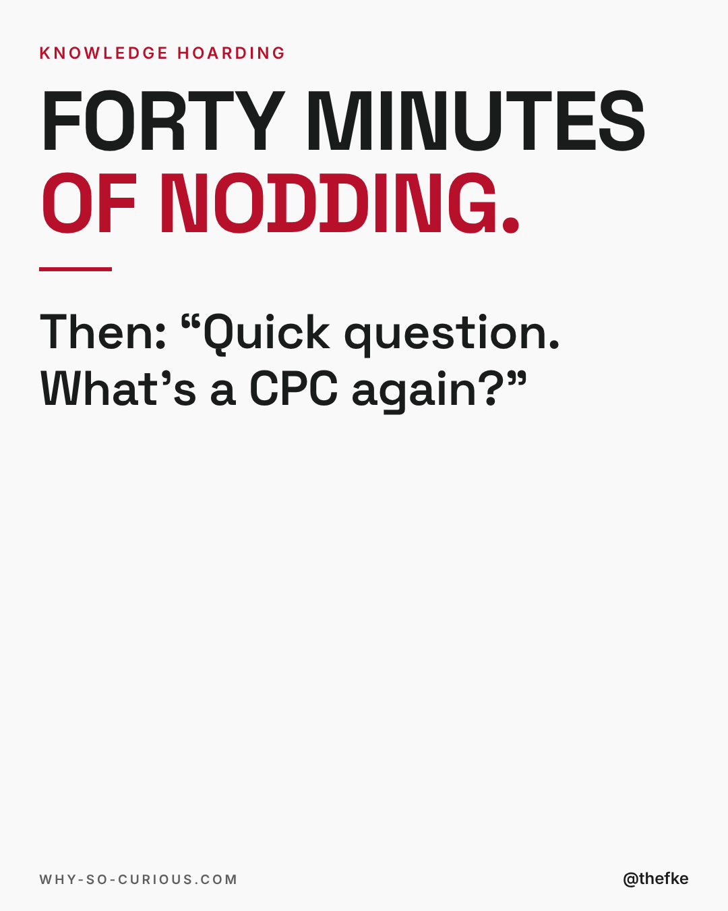
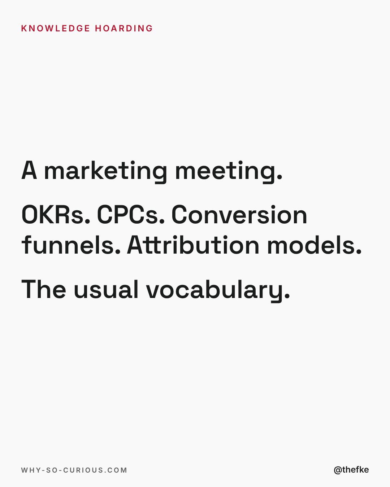
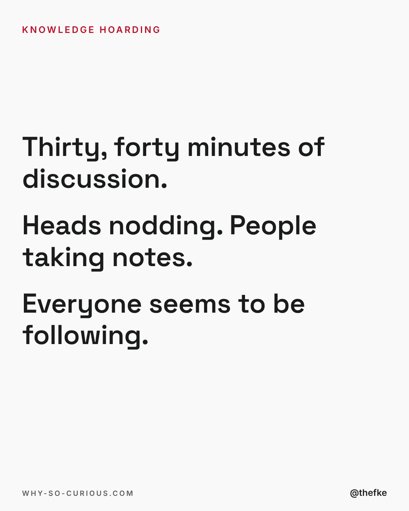
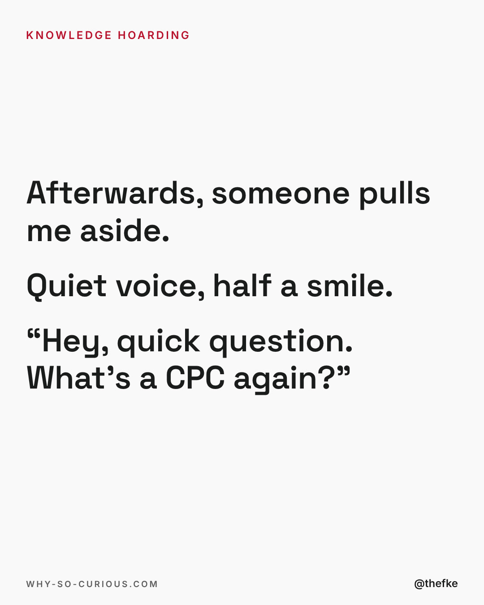
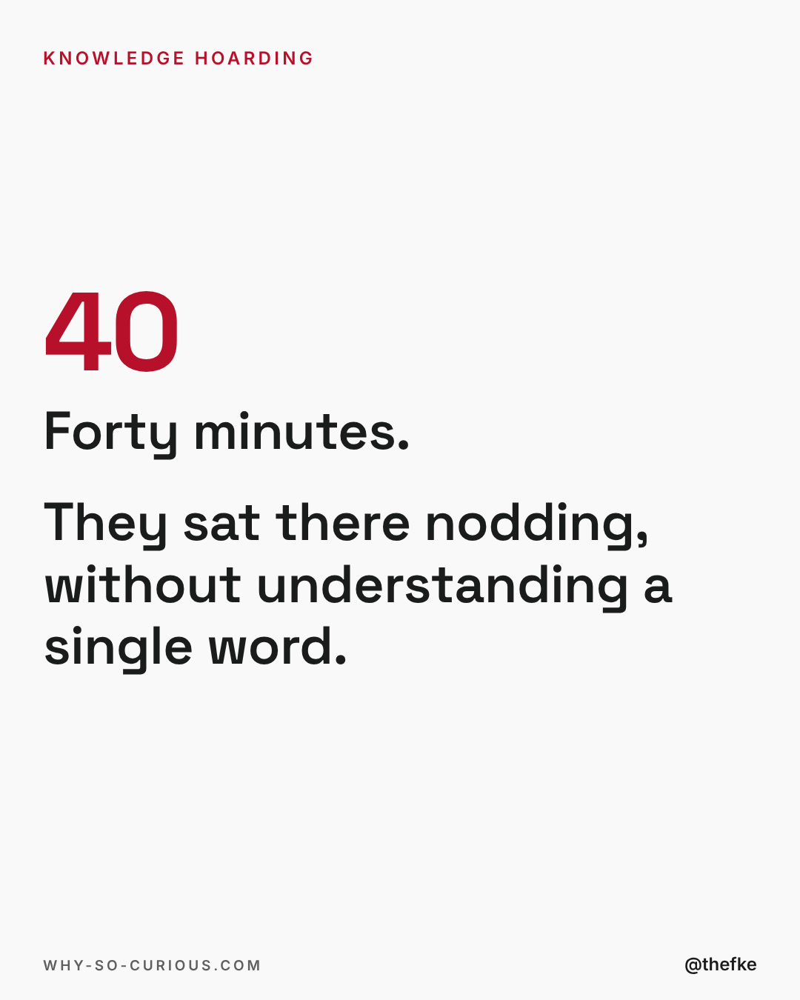
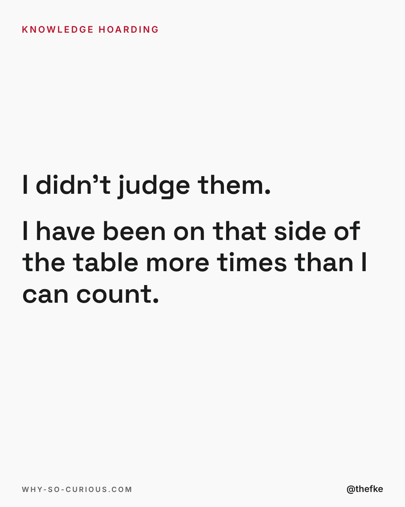
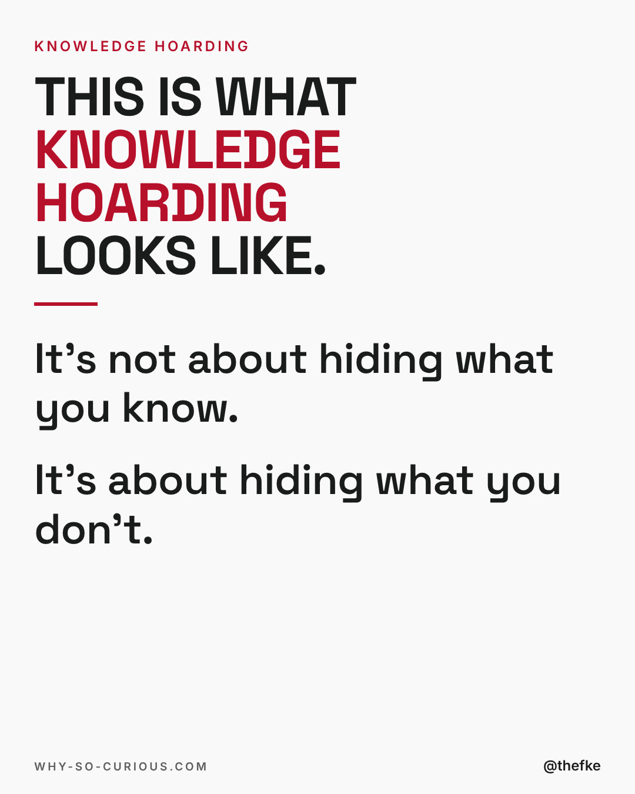
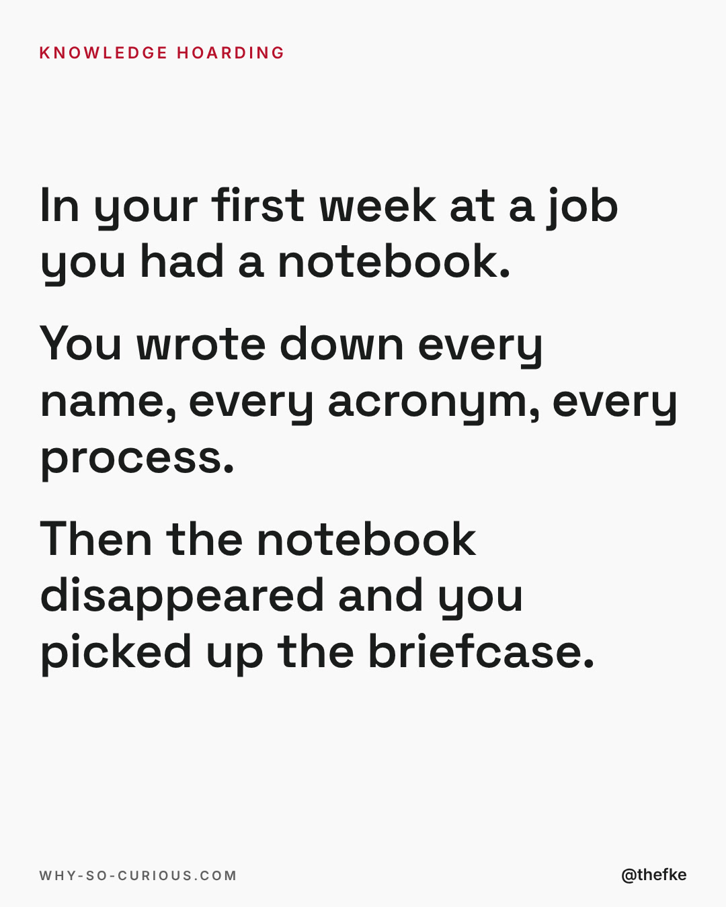
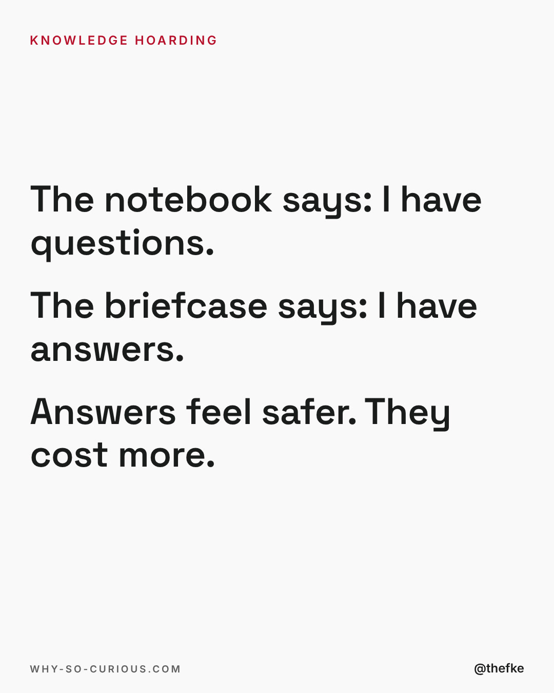
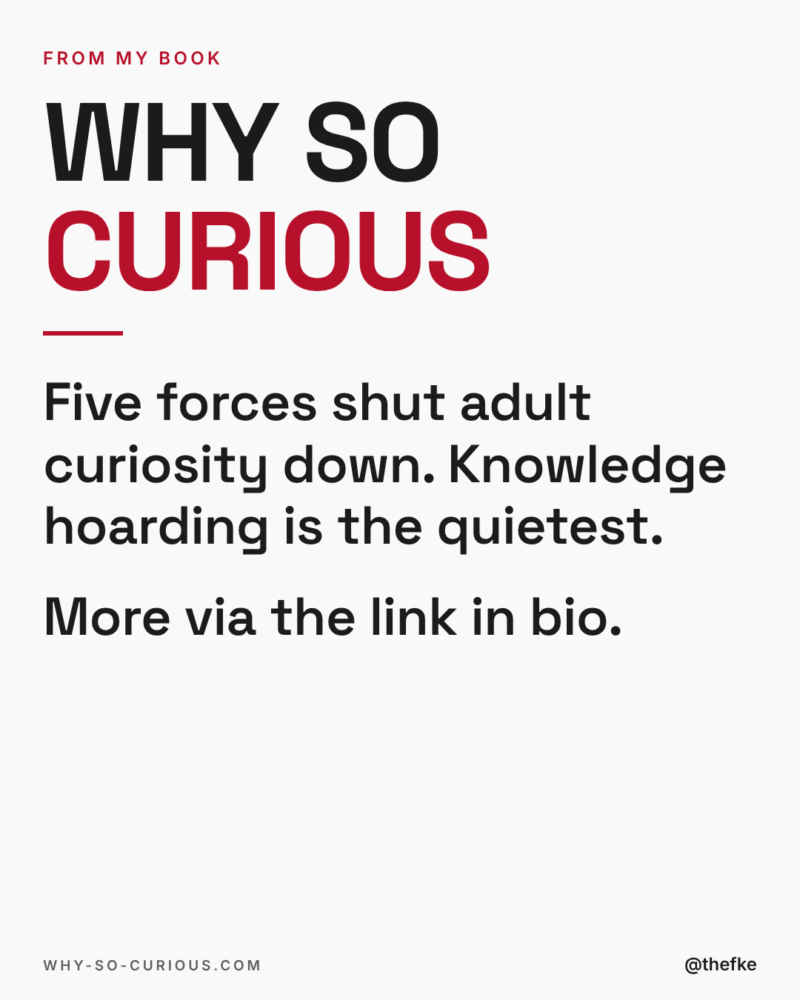

# Mo 04.01. · Forty minutes of nodding

Karussell, 10 Slides. Beim Hochladen 4:5 wählen.

Buchkampagne, Vorschlag zum Kampagnenstart. Termin nach dem Buchplan verschieben.

Quelle: `thomas-hefke-os/knowledge/06-content/posts/`, gebaut mit `wsc-web/tools/social/story.mjs`.

## Caption

```
Forty minutes of nodding, then a whispered question in the hallway. I think about that moment a lot.

The person who asked me wasn't slow. They were doing what almost everyone in that room had learned to do: protect the appearance of competence. Asking would have cost them something. So they paid a different price instead.

I wrote a whole chapter about this. It's called Knowledge Hoarding, and it is the quietest of the five forces that shut adult curiosity down.

What's the term everyone at your company uses that you have never actually looked up? No judgement here. I'll start: it took me two years in hospitality to admit I had no idea what RevPAR meant.

#curiosity #leadership #worklife #imposter #whysocurious
```

## Slides











