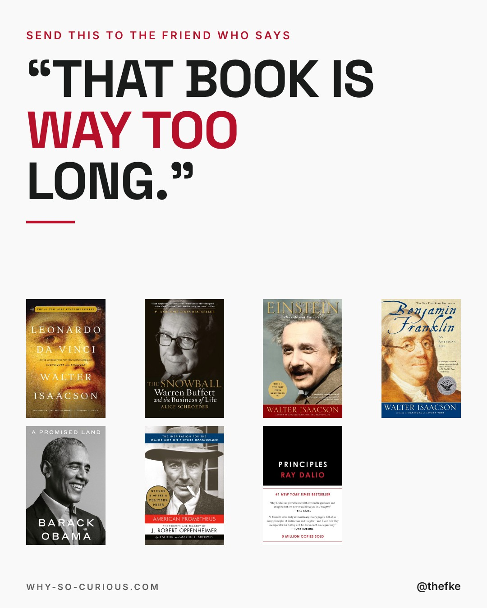
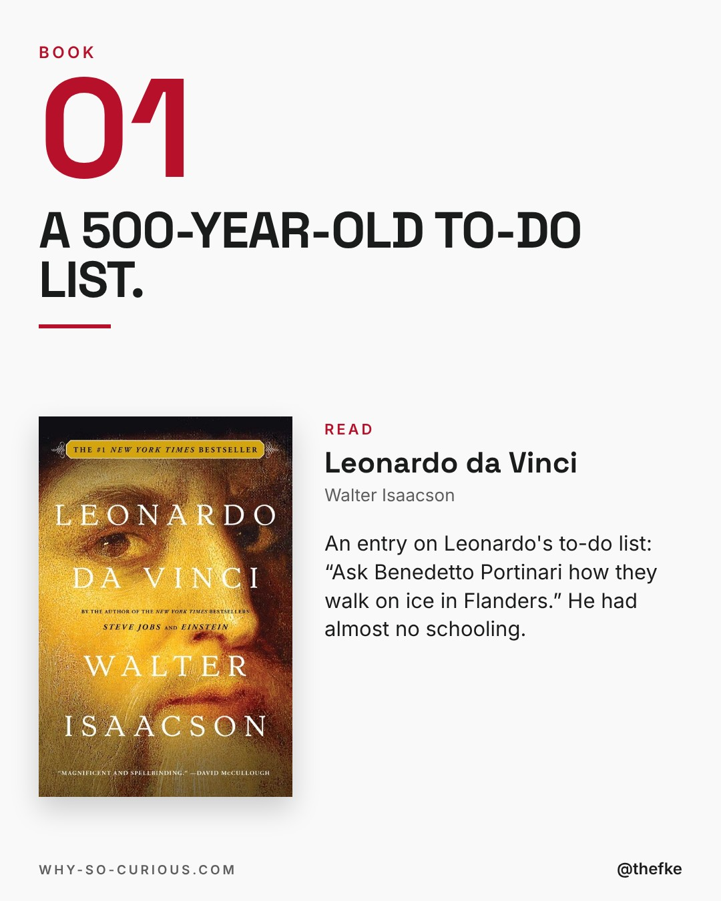
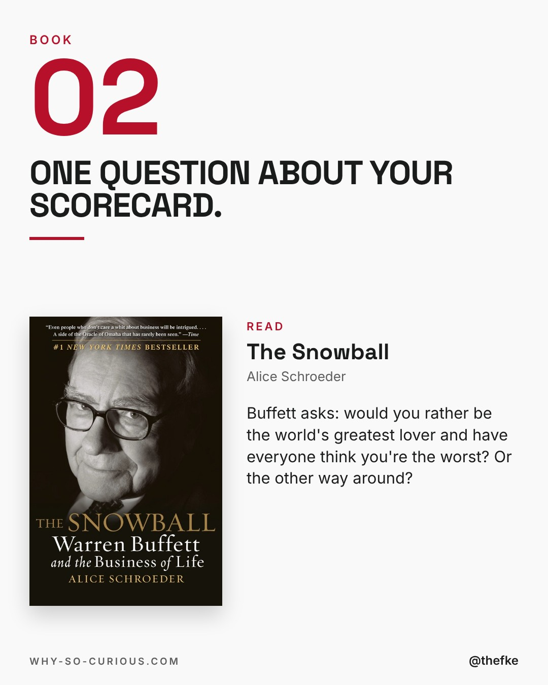
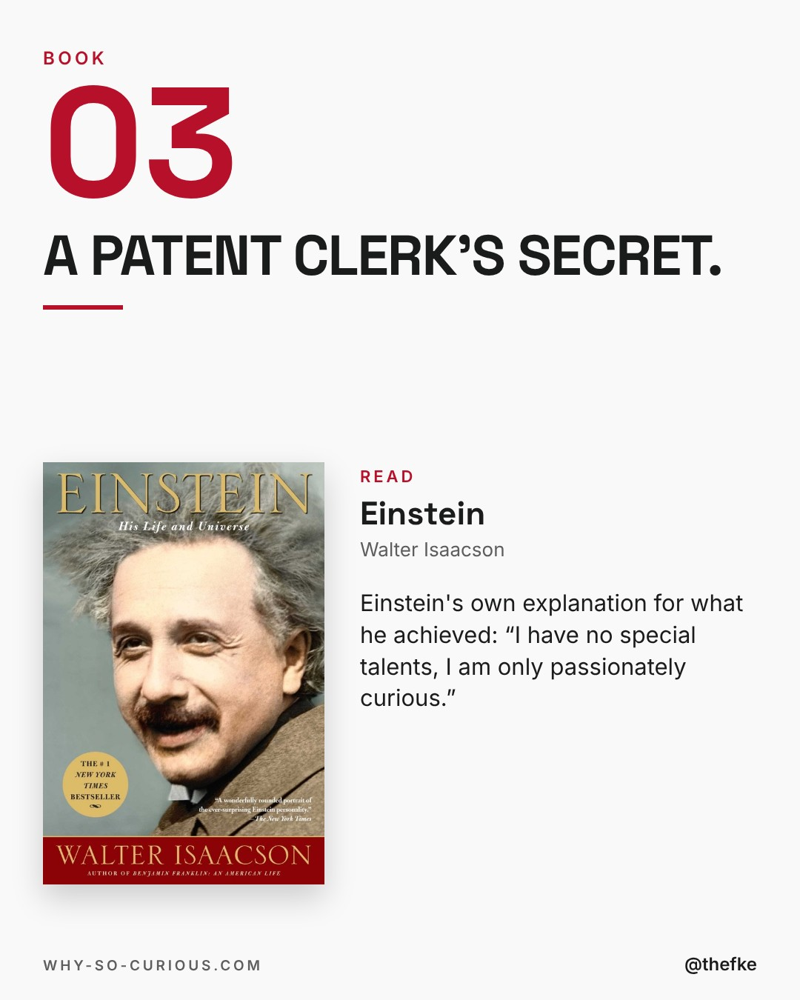
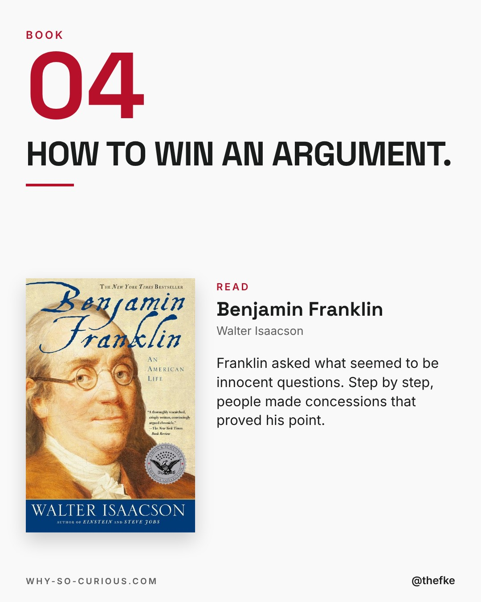
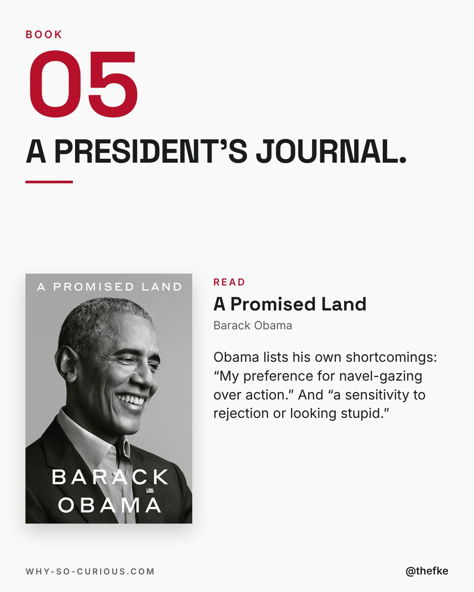
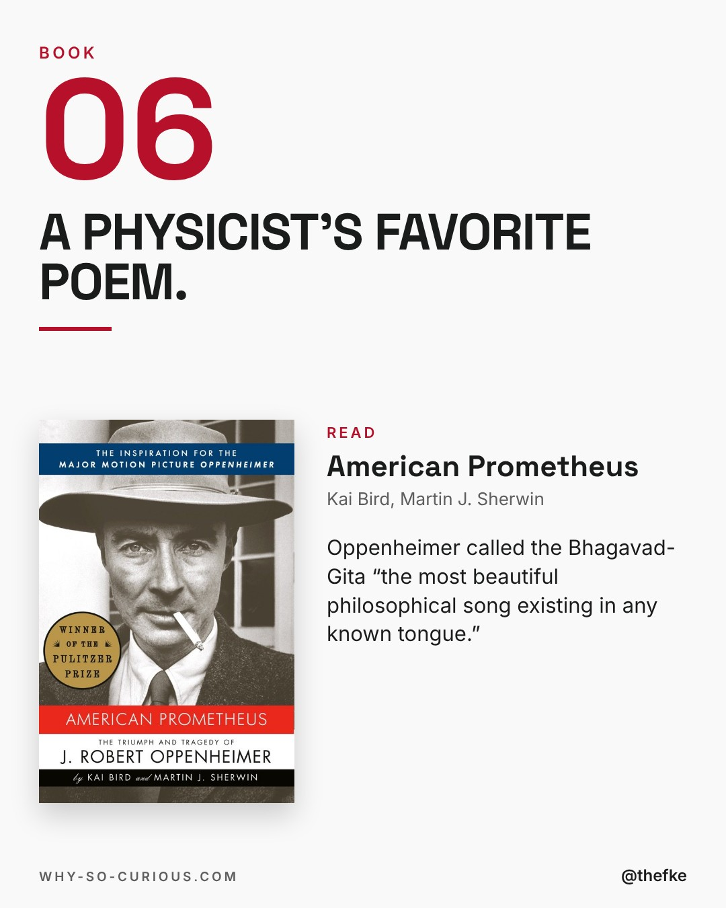
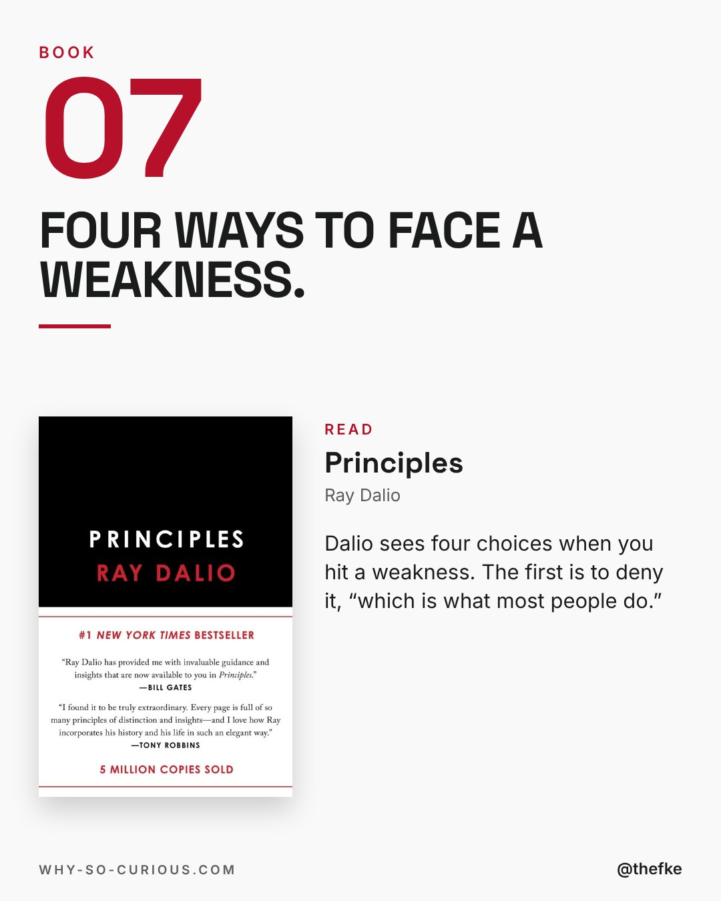
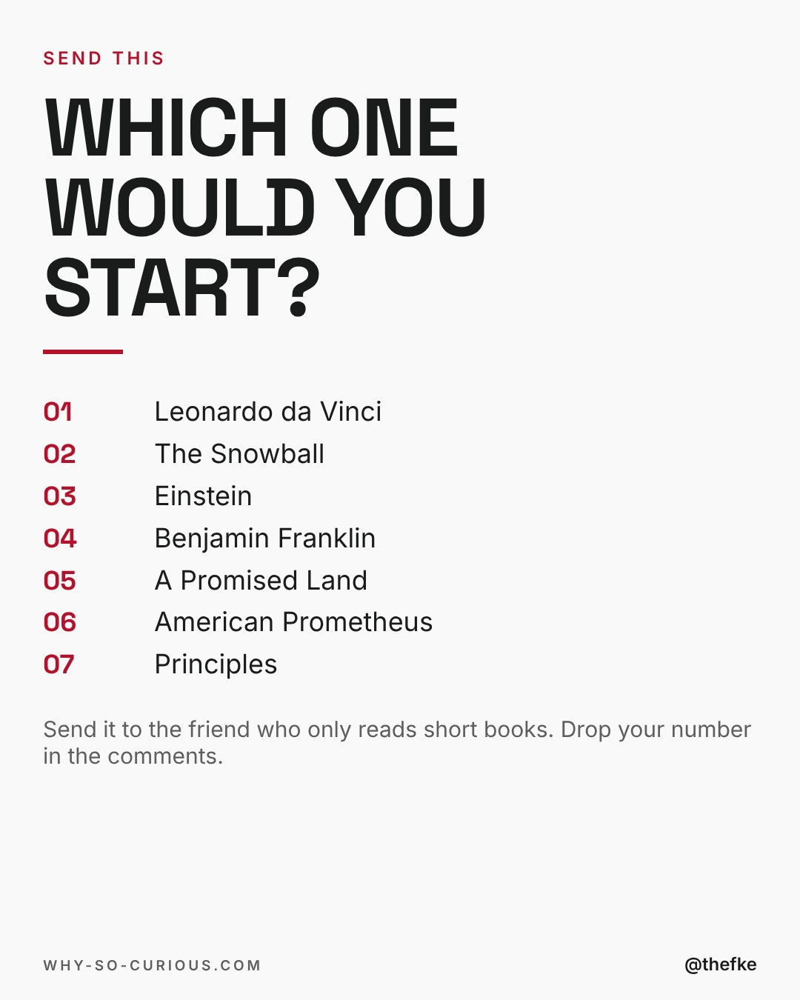

# Mo 04.01. · “That book is way too long.” Seven worth every page

Früh-Slot, wird automatisch gepostet (ohne Musik). Nicht von Hand posten. Karussell, 9 Slides. Beim Hochladen 4:5 wählen.

## Caption

```
“That book is way too long.”
Some long books pay you back on almost every page.

Seven thick ones from my shelf.
One detail from each that made the weight worth it.

A to-do list from Leonardo.
A question Buffett asks about your scorecard.
The journal of a president who doubted himself.

Walter Isaacson in Leonardo da Vinci:
“Leonardo had almost no schooling and could barely read Latin or do long division.”

Start with one. Read ten pages a day.

Send this to the friend who only reads short books.

Which one would you start?

Books from this post: link in bio.

#bookstagram #bookrecommendations #books
```

## Slides










