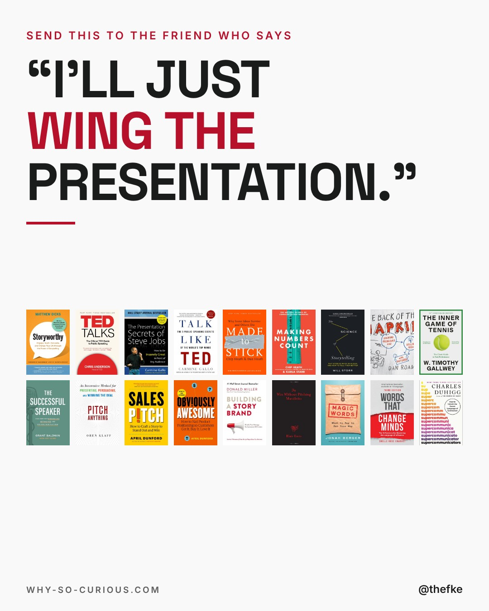
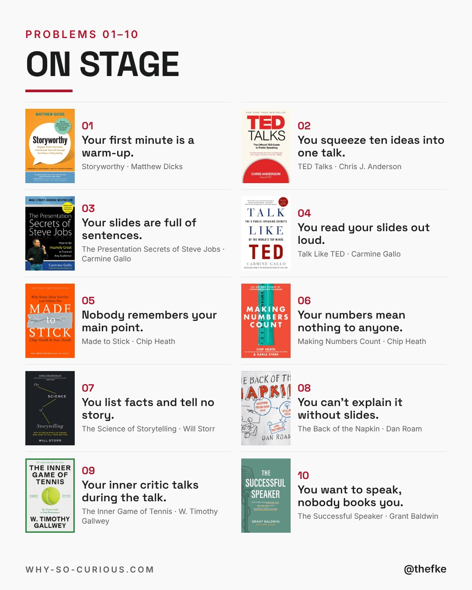
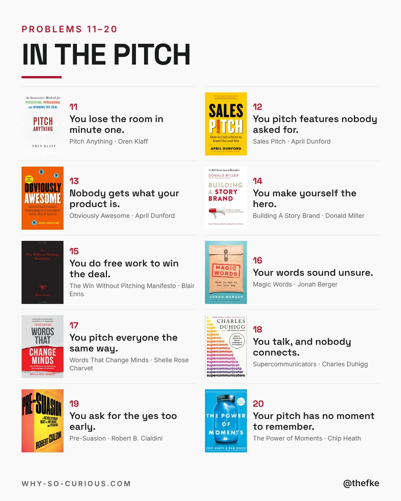
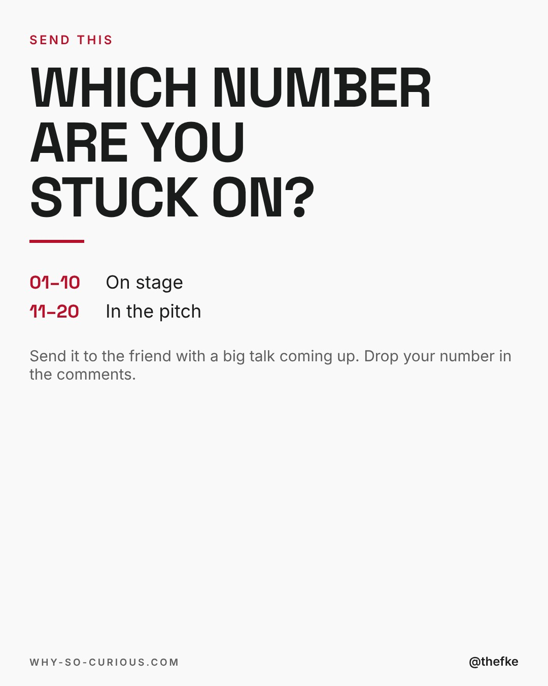

# Di 05.01. · 20 Presentation Problems, 20 Books

Früh-Slot, wird automatisch gepostet (ohne Musik). Nicht von Hand posten. Karussell, 4 Slides. Beim Hochladen 4:5 wählen.

## Caption

```
“I'll just wing the presentation.”
Then the first slide comes up and your mind goes blank.

20 presentation problems.
20 books from my shelf that help.

10 on stage.
10 in the pitch.

Chip and Dan Heath in Made to Stick:
“One important implication of the gap theory is that we need to open gaps before we close them. Our tendency is to tell people the facts.”

Send this to the friend with a big talk coming up.

Which number are you stuck on?

Books from this post: link in bio.

#bookstagram #bookrecommendations #books
```

## Slides





