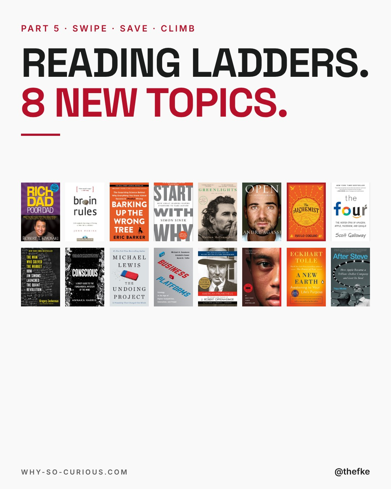
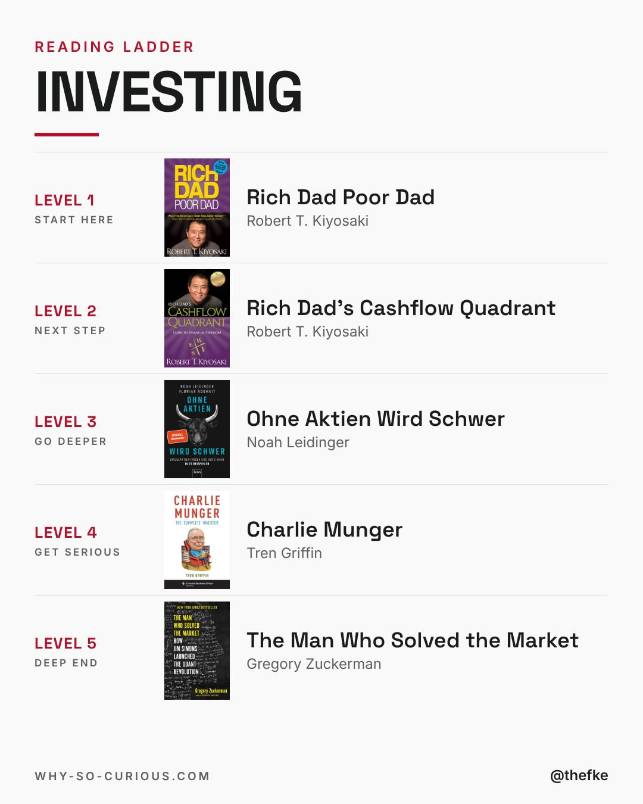
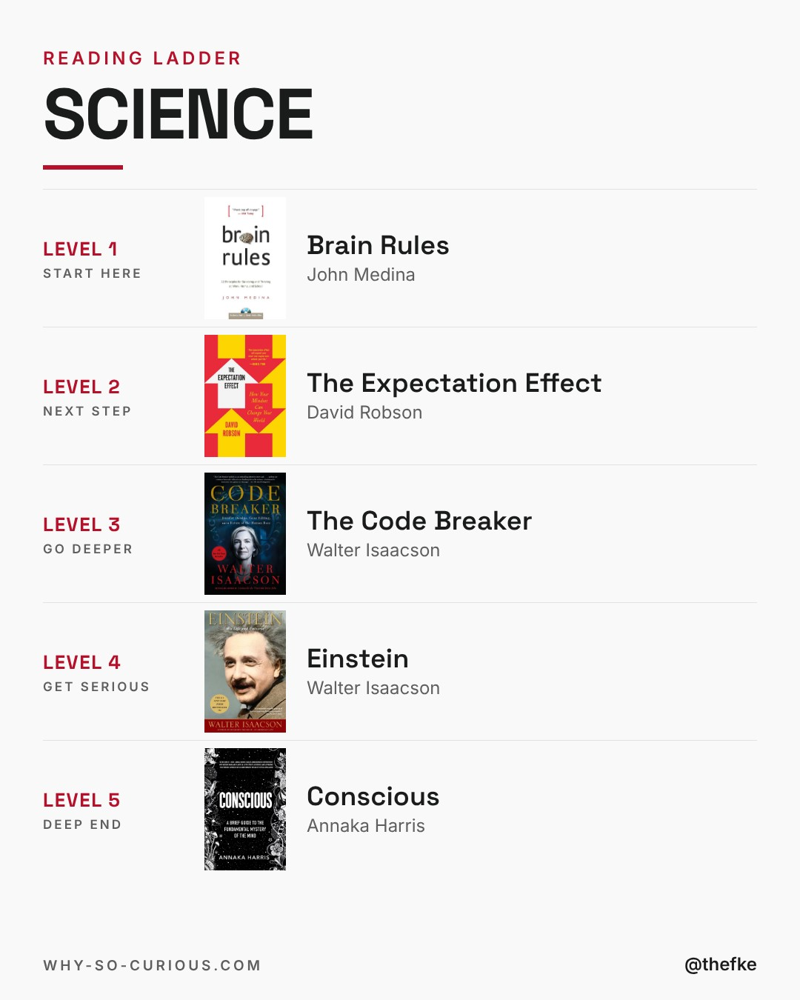
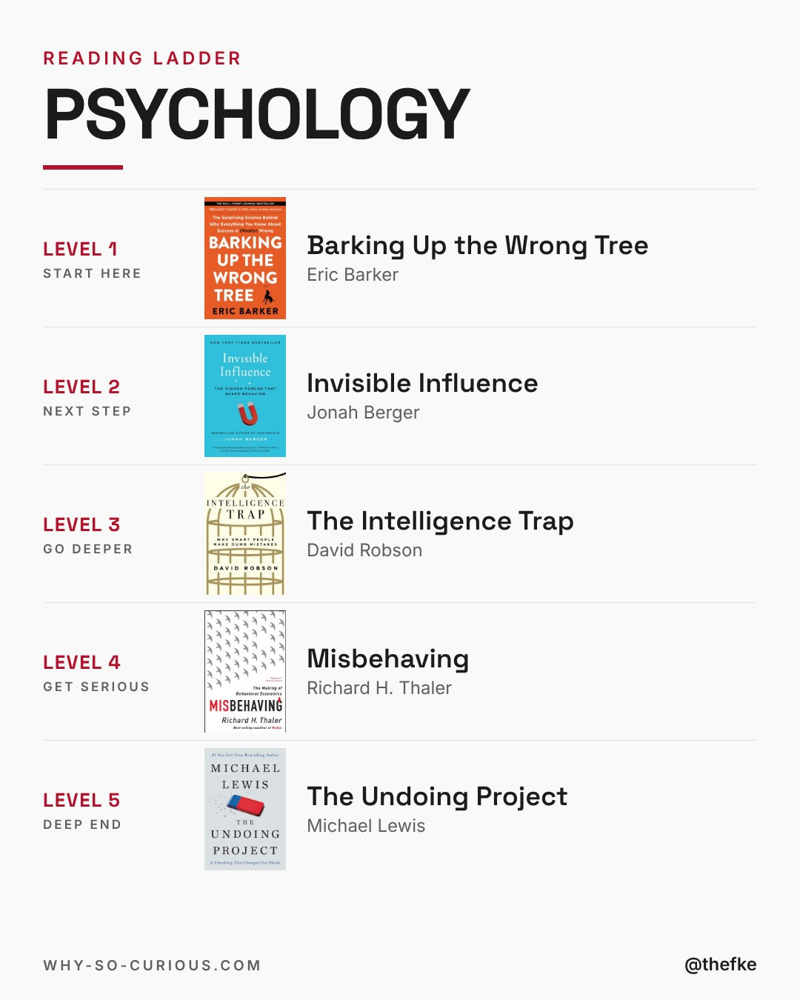
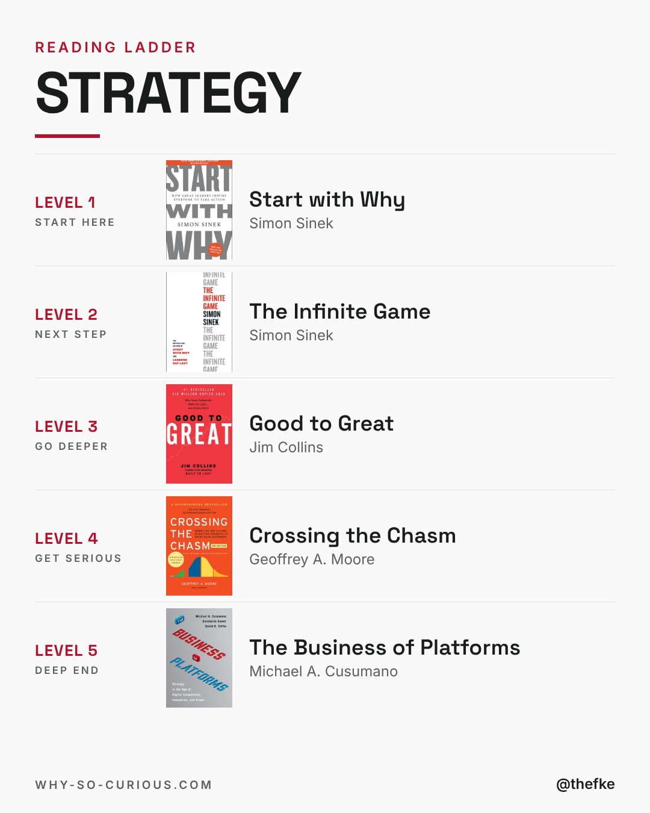
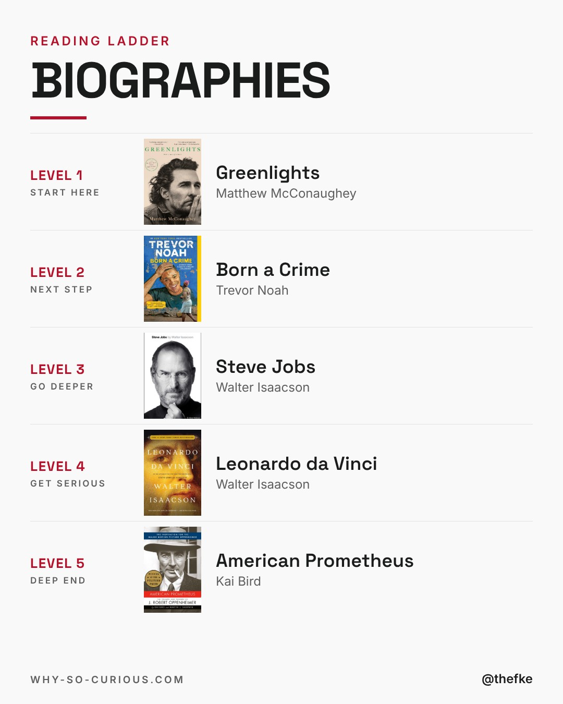
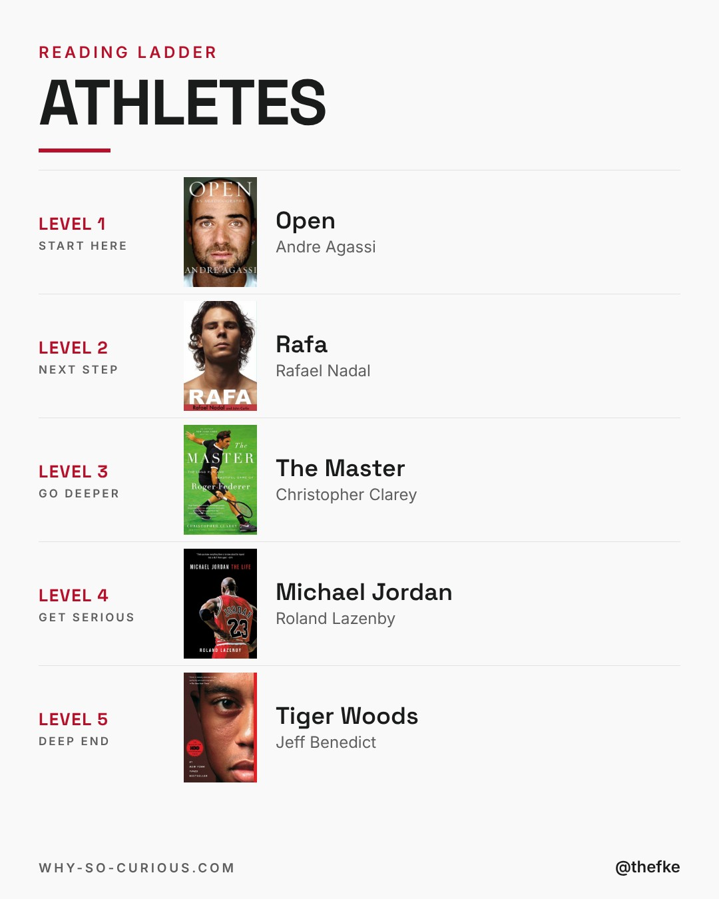
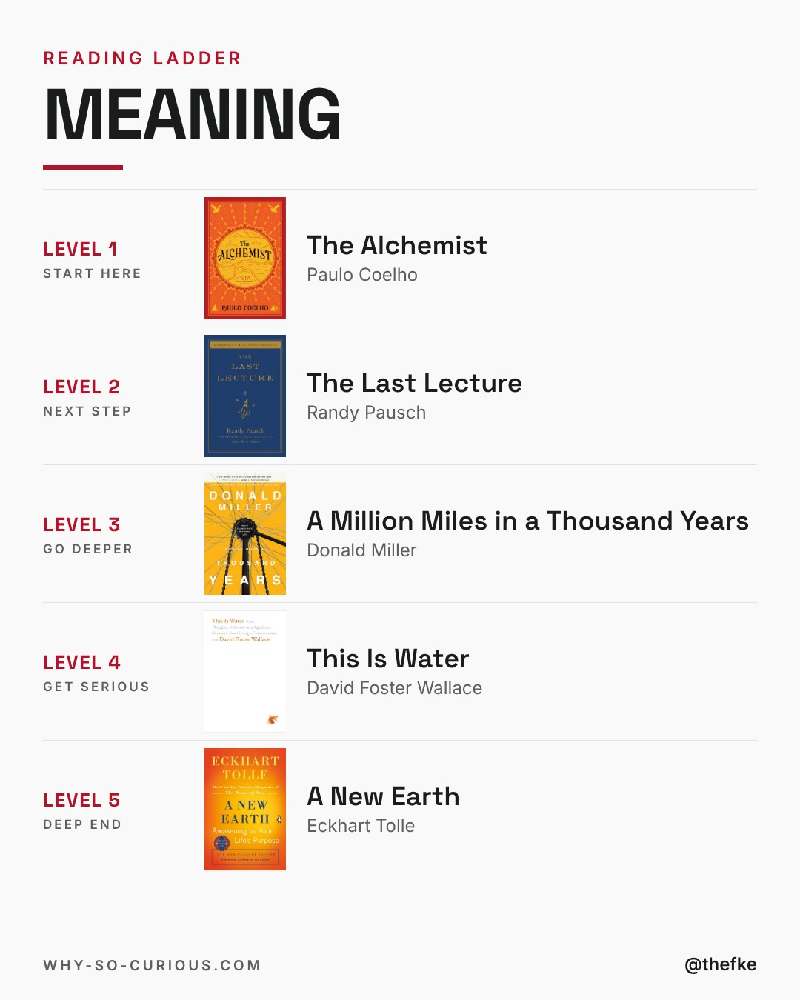
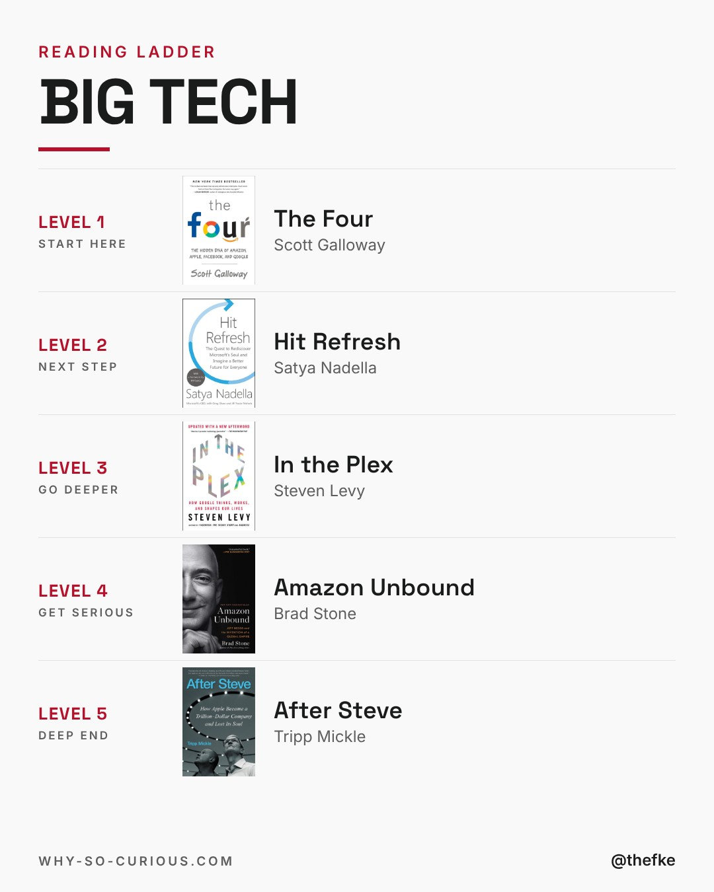
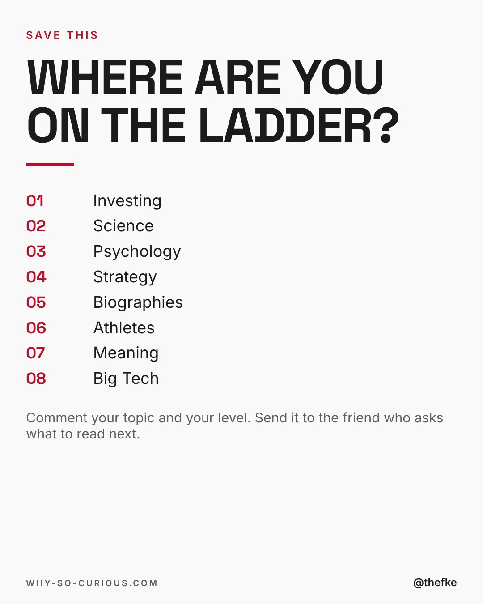

# Di 05.01. · Reading Ladders, Part 5

Karussell, 10 Slides. Beim Hochladen 4:5 wählen.

## Caption

```
Reading ladders, part 5.

Investing, science, psychology, strategy.
Biographies, athletes, meaning, big tech.

5 levels each.
Level 1 gets you in. Level 5 is the deep end.

The meaning ladder has David Foster Wallace on level 4:
“‘Learning how to think’ really means learning how to exercise some control over how and what you think.”

All 40 books from my shelf.

Save it and climb one step at a time.
Send it to the friend who asks what to read next.

Which topic, which level?

Books from this post: link in bio.

#bookstagram #bookrecommendations #books
```

## Slides











