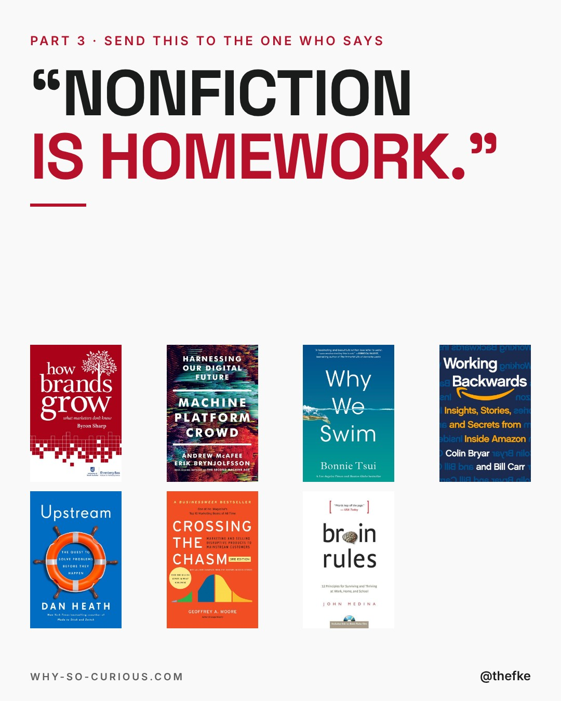
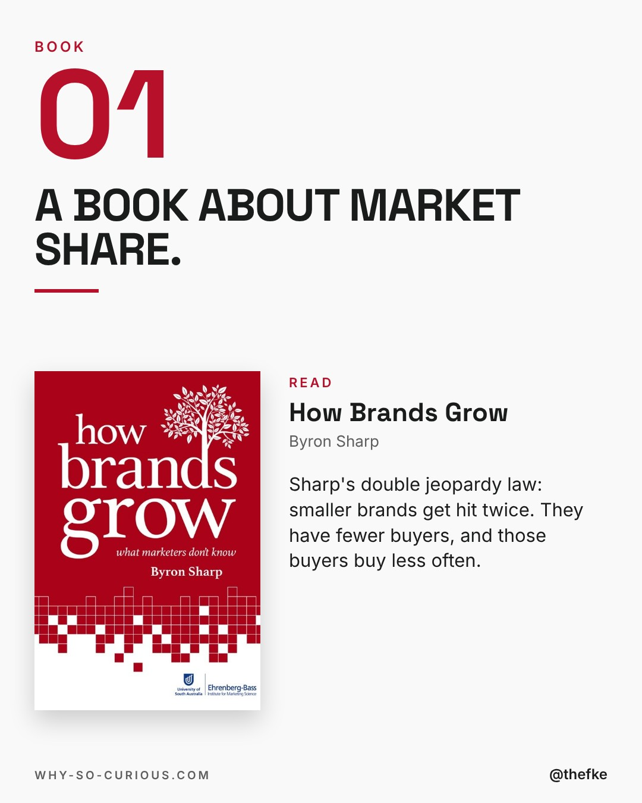
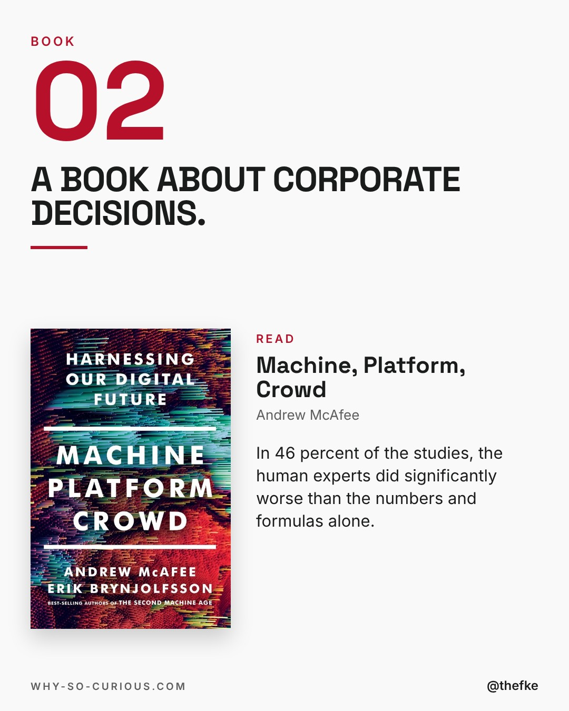
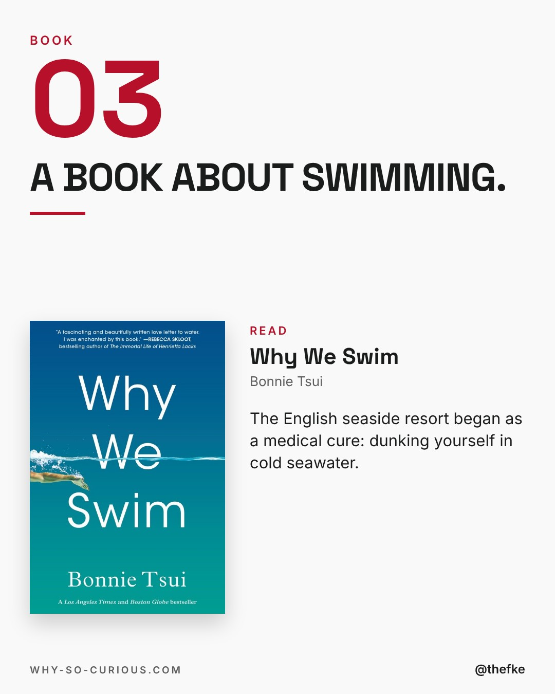
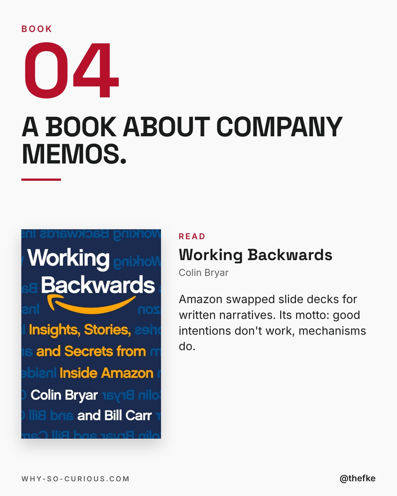
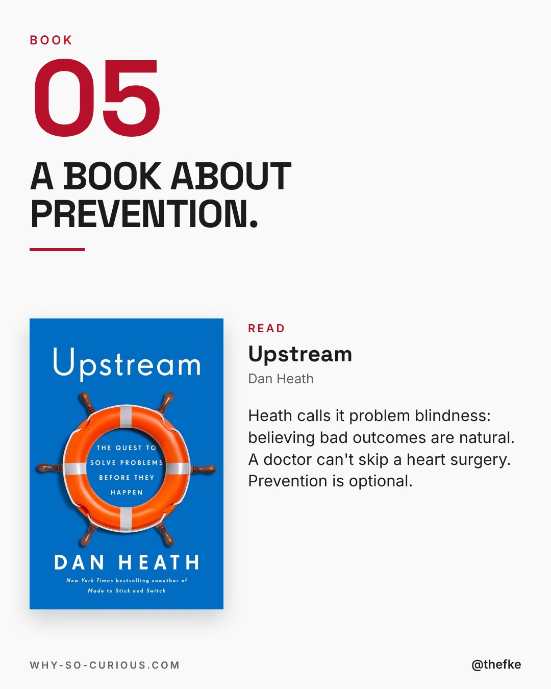
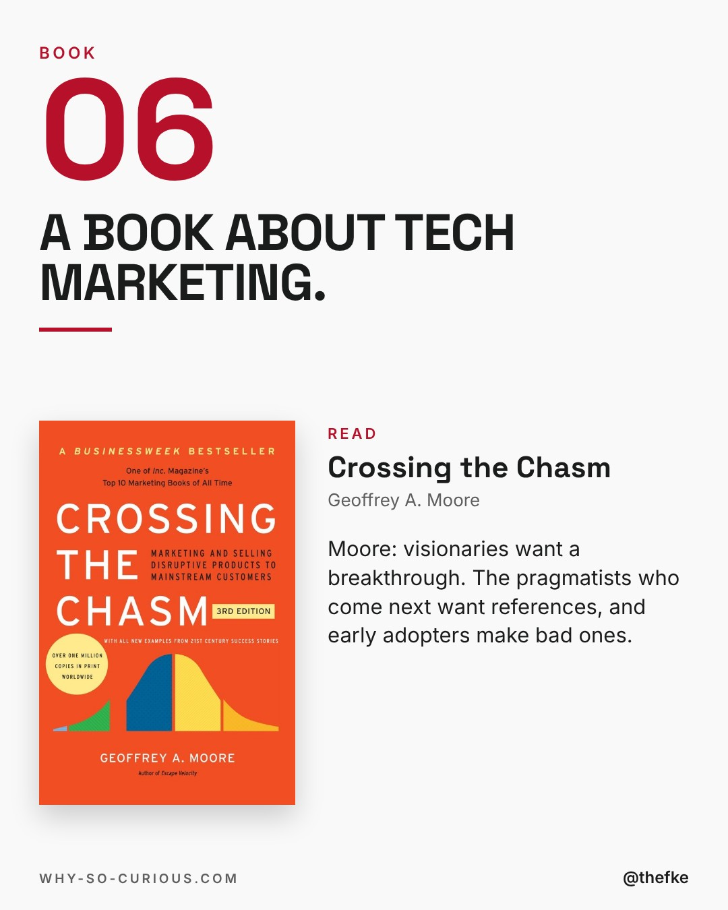
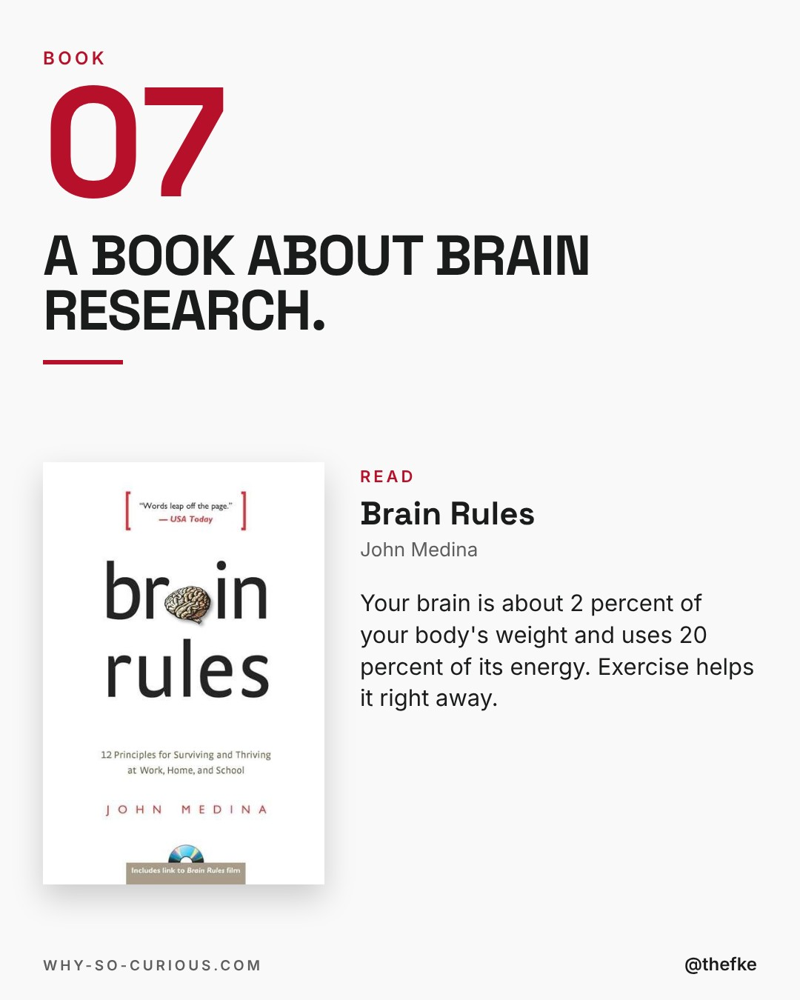
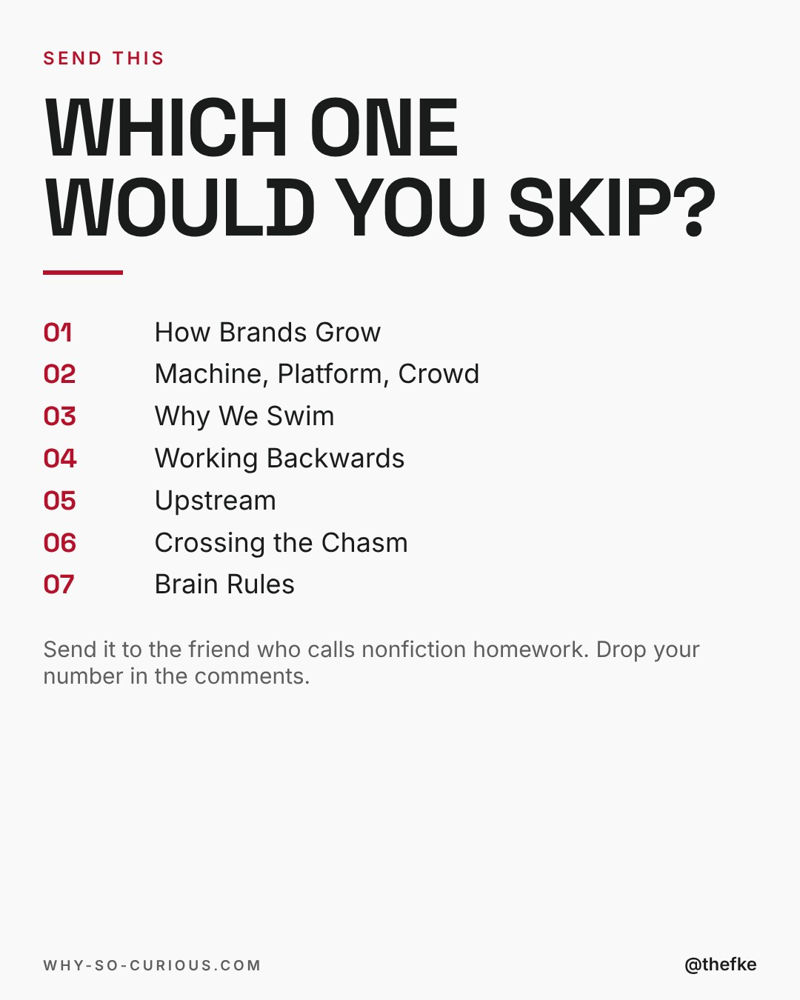

# Di 05.01. · Books that sound boring. They aren't, Part 3

Abend-Slot. Karussell, 9 Slides. Beim Hochladen 4:5 wählen.

## Caption

```
“Nonfiction is homework.”
Seven more books that look like it.

Market share. Memos. Swimming. Prevention.
Every one has a detail you'll repeat at dinner.

The wildest detail is in Machine, Platform, Crowd.
In 46 percent of the studies considered, “the human experts actually performed significantly worse than the numbers and formulas alone.”

All from my shelf.

Send this to the friend who still calls nonfiction homework.

Which one would you have skipped?

Books from this post: link in bio.

#bookstagram #bookrecommendations #books
```

## Slides










