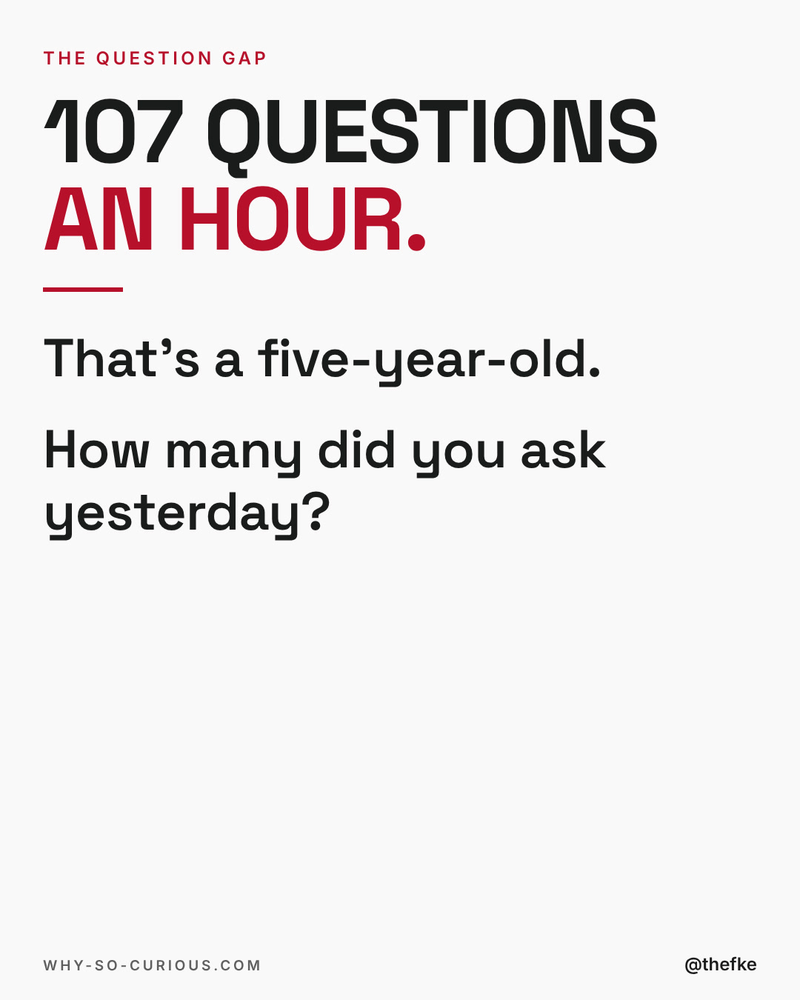
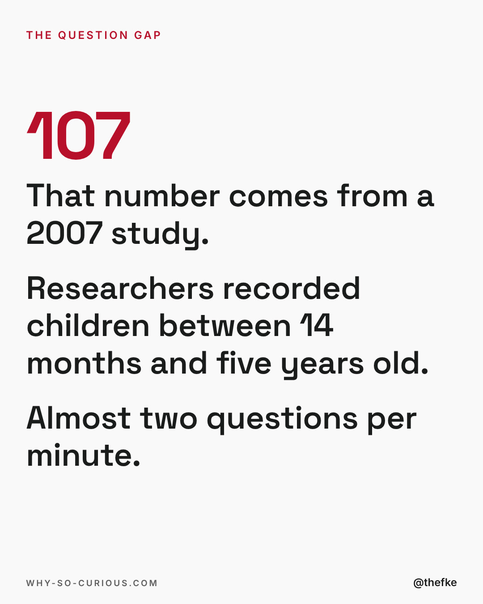
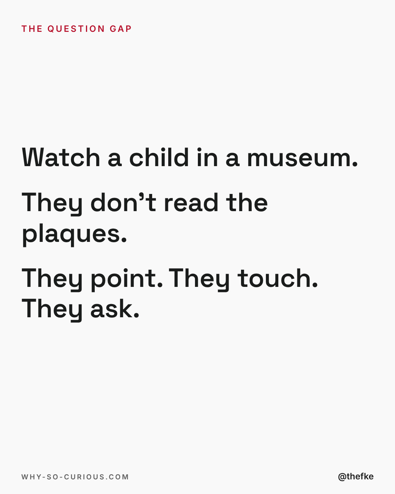
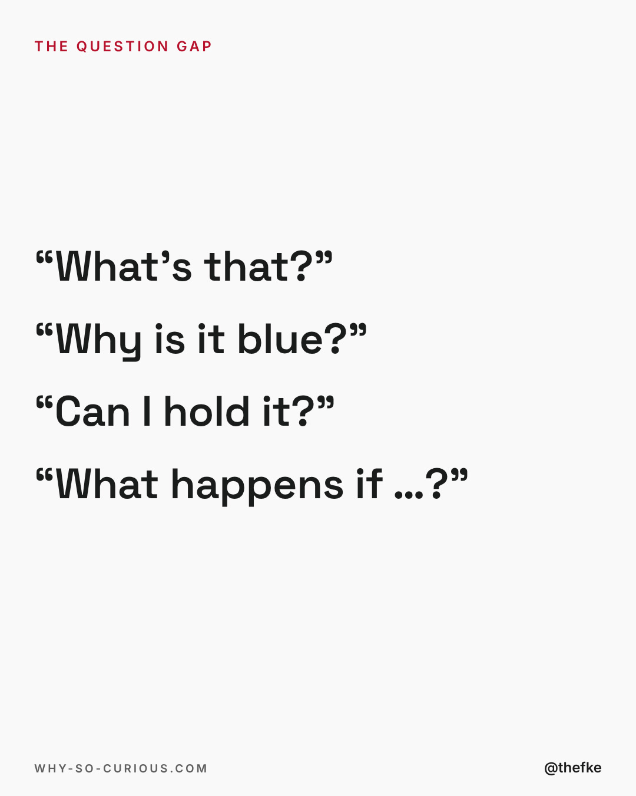
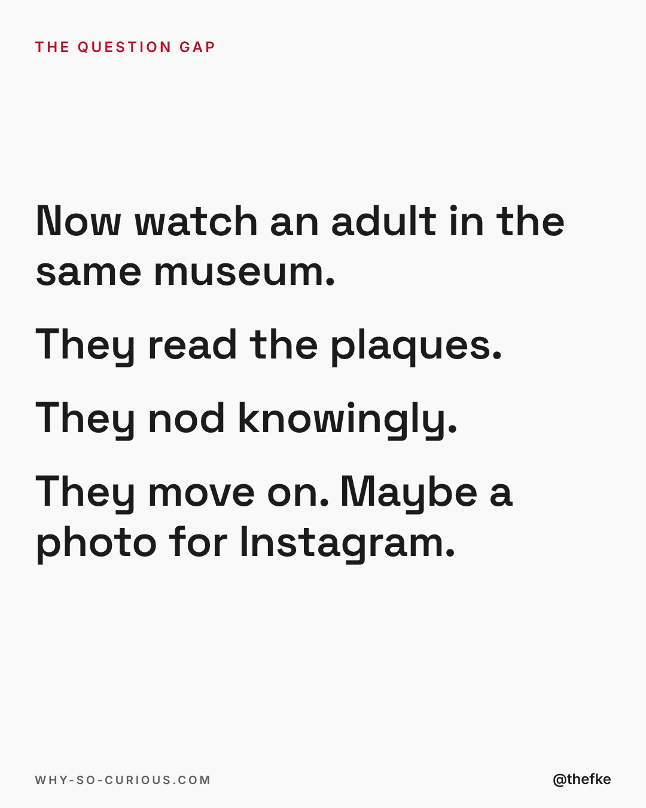
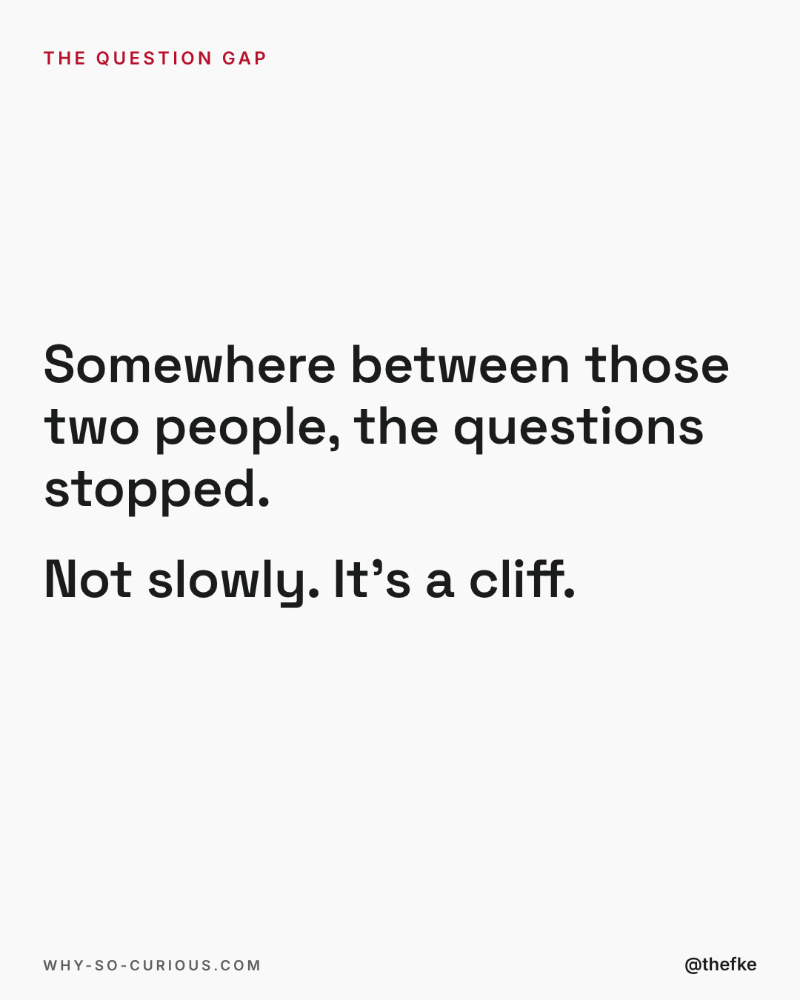
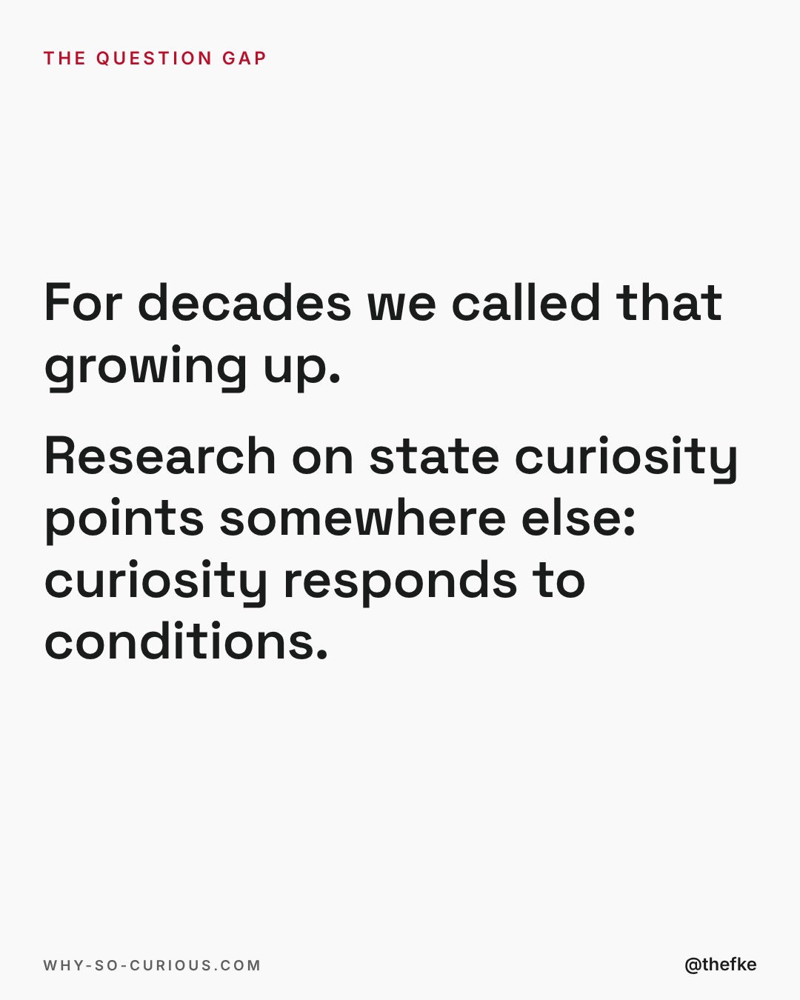
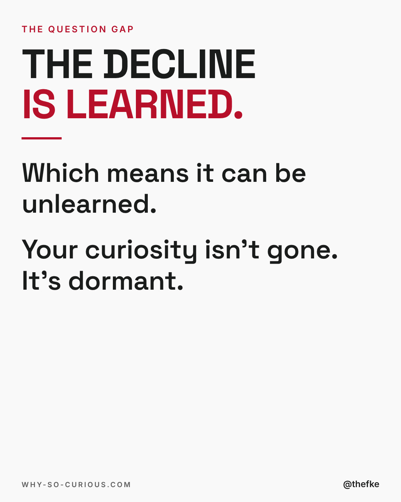
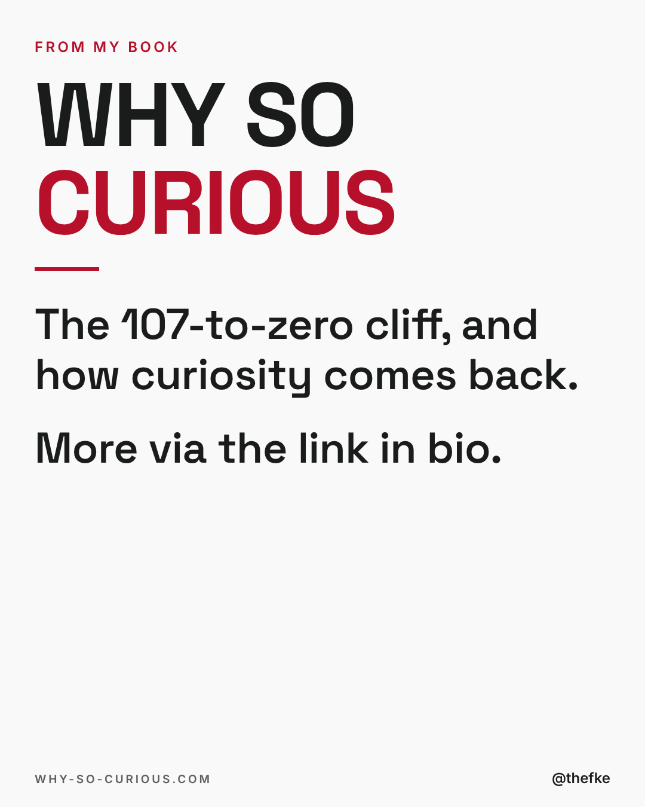

# Mi 06.01. · 107 questions an hour

Karussell, 9 Slides. Beim Hochladen 4:5 wählen.

Buchkampagne, Vorschlag zum Kampagnenstart. Termin nach dem Buchplan verschieben.

Quelle: `thomas-hefke-os/knowledge/06-content/posts/`, gebaut mit `wsc-web/tools/social/story.mjs`.

## Caption

```
107 questions an hour. That's what researchers counted when they recorded young children in 2007.

Then think about your last Tuesday. How many real questions did you ask? Not clarifying questions in a meeting. Real ones. The kind where you actually don't know the answer and you say so out loud.

Nobody outgrows curiosity. A molecular biologist named John Medina puts it bluntly: it isn't possible to outgrow curiosity in the seven or eight decades we spend here. So the problem isn't your brain. It's the rooms you spend your days in.

Count your questions tomorrow. Just count them. That number tells you more about your next five years than your CV does.

#curiosity #learning #questions #whysocurious #books
```

## Slides










