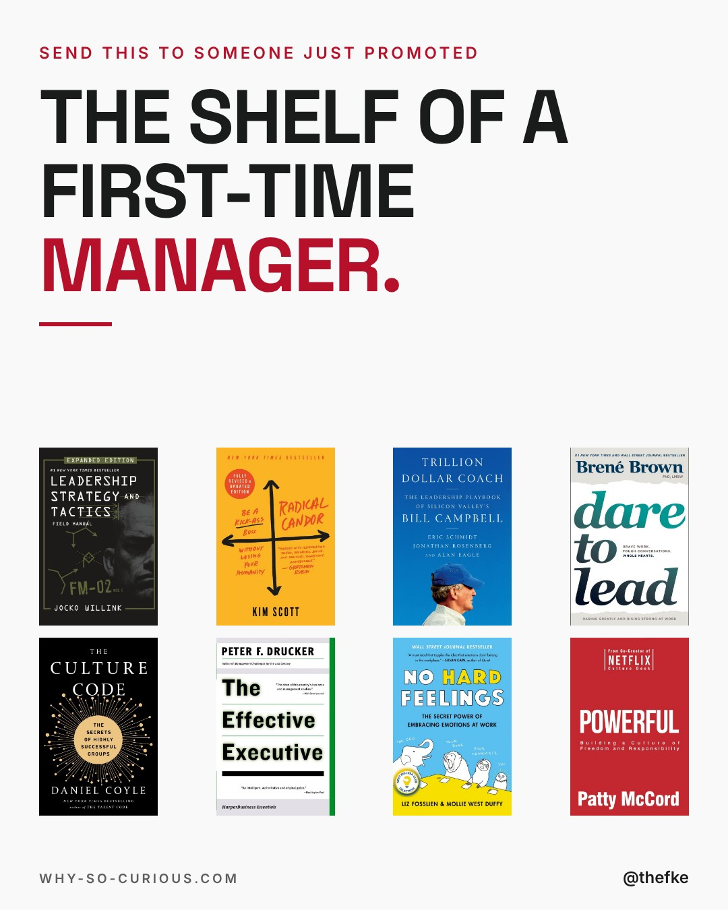
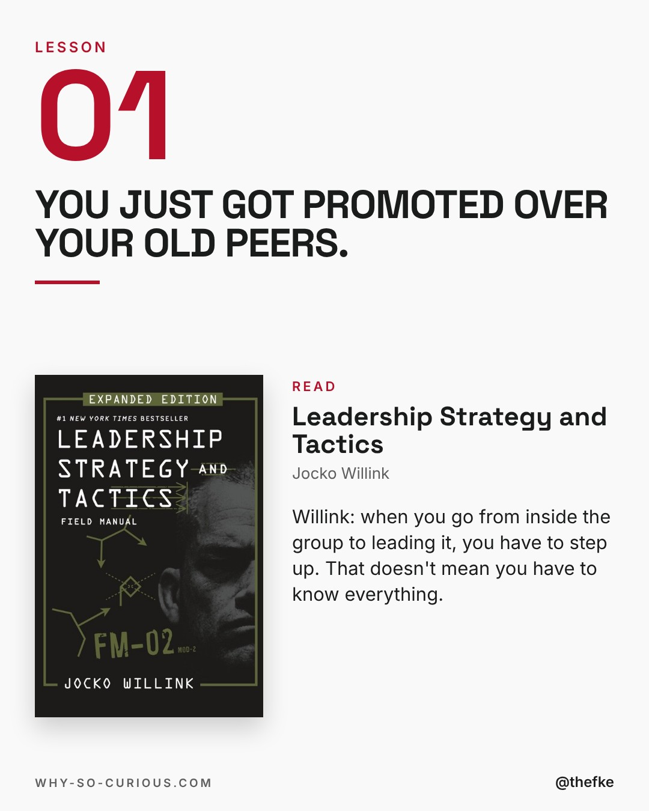
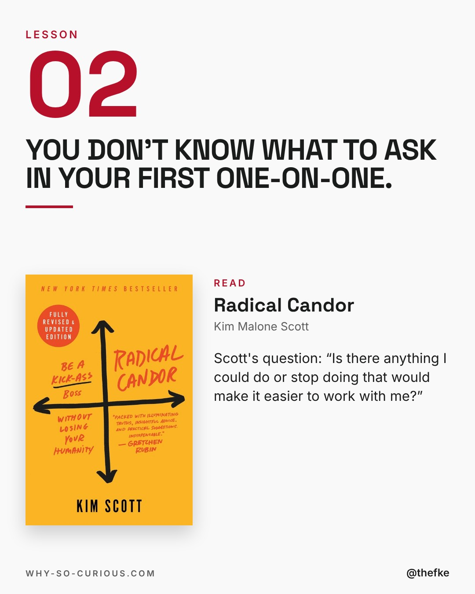
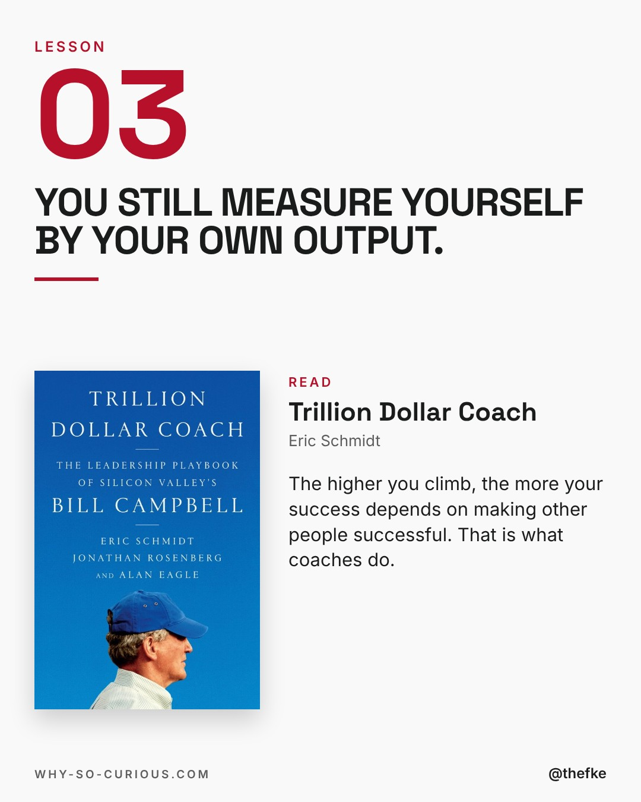
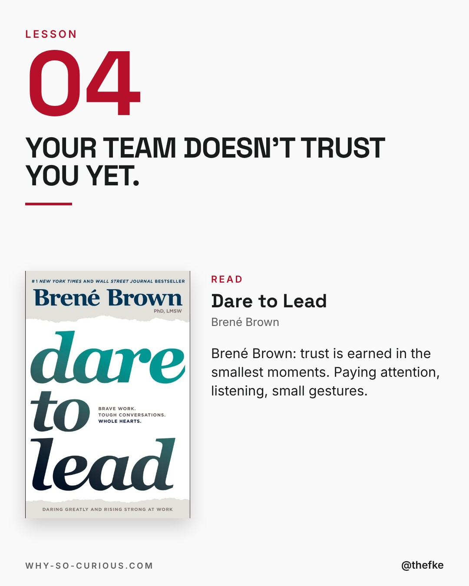
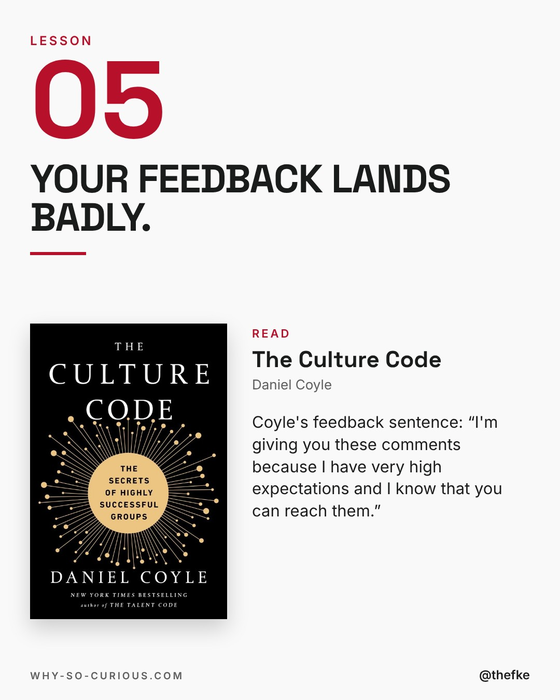
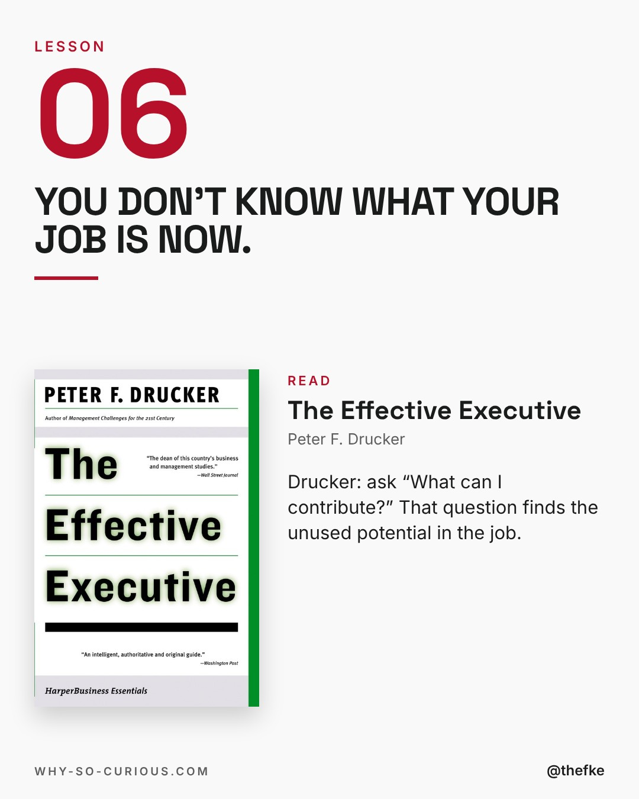
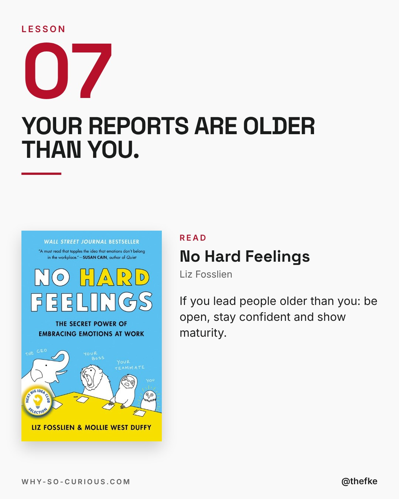
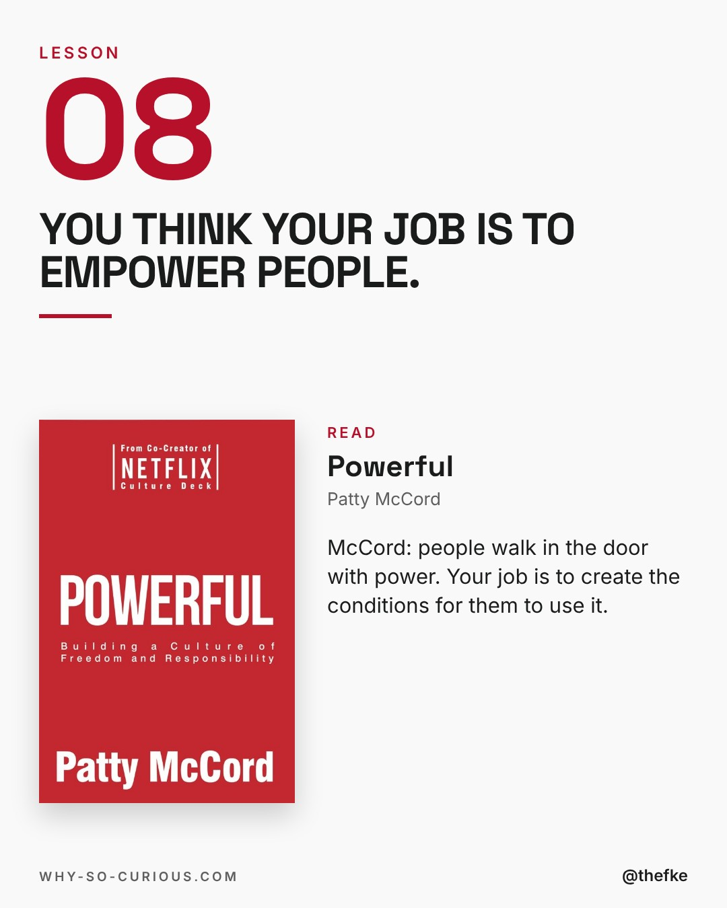
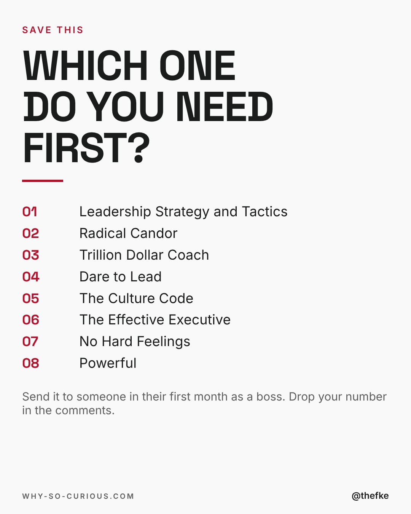

# Mi 06.01. · The shelf of a first-time manager

Abend-Slot. Karussell, 10 Slides. Beim Hochladen 4:5 wählen.

## Caption

```
Yesterday you were on the team.
Today you lead it.

8 books for a first-time manager.
From my shelf.

Step up without pretending to know everything.
Earn trust in small moments.
Measure yourself by your team.

Kim Malone Scott in Radical Candor has one question for every one-on-one:
“Is there anything I could do or stop doing that would make it easier to work with me?”

Send this to someone in their first month as a boss.

Which one would you hand a new manager first?

Books from this post: link in bio.

#bookstagram #bookrecommendations #books
```

## Slides











