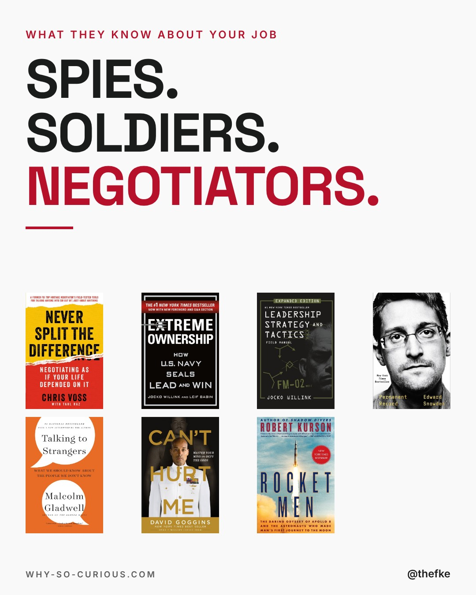
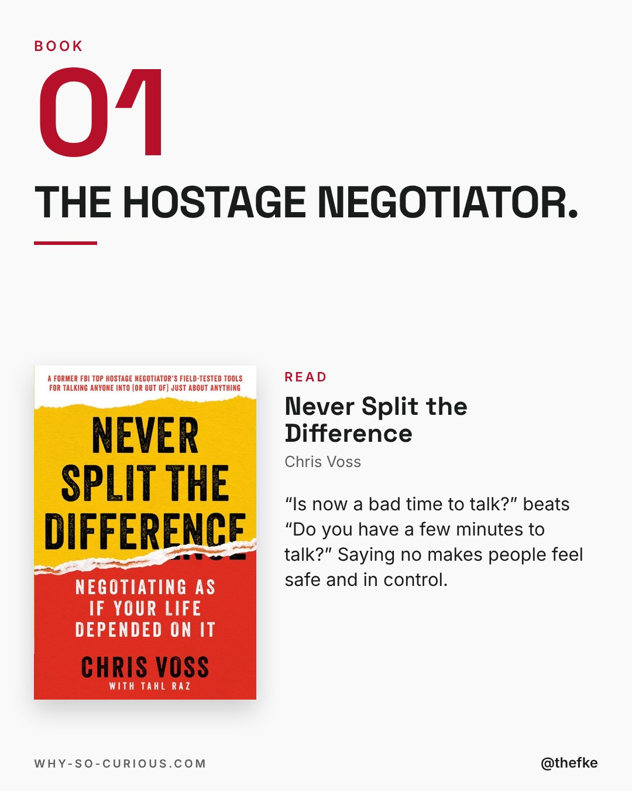
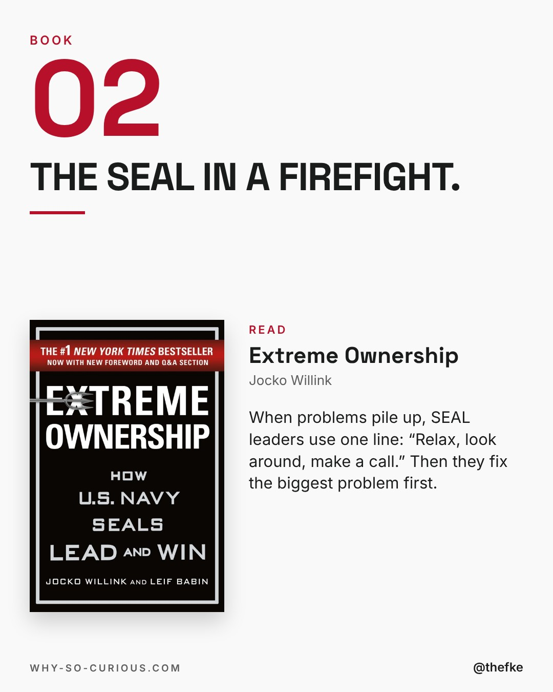
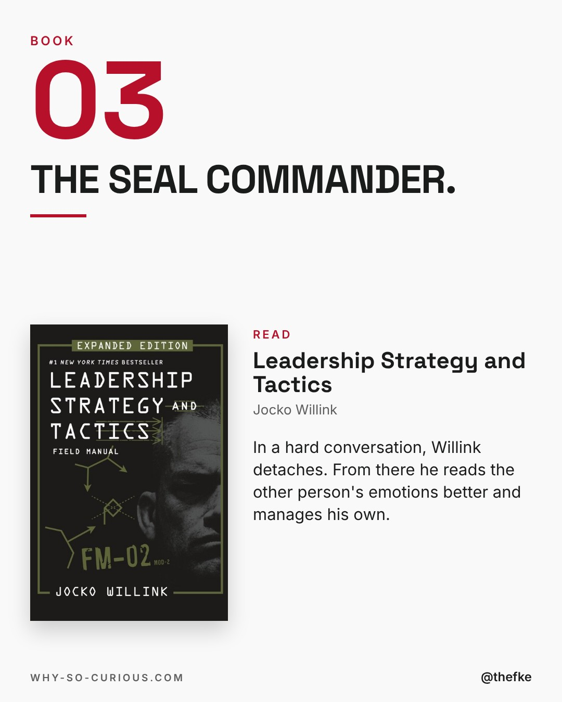
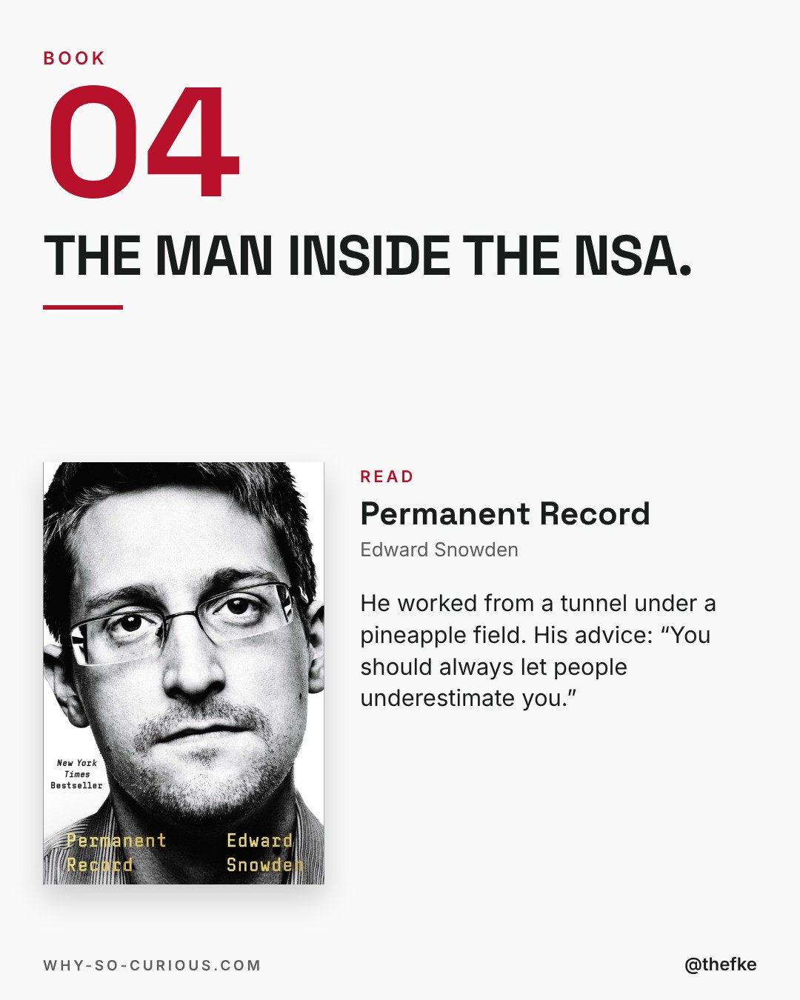
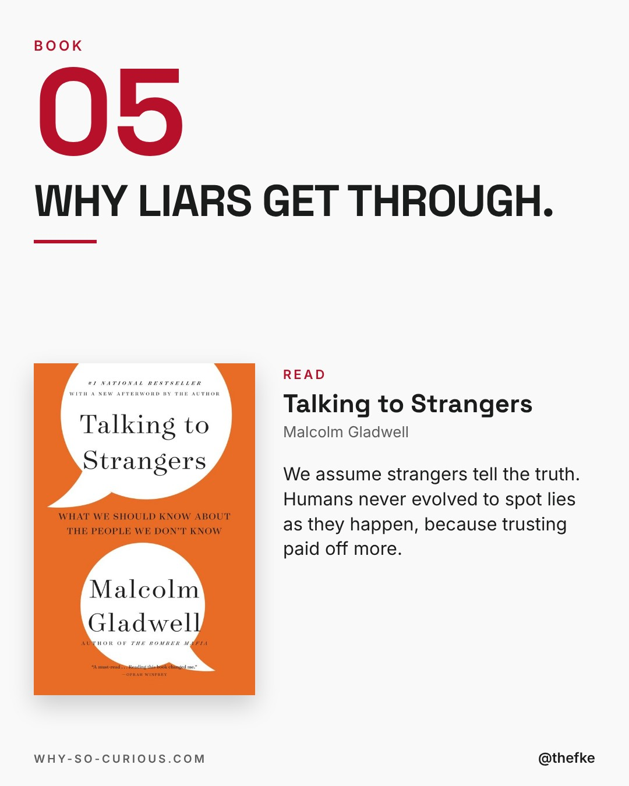
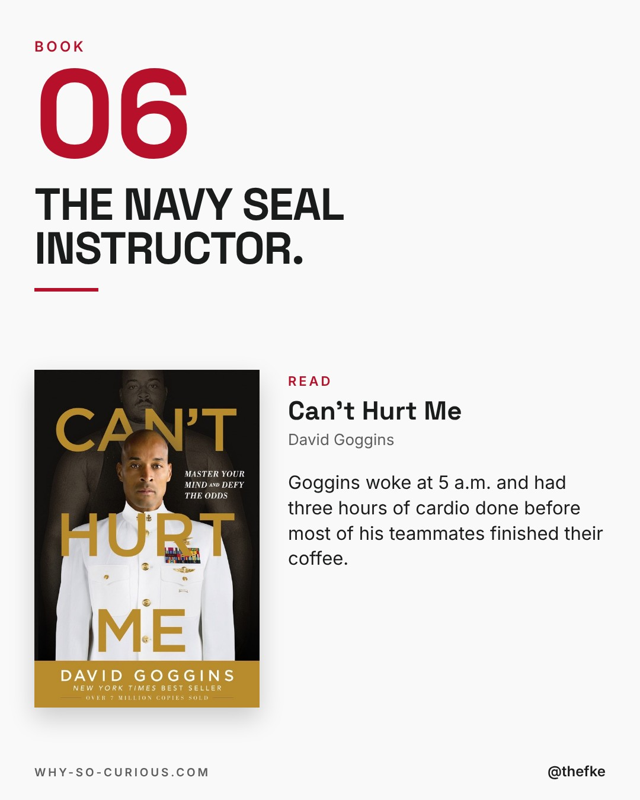
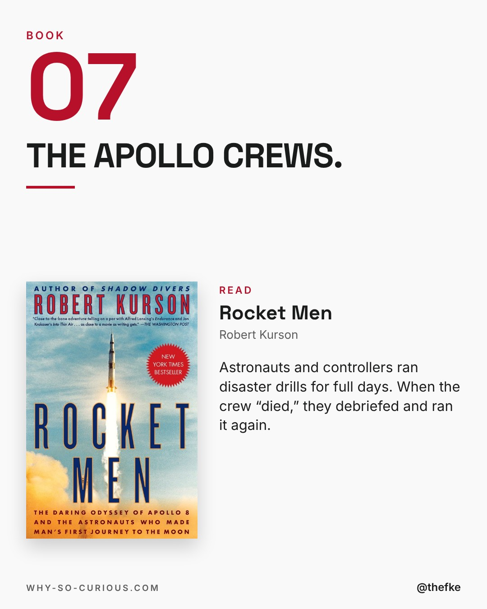
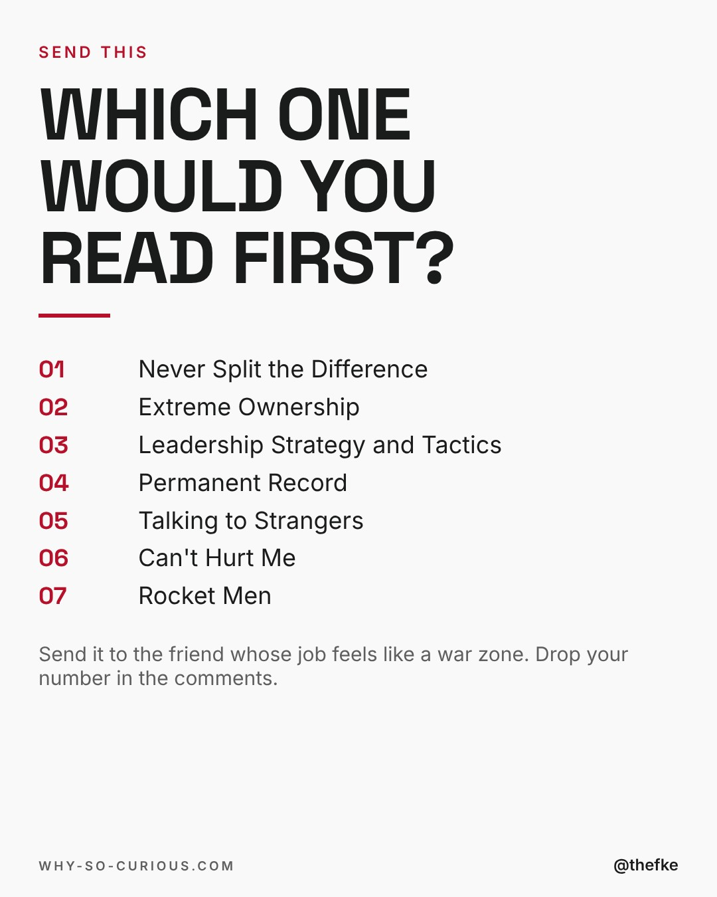

# Mi 06.01. · Spies. Soldiers. Negotiators. What they know about your job

Früh-Slot, wird automatisch gepostet (ohne Musik). Nicht von Hand posten. Karussell, 9 Slides. Beim Hochladen 4:5 wählen.

## Caption

```
Your Monday feels like a war zone?
Some people work where a mistake costs lives.

A hostage negotiator.
Two Navy SEALs.
A man who sat inside the NSA.
The crews who flew to the Moon.

Seven books. One habit from each that works in any office.

Jocko Willink in Extreme Ownership:
“On the battlefield, countless problems compound in a snowball effect, every challenge complex in its own right, each demanding attention. But a leader must remain calm and make the best decisions possible.”

All from my shelf.

Send this to the friend whose job feels like a war zone.

Which one would you read first?

Books from this post: link in bio.

#bookstagram #bookrecommendations #books
```

## Slides










