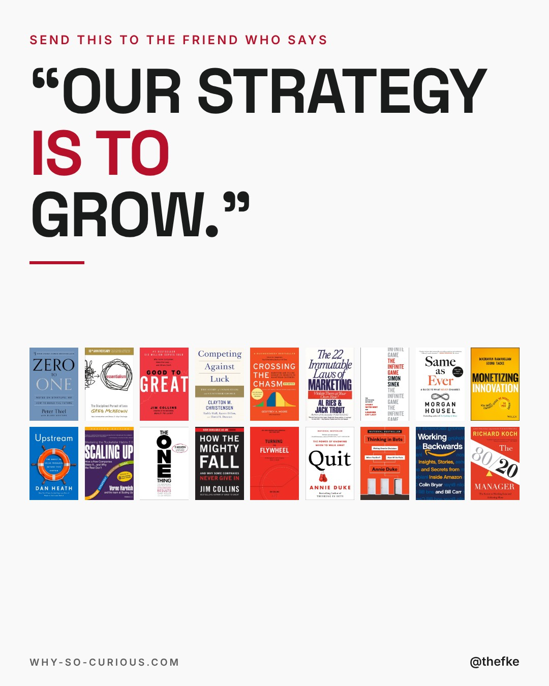
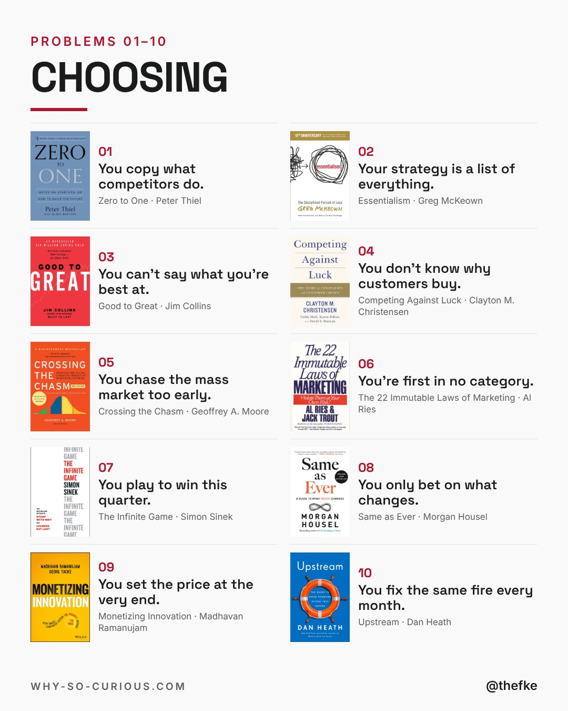
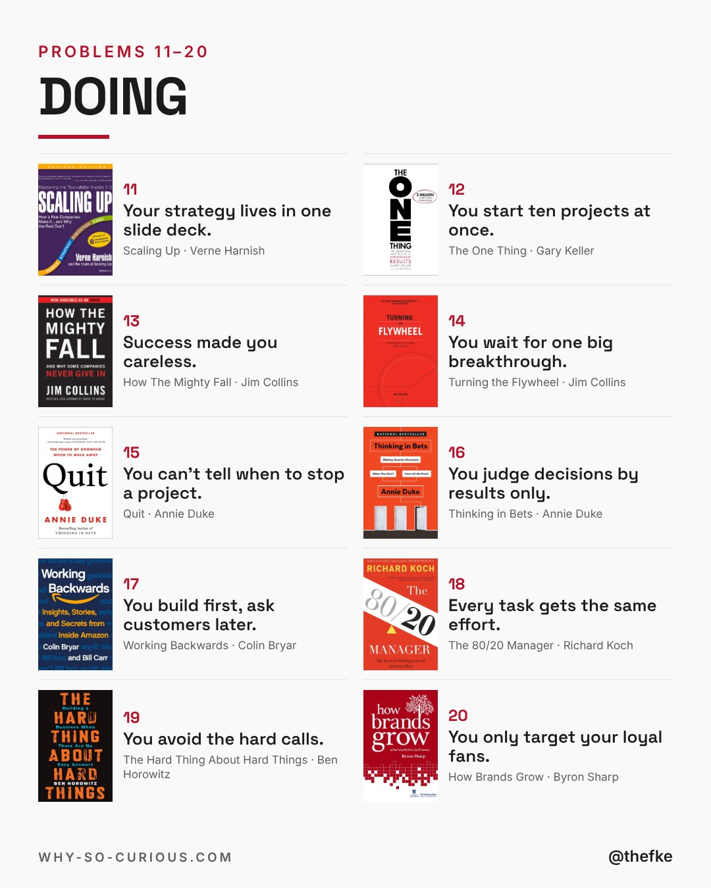

# Do 07.01. · 20 Strategy Problems, 20 Books

Früh-Slot, wird automatisch gepostet (ohne Musik). Nicht von Hand posten. Karussell, 4 Slides. Beim Hochladen 4:5 wählen.

## Caption

```
“Our strategy is to grow.”
That's a wish. A strategy says what you will stop doing.

20 strategy problems.
20 books from my shelf that help.

10 about choosing.
10 about doing.

Peter Thiel in Zero to One:
“All happy companies are different: each one earns a monopoly by solving a unique problem. All failed companies are the same: they failed to escape competition.”

Send this to the friend writing next year's plan.

Which number is your company?

Books from this post: link in bio.

#bookstagram #bookrecommendations #books
```

## Slides





