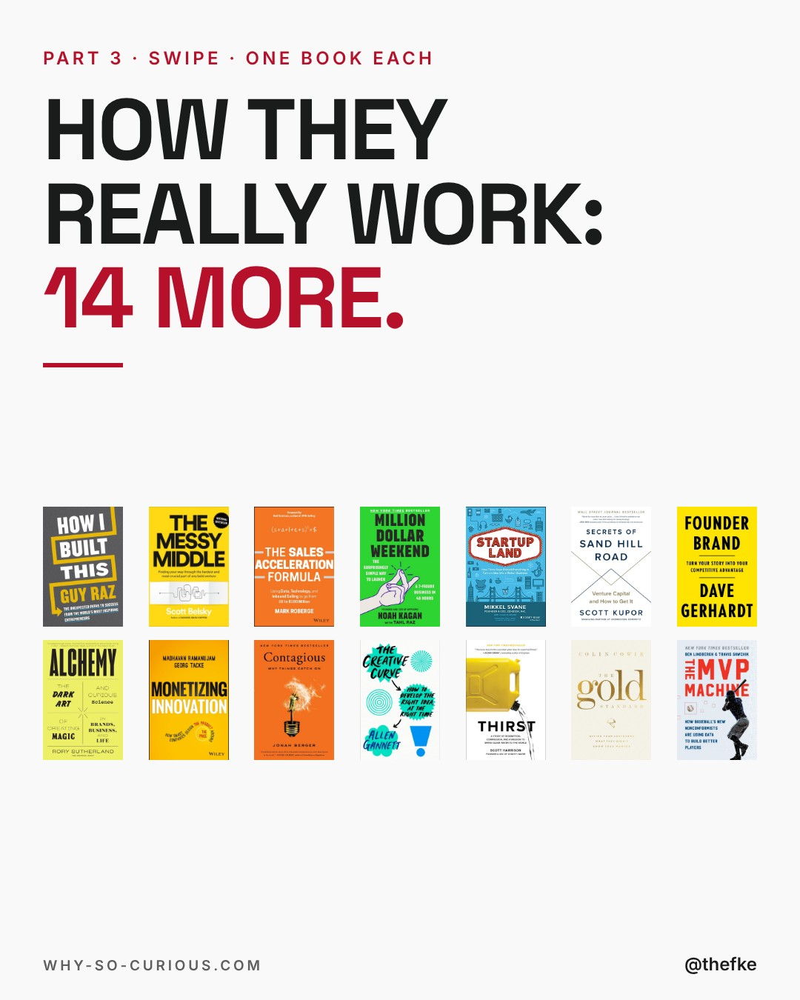
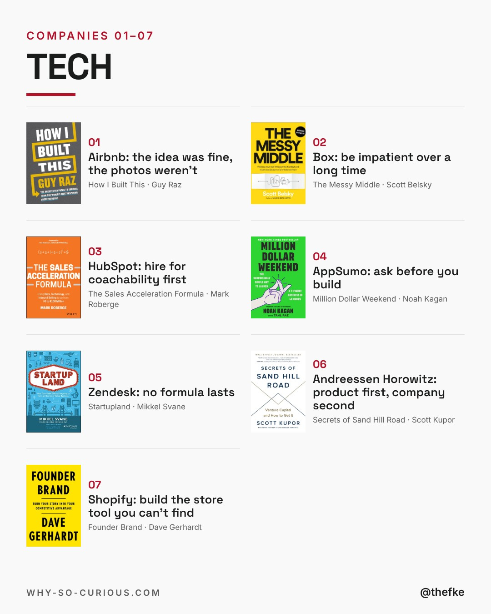
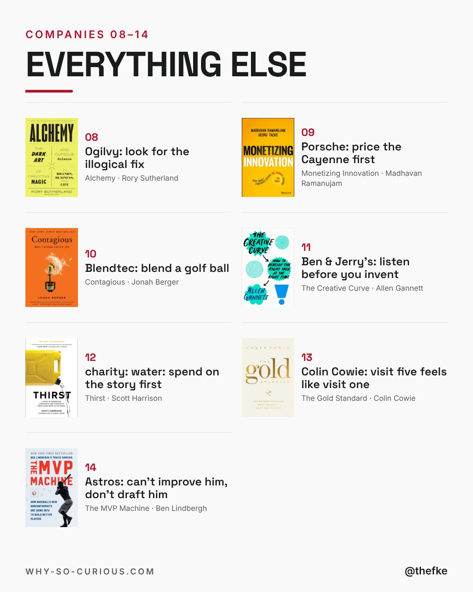
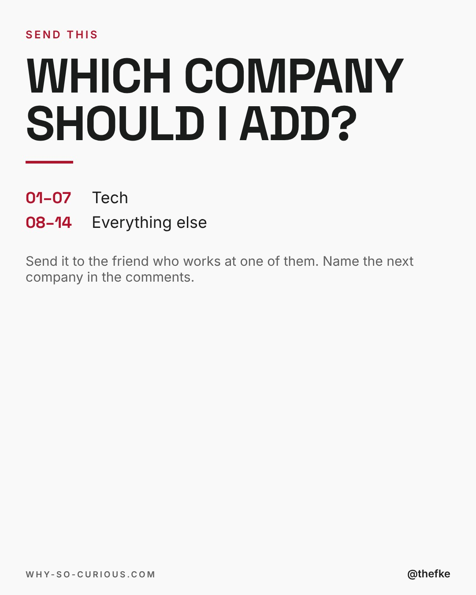

# Do 07.01. · How They Really Work: 14 More Companies

Karussell, 4 Slides. Beim Hochladen 4:5 wählen.

## Caption

```
Part 1 had Apple and Netflix.
Part 2 had Basecamp and Bloomberg.
Here are 14 more.

Porsche set the price of the Cayenne before the design.
Blendtec blends golf balls.
And the Astros pass on any player they can't improve.

Shopify started as a snowboard shop.
The founders couldn't find a tool to build their own online store, so they built one.

14 companies. 14 books from my shelf.
7 from tech, 7 from everything else.

Send this to the friend who works at one of them.

Which company should I add?

Books from this post: link in bio.

#bookstagram #bookrecommendations #books
```

## Slides





