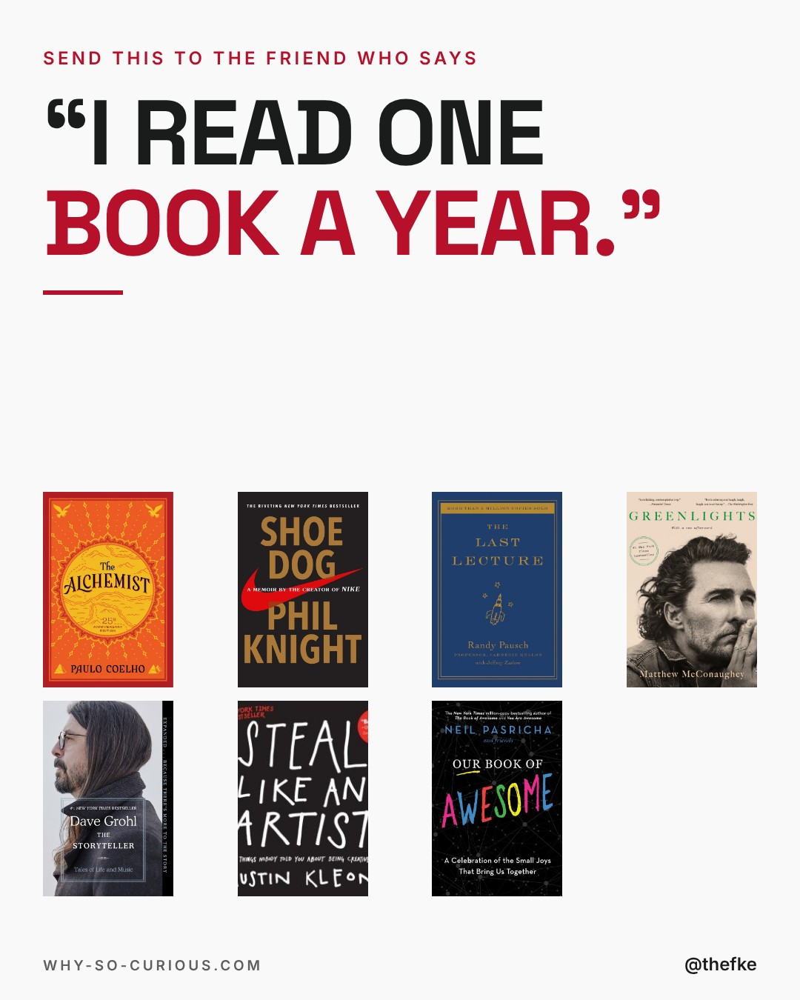
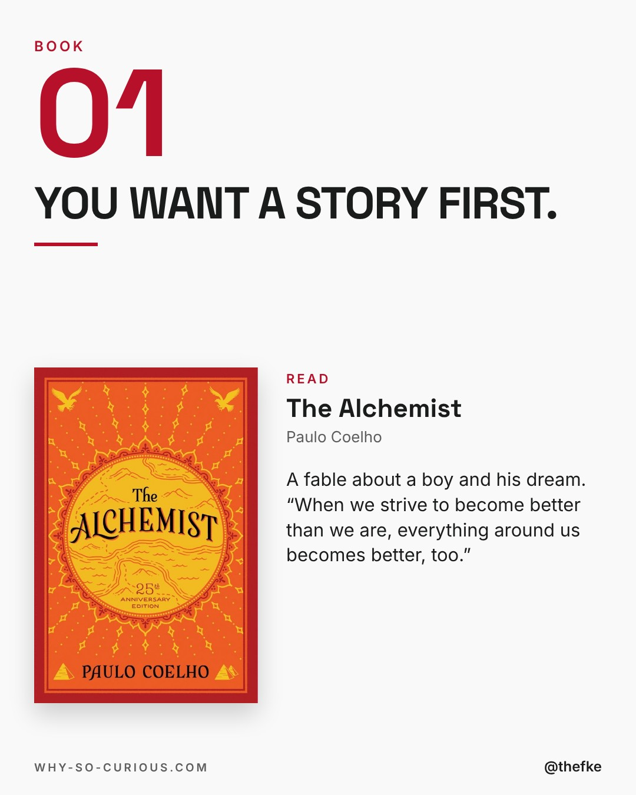
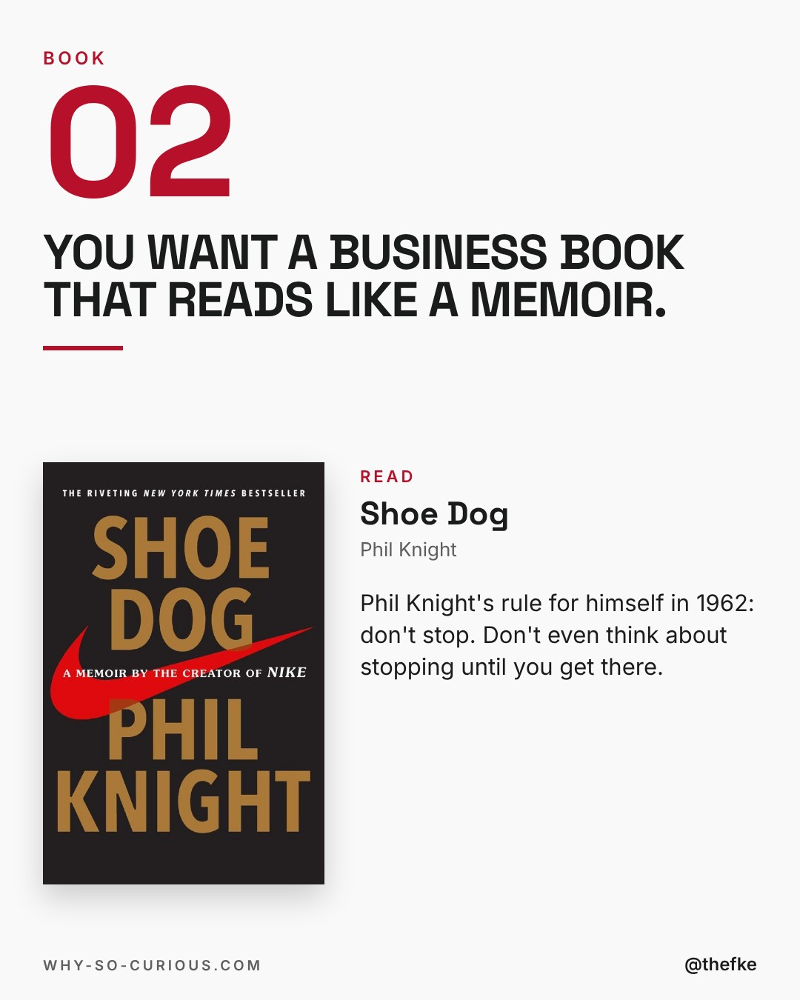
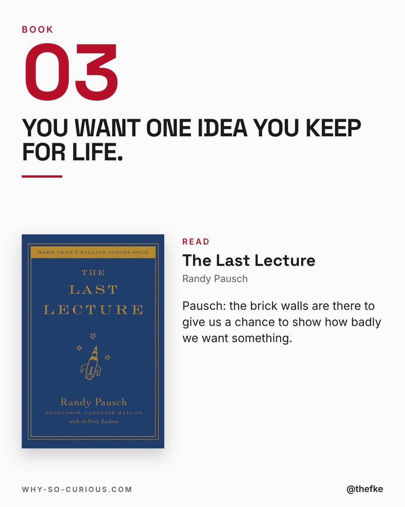
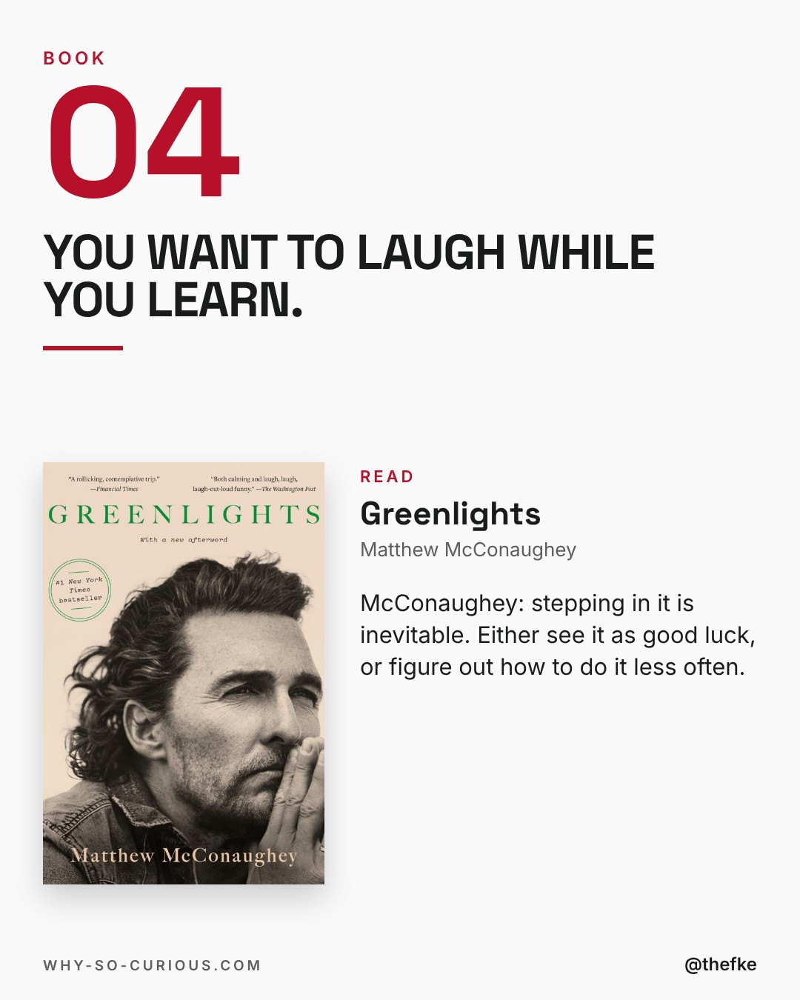
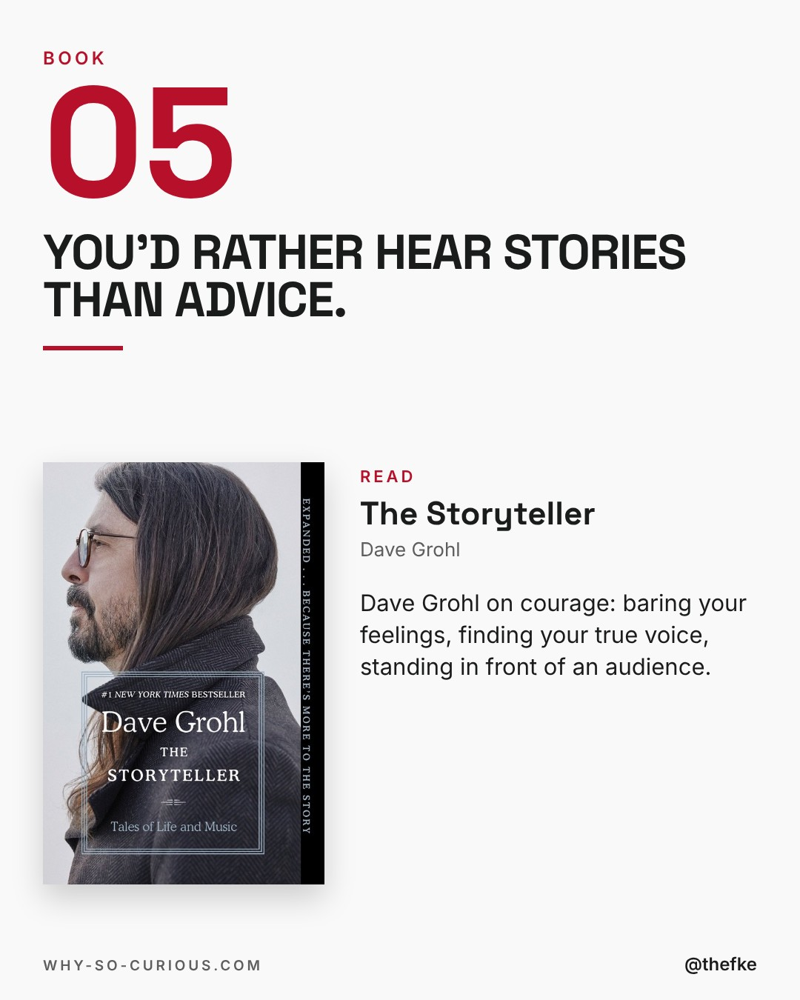
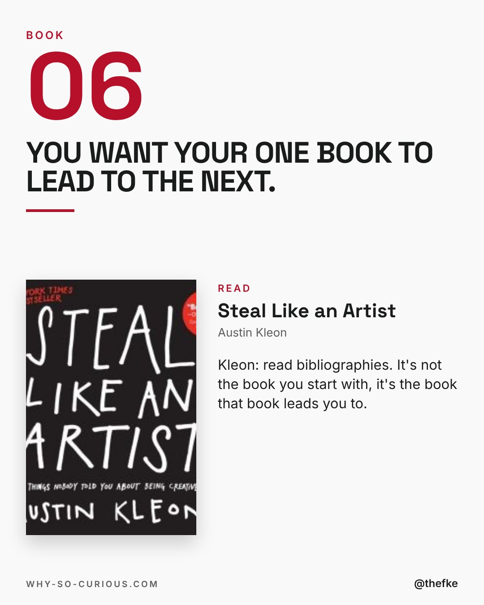
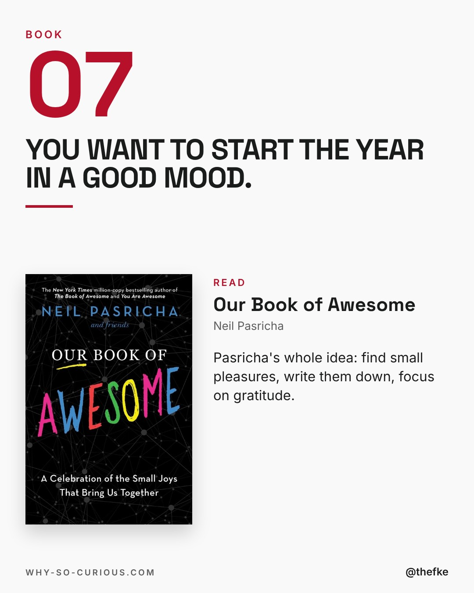
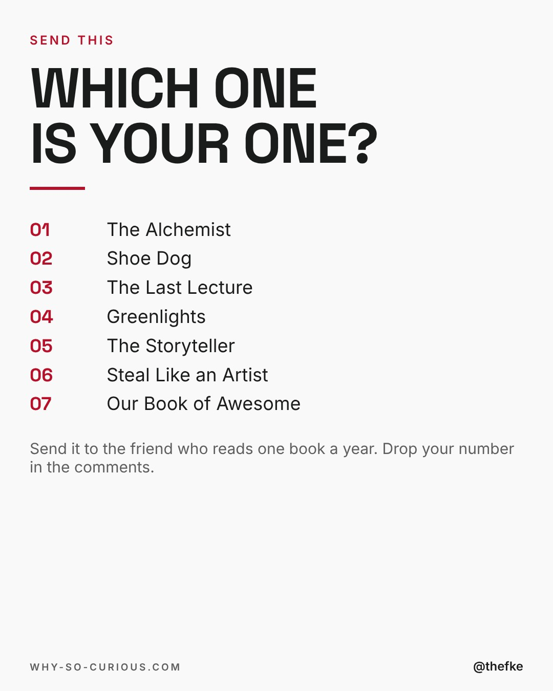

# Do 07.01. · Books for people who read one book a year

Abend-Slot. Karussell, 9 Slides. Beim Hochladen 4:5 wählen.

## Caption

```
“I read one book a year.”
Then make it a good one.

Seven books with a story that carries you.
A fable. A founder. A last lecture.
An actor, a drummer, a list of small joys.

And one that tells you what to read next.
Austin Kleon in Steal Like an Artist:
“It's not the book you start with, it's the book that book leads you to.”

All from my shelf.

Send this to the friend who reads one book a year.

Which one would be your one?

Books from this post: link in bio.

#bookstagram #bookrecommendations #books
```

## Slides










