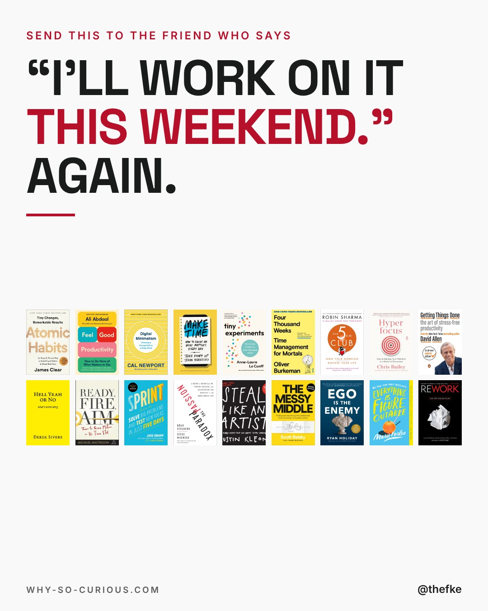
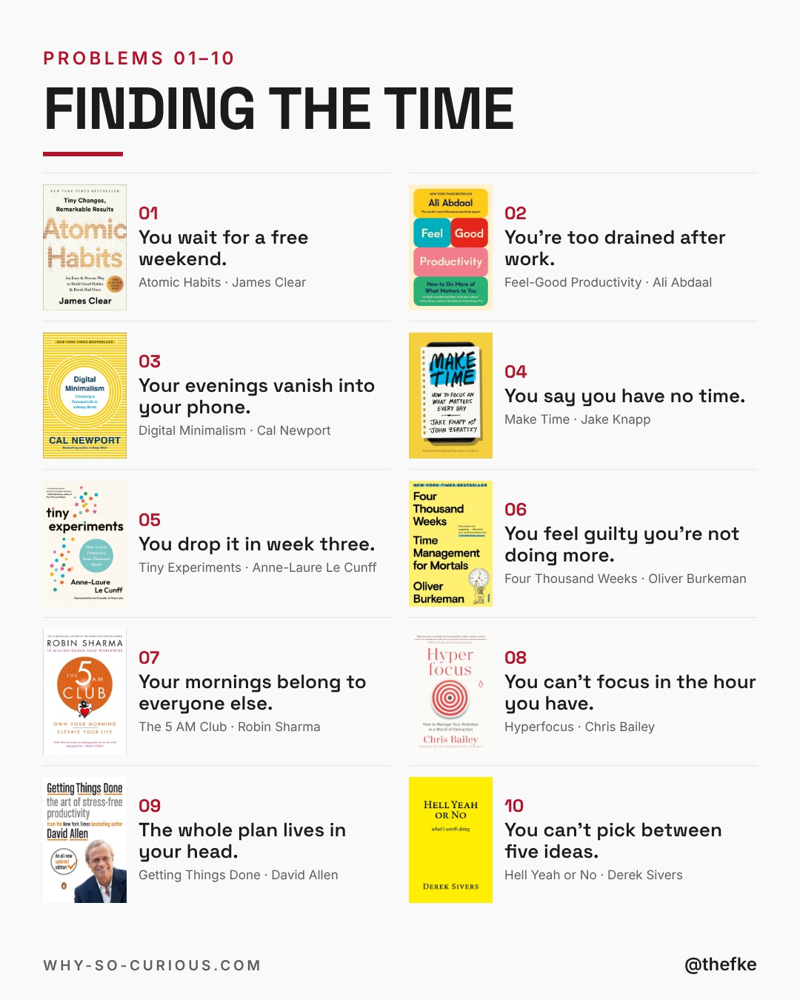
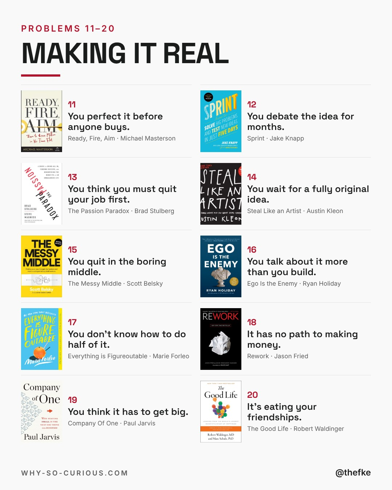
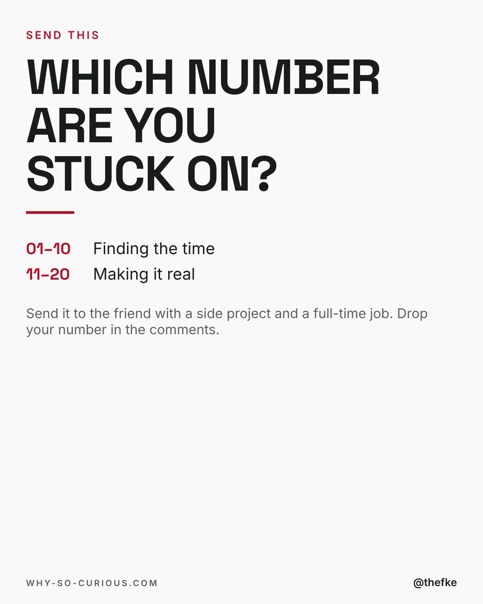

# Fr 08.01. · 20 Side Project Problems, 20 Books

Früh-Slot, wird automatisch gepostet (ohne Musik). Nicht von Hand posten. Karussell, 4 Slides. Beim Hochladen 4:5 wählen.

## Caption

```
“I'll work on it this weekend.”
You said that last weekend too.

20 side project problems.
20 books from my shelf that help.

10 about finding the time.
10 about making it real.

Brad Stulberg and Steve Magness in The Passion Paradox:
“Those who go big or go home often end up going home. Those who go incrementally over a long period of time often end up with something big.”

Send this to the friend with a side project and a full-time job.

Which number are you stuck on?

Books from this post: link in bio.

#bookstagram #bookrecommendations #books
```

## Slides





