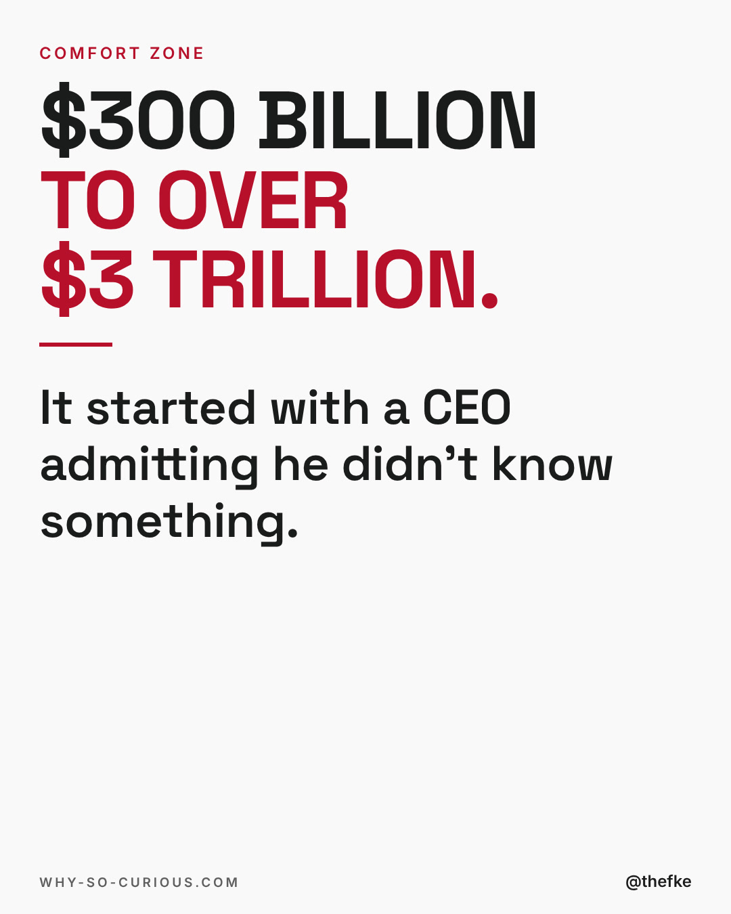
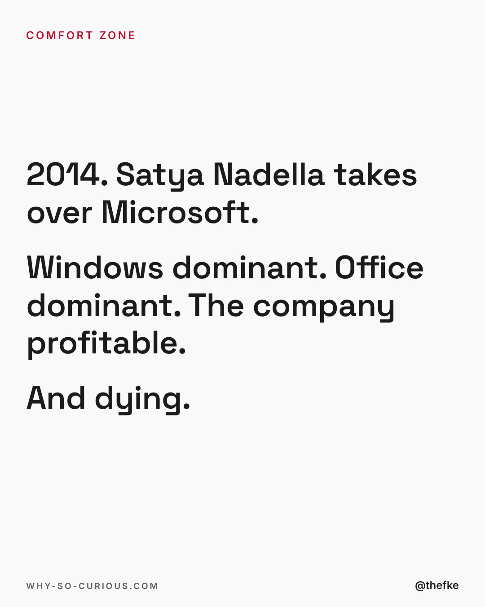
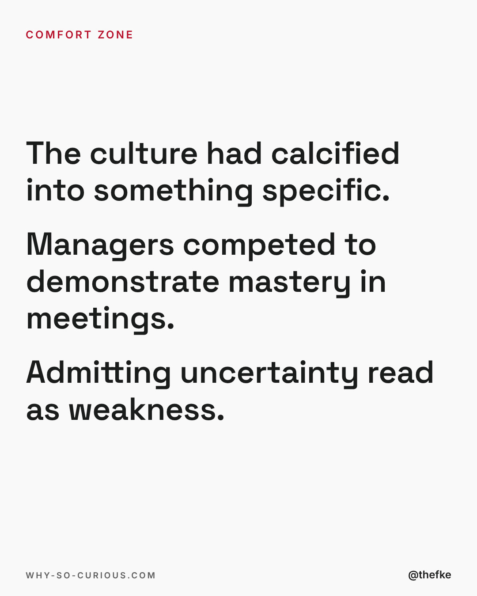
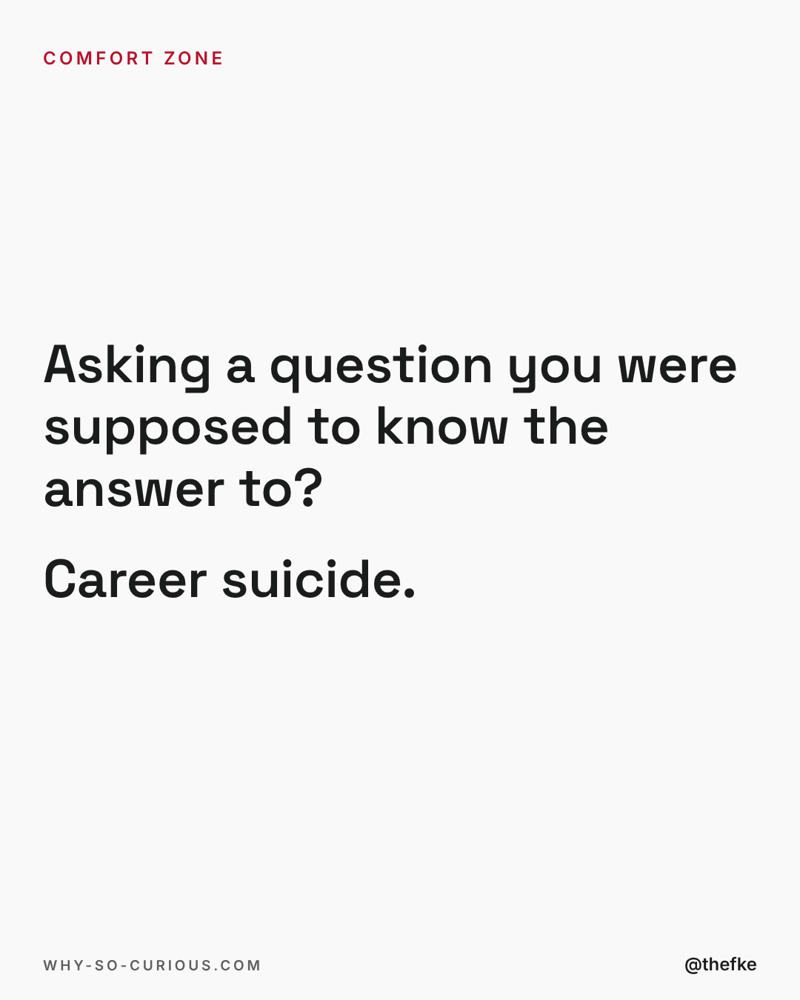
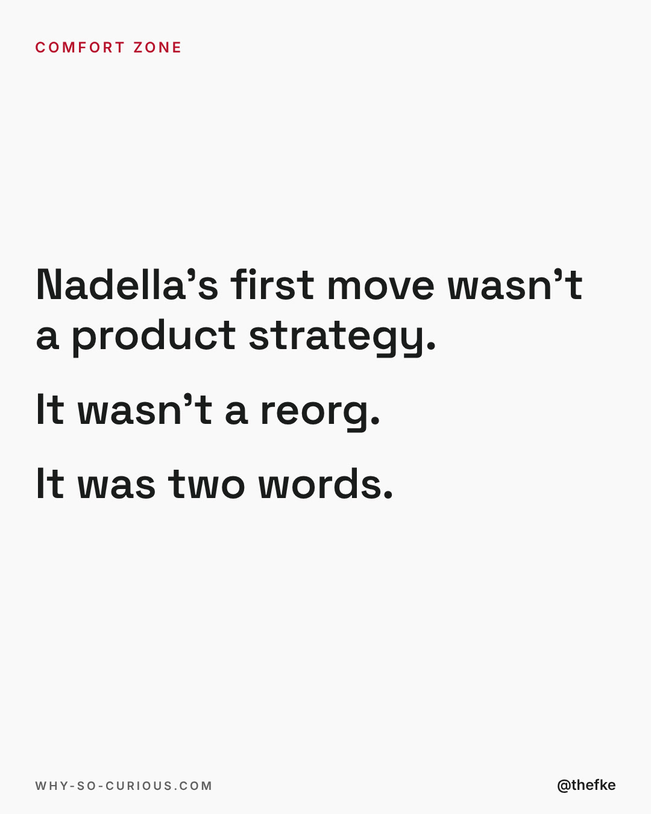
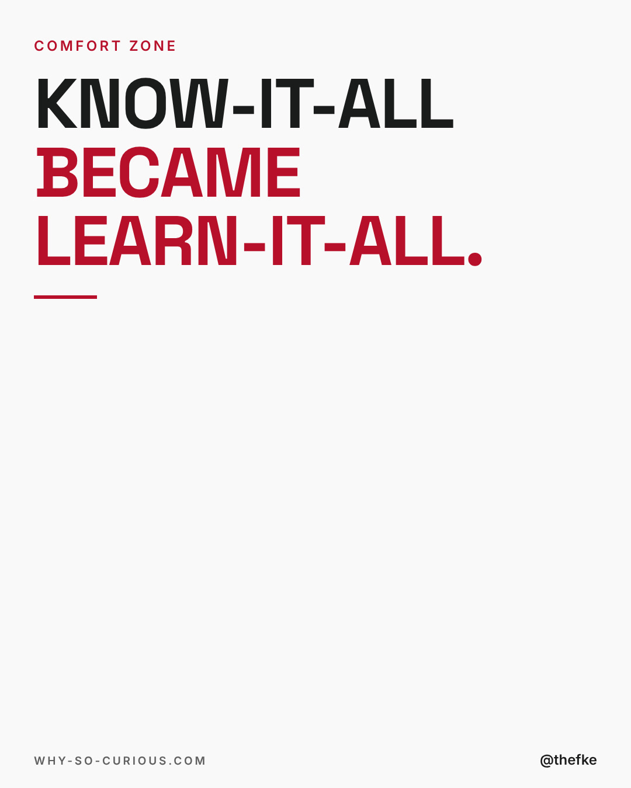
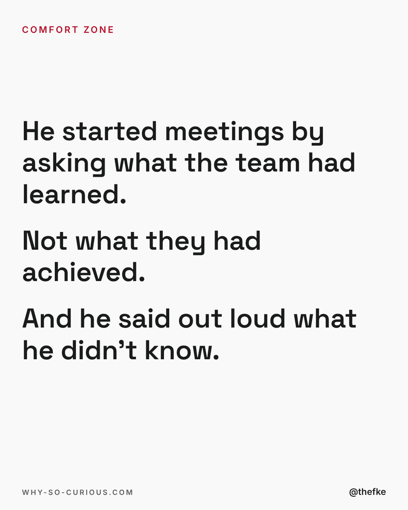
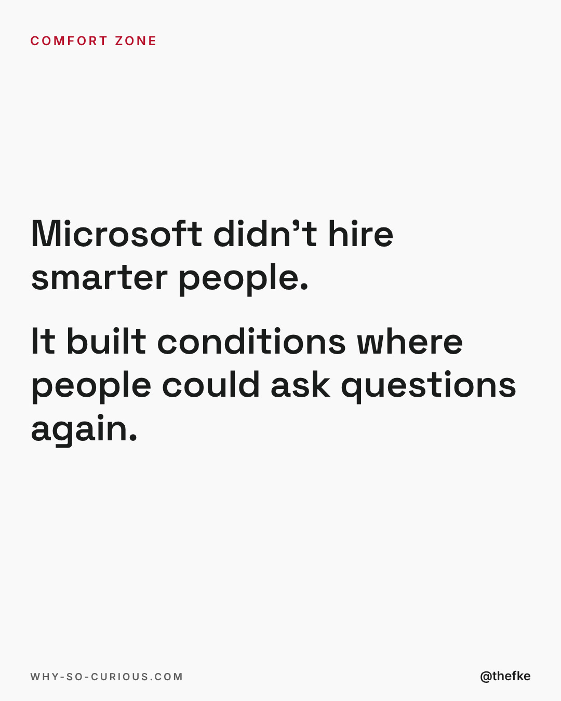
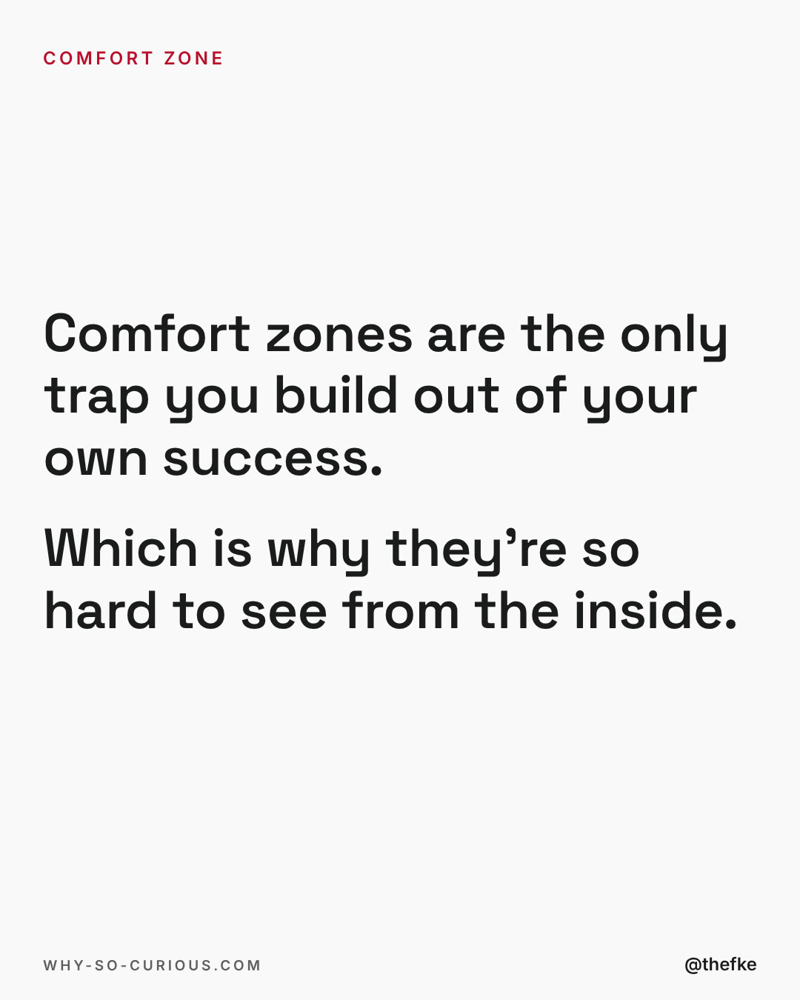
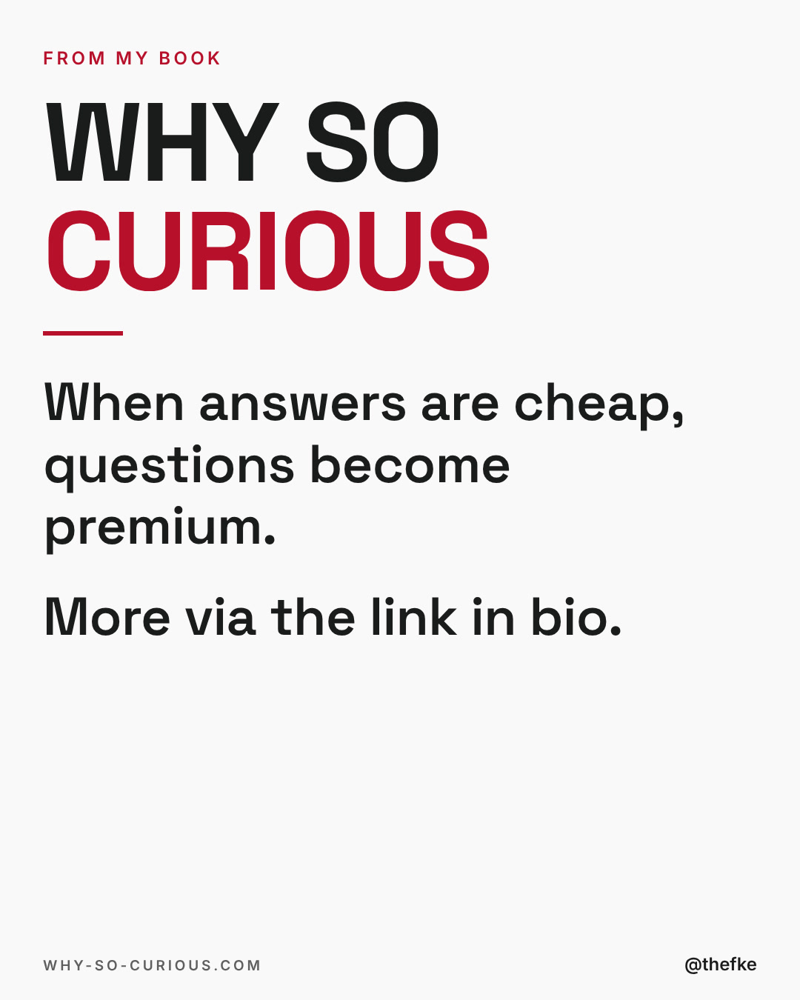

# Fr 08.01. · $300 billion to over $3 trillion

Karussell, 10 Slides. Beim Hochladen 4:5 wählen.

Buchkampagne, Vorschlag zum Kampagnenstart. Termin nach dem Buchplan verschieben.

Quelle: `thomas-hefke-os/knowledge/06-content/posts/`, gebaut mit `wsc-web/tools/social/story.mjs`.

## Caption

```
Microsoft in 2014 was profitable and dying at the same time. That combination is the most dangerous state a company or a career can be in, because nothing looks broken.

What changed wasn't talent. It was permission. Nadella replaced know-it-all with learn-it-all and started meetings by asking what people had learned instead of what they had shipped.

I keep coming back to this case because the comfort zone is the only trap you build out of your own success. Every year of expertise raises the social cost of saying "I don't know." Until one day you're the most competent person in the room and the least curious.

What did you learn last week? Not achieve. Learn.

#leadership #culture #microsoft #curiosity #whysocurious
```

## Slides











