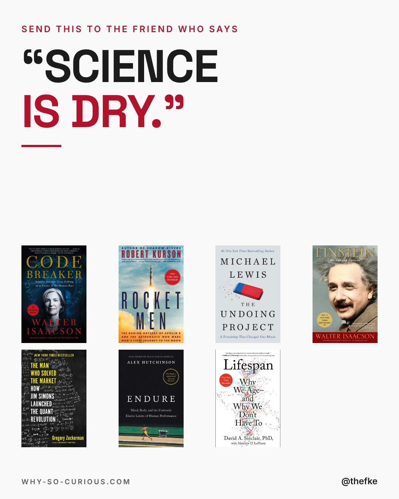
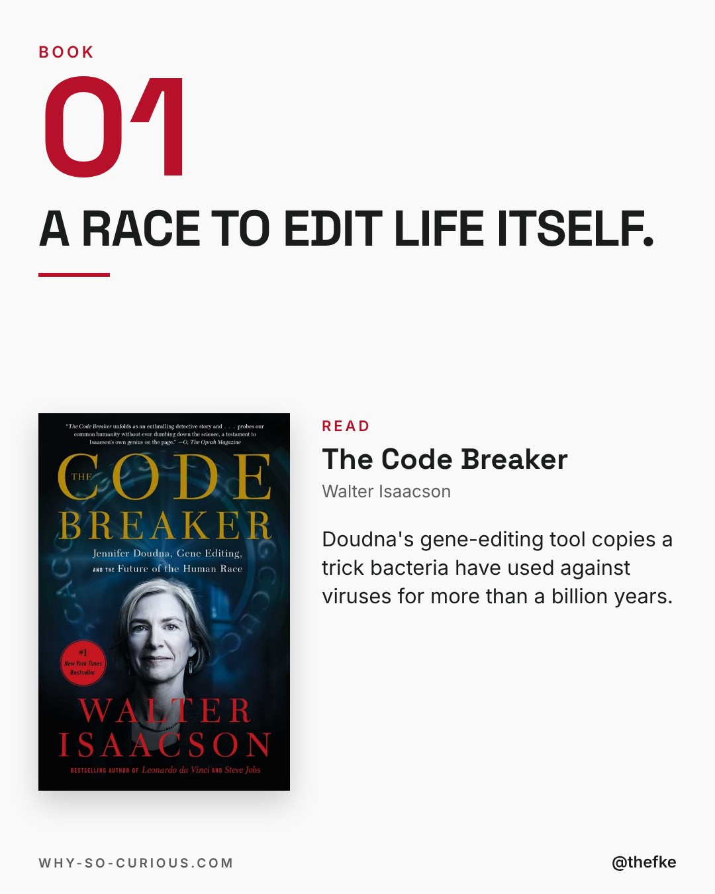
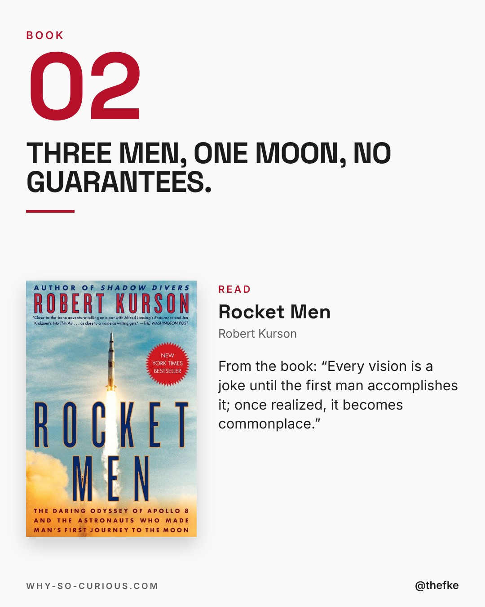
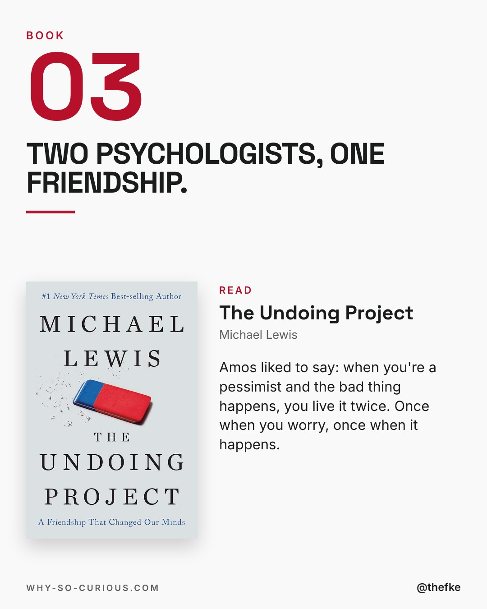
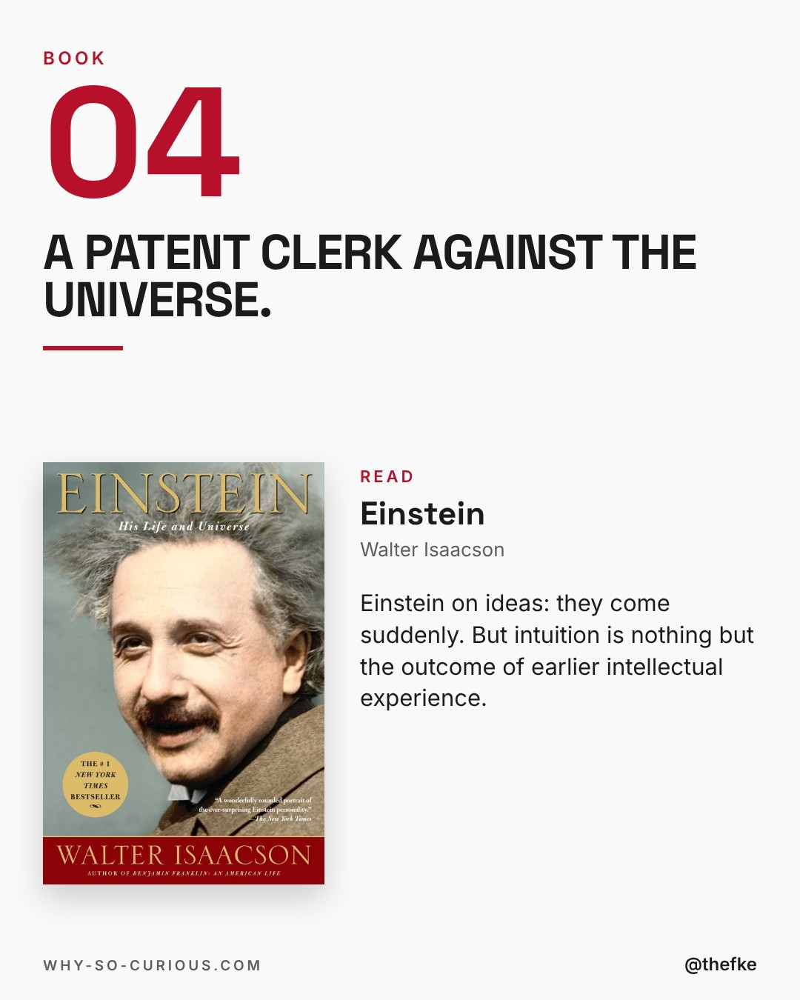
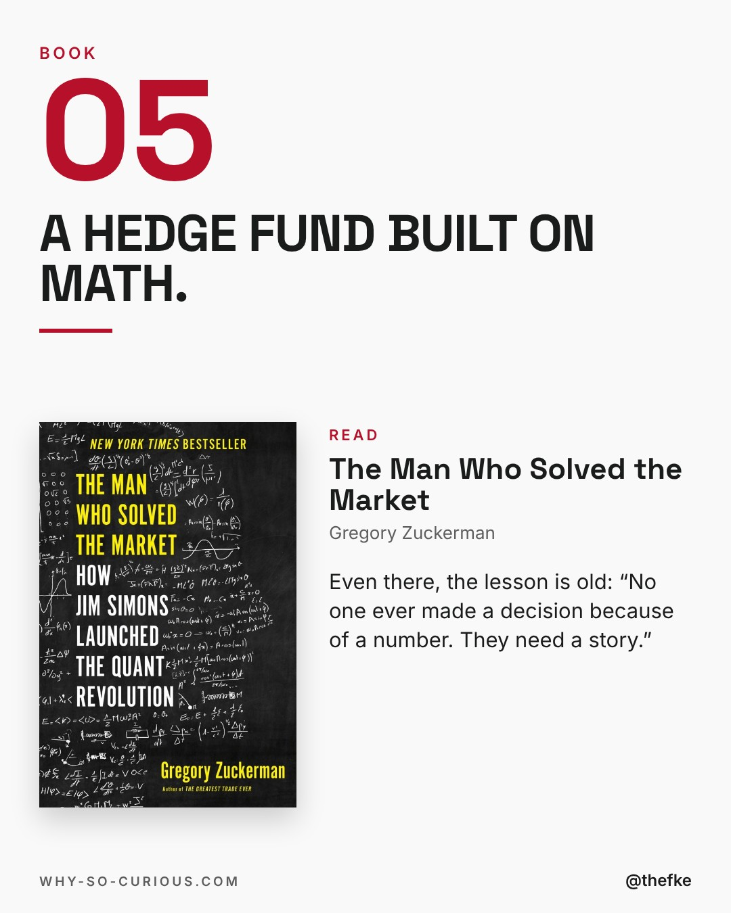
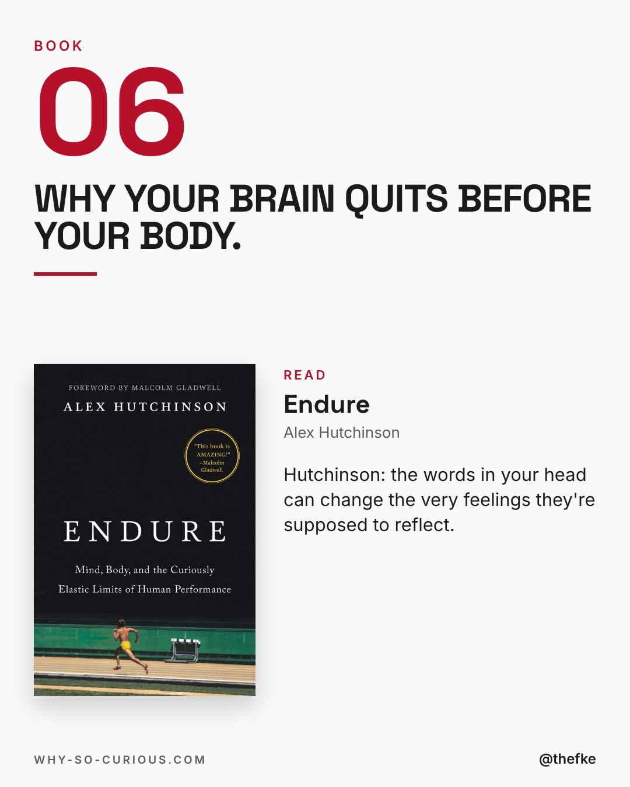
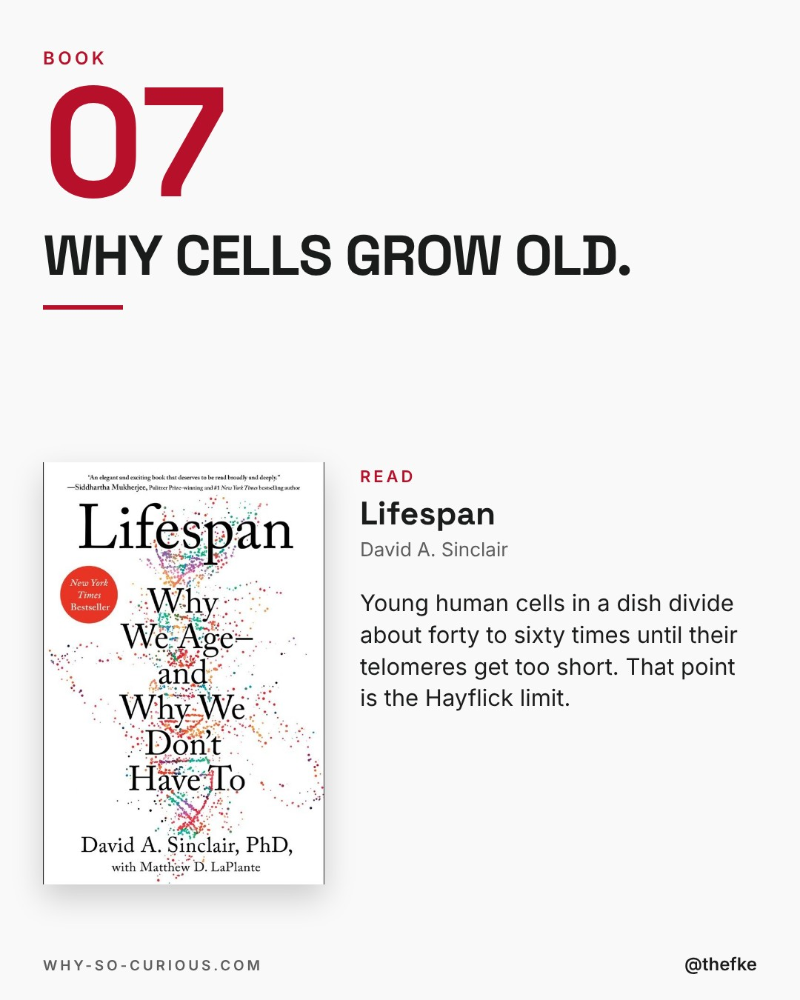
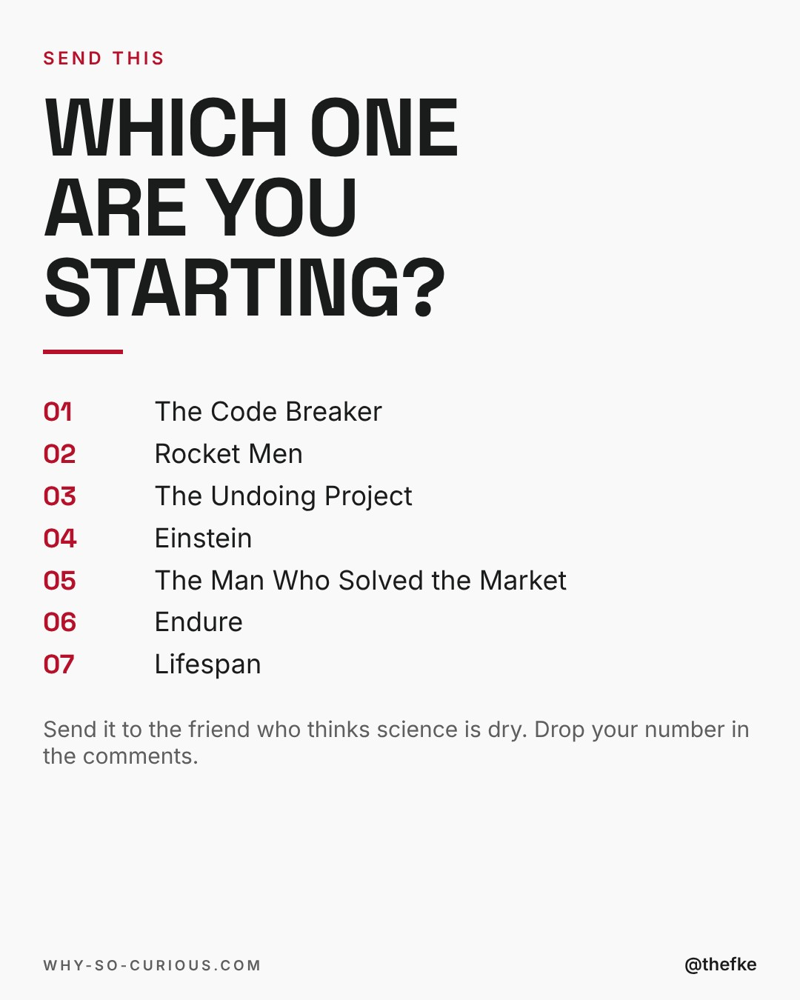

# Fr 08.01. · Science books that read like novels

Abend-Slot. Karussell, 9 Slides. Beim Hochladen 4:5 wählen.

## Caption

```
“Science is dry.”
Then you haven't read these seven.

Science books that read like novels.
Gene editing. The Moon. A friendship. A patent clerk.
A hedge fund, an endurance lab, and why cells grow old.

Michael Lewis in The Undoing Project has a new definition of the nerd:
“a person who knows his own mind well enough to mistrust it.”

All from my shelf.

Send this to the friend who thinks science is dry.

Which one are you starting?

Books from this post: link in bio.

#bookstagram #bookrecommendations #books
```

## Slides










